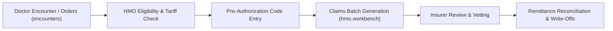
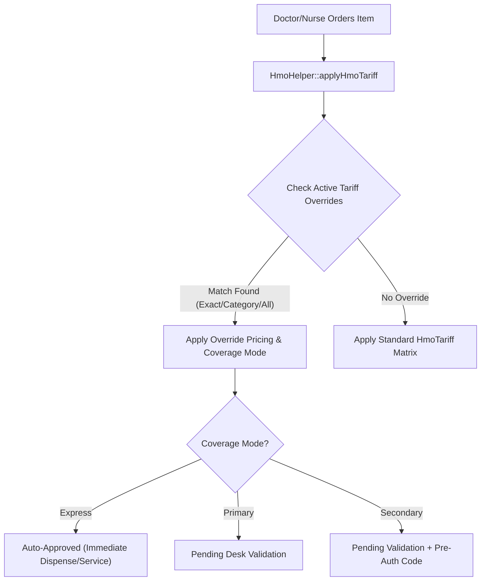

# HMO & Health Insurance Workbench

ROLE GUARD: SUPERADMIN | ADMIN | HMO EXECUTIVE

The **HMO Workbench** streamlines managed healthcare claims: verifying secondary pre-authorization codes, enforcing per-provider tariff matrices, generating claims batches, and reconciling insurer remittances.

---

## 1. Visual Tour: HMO Claims & Tariffs

> [!TIP]
> The HMO Workbench segregates primary claims from secondary pre-authorizations, allowing executives to bulk-vet batches before insurer submission.

---

## 2. Real Routes & Role Authorization

- **Primary Route**: `hmo.workbench` (`/hmo/workbench`)
- **Authoritative Role Guard**: Defined in `sidebar/_nav-hmo.blade.php` as `@hasanyrole('SUPERADMIN|ADMIN|HMO Executive')`.

---

## 3. HMO Claims Lifecycle

---

## 4. Cross-Module Data & Patient Flows

- **Reception (`reception.workbench`)**: Validates patient insurance cards and enrollee numbers upon intake.
- **Billing (`billing.workbench`)**: Automatically calculates co-payments and generates insurance claim receivables.
- **Accounting**: Observer actions tag revenue to Accounts Receivable - HMO.

---

## 5. Tariff Overrides & Custom Coverage Rules

### 1. Operational Objective & Overview
Tariff Overrides allow HMO executives and hospital administrators to define custom pricing rules and coverage authorization modes that supersede the standard catalog tariff matrix. Overrides can be scoped broadly (e.g. all drugs under the Corporate scheme at 0% copay) or granularly (e.g. a specific high-cost antibiotic requiring secondary authorization).

### 2. Exact UI Location
- Navigate to **HMO Tariffs & Settings** &rarr; click **Overrides** in the management axis selector or visit `/admin/hmo-tariffs/overrides`.
- Click the golden **Add Override** button in the header toolbar to open the configuration modal.

### 3. Required vs Optional Fields & Variations
- **1. Applicability Context (Required)**:
  - *Context Type*: Choose **Specific HMO** (e.g., Reliance HMO) or **HMO Scheme** (e.g., Corporate, NHIS, State Health).
  - *Select Context*: Choose the specific provider or scheme category.
- **2. Target Scope (Required)**:
  - *Target Type*: Choose **Specific Product**, **Specific Service**, **Product Category**, **Service Category**, **All Products**, or **All Services**.
  - *Select Target*: Automatically disabled and set to `All` when selecting global scopes.
- **3. Pricing Rule (Required)**:
  - *Patient Pays By*: Choose **Percentage (%) of Retail Price** or **Fixed Amount (₦)**.
  - *Amount*: Percentage (e.g., `0%` for fully covered, `10%` for standard copay) or fixed naira value (e.g., `₦500.00`).
- **4. Coverage Mode Override (Optional)**:
  - **Inherit from Underlying Tariff (Default)**: Preserves each affected item's existing tariff coverage mode.
  - **Express (Auto-Approved / Immediate)**: Automatically approves the claim upon order, bypassing desk queues for immediate service or medication dispensing.
  - **Primary (Requires HMO Validation)**: Holds order in the HMO desk queue until an HMO officer validates the item.
  - **Secondary (Requires Validation + Pre-Auth Code)**: Flags order as requiring both officer validation and an official insurer pre-authorization code.

### 4. Downstream Handover
Once an override is active, any order created in Pharmacy, Nursing, Laboratory, Imaging, or Emergency immediately calculates the overridden copay and claim amounts. Items marked **Express** flow straight to service delivery without bottlenecks, while **Primary** and **Secondary** items populate the HMO Workbench verification queue.

---

## Developer Reference
👉 **[Read the HMO Tariffs & Claims Developer API Reference](/developer/workbenches/hmo)**
