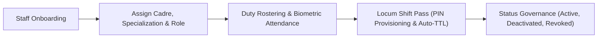

# Human Resources & Staff Management Workbench

ROLE GUARD: SUPERADMIN | ADMIN | HR MANAGER

The **Human Resources Workbench** manages the hospital workforce: staff profiles, clinical regulatory credential tracking (MDCN, NMCN, PCN, MLSCN, RRBN), employment status governance (Active, On-Leave, Suspended, Terminated), smart locum passes, and biometric clocking.

---

## 1. Visual Tour: HR Workforce Management

> [!TIP]
> The HR Workbench provides workforce metrics, department rosters, and real-time leave status trackers.

---

## 2. Real Routes & Role Authorization

- **Primary Route**: `hr.workbench.index` (`/hr/workbench`)
- **Authoritative Role Guard**: Defined in `sidebar/_nav-hr.blade.php` as `@hasanyrole('SUPERADMIN|ADMIN|super-admin|HR MANAGER')` gated by `@can('hr-workbench.access')`.

---

## 3. Staff Lifecycle & Locum Pass Governance

---

## 4. Cross-Module Data & Patient Flows

- **Doctors & Clinicians**: Staff activation status controls who appears in the clinic booking dropdowns at Reception (`reception.workbench`).
- **Accounting**: Payroll calculations and staff medical bills settle directly against employee ledgers.

---

## Developer Reference
👉 **[Read the HRMS Developer API Reference](/developer/workbenches/hr)**
