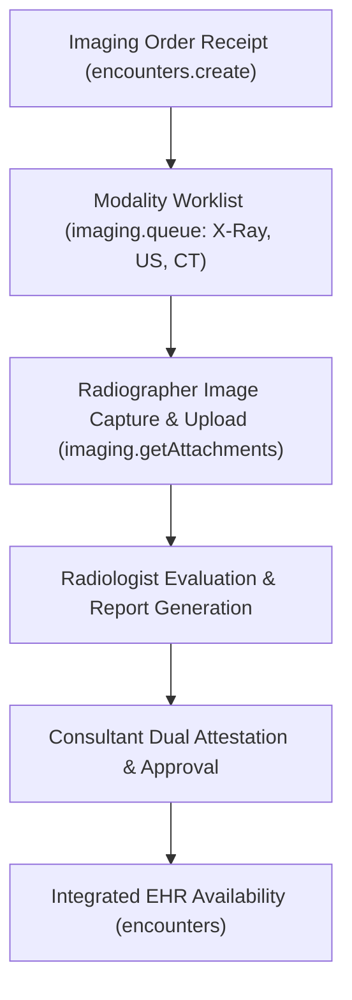

# Imaging & Radiology Workbench

ROLE GUARD: SUPERADMIN | ADMIN | RADIOLOGIST

The **Imaging & Radiology Workbench** provides radiologists and imaging technologists with an integrated suite for managing X-Ray, Ultrasound, CT, MRI, and Mammography orders, capturing diagnostic observations, uploading images, and issuing finalized consultant reports.

---

## 1. Visual Tour: Radiology Cockpit

> [!TIP]
> The Imaging Workbench provides instant modality queue filtering and direct DICOM image inspection within a locked zero-scroll viewport.

---

## 2. Real Routes & Role Authorization

- **Primary Route**: `imaging.workbench` (`/imaging-workbench`)
- **Authoritative Role Guard**: Defined in `sidebar/_nav-radiology.blade.php` as `@hasanyrole('SUPERADMIN|ADMIN|RADIOLOGIST')`.

---

## 3. Radiology Workflow

---

## 4. Cross-Module Data & Patient Flows

- **Doctor**: Attending clinicians view imaging reports and diagnostic summaries directly within the patient encounter history.
- **Cashier**: Cleared radiology service fees update request status to ready-for-capture.

---

## Developer Reference
👉 **[Read the Imaging Developer Reference](/developer/workbenches/imaging)**
