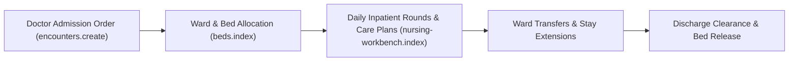

# Inpatient Wards & Bed Admissions

ROLE GUARD: SUPERADMIN | ADMIN | NURSE

The **Inpatient Wards & Admissions** modules provide real-time oversight of hospital bed inventory, ward occupancy rates, patient admissions, inter-ward bed transfers, and discharge authorizations across all hospital wards (Male Medical, Female Surgical, Paediatrics, ICU, Private Suites).

---

## 1. Visual Tour: Bed Census & Inpatient Tracking

> [!TIP]
> Bed statuses are color-coded in real-time (Green for Vacant, Red for Occupied, Yellow for Reserved, and Grey for Maintenance/Sanitizing).

---

## 2. Real Routes & Role Authorization

- **Bed Management Route**: `beds.index` (`/beds`)
- **Ward Dashboard Integration**: Embedded in `nursing-workbench.index` and `reception.workbench`.
- **Authoritative Role Guard**: Defined in `sidebar/_nav-nursing.blade.php` as `@hasanyrole('SUPERADMIN|ADMIN|NURSE')`.

---

## 3. Admission to Discharge Pathway

---

## 4. Cross-Module Data & Patient Flows

- **Doctor**: Attending clinicians convert outpatient encounters into inpatient stays with assigned bed categories.
- **Nursing**: Nurses manage bed occupancy, fluid balances, and Medication Administration Records (MAR).
- **Billing (`billing.workbench`)**: Daily ward stay accommodation tariffs accumulate automatically on the patient's folio.

---

## Developer Reference
👉 **[Read the Inpatient Wards Developer API Reference](/developer/workbenches/inpatient)**
