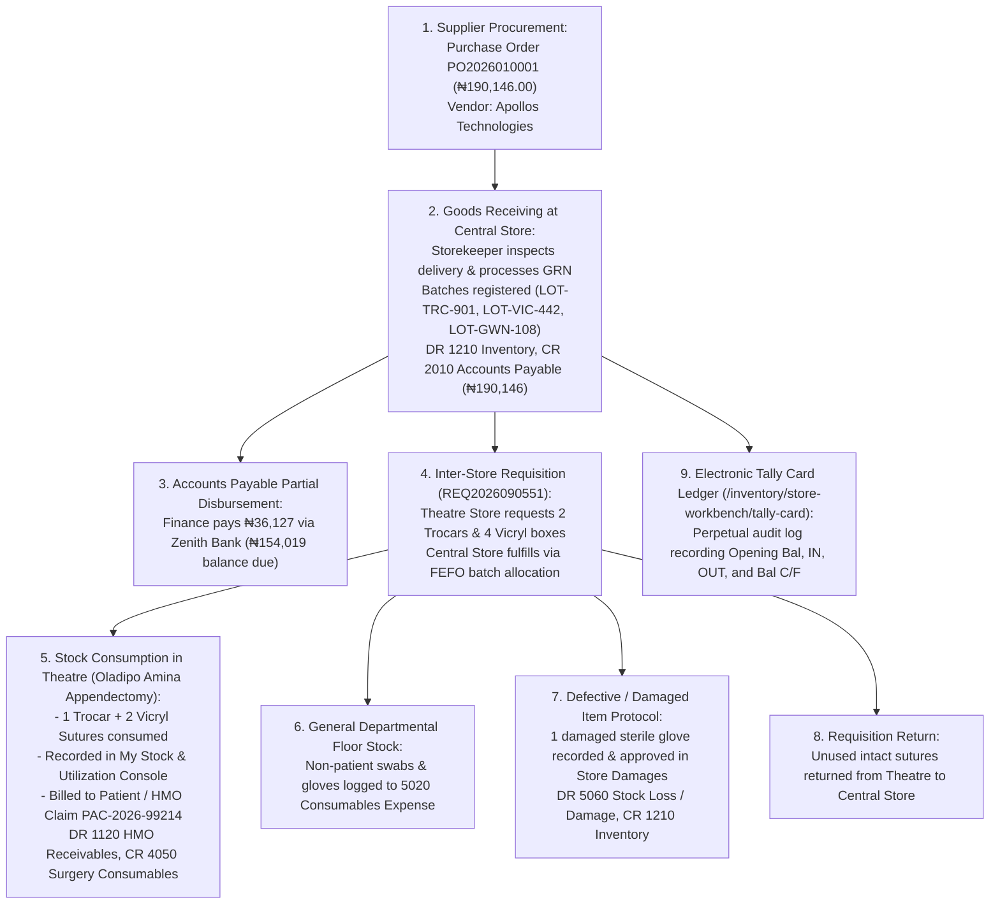

# Store, Inventory Governance & Supply Chain Management

ROLE GUARD: SUPERADMIN | ADMIN | super-admin | STORE | PHARMACY | ACCOUNTS

The **Store & Inventory Workbench** is the central logistics and materials engine of CoreHealth v2. It coordinates hospital multi-store procurement, automated purchase orders, Goods Receive Notes (GRNs), multi-tier batch and lot tracking, First-Expired-First-Out (FEFO) dispensing, departmental requisitions, electronic tally cards, ward stock utilization, damaged item disposals, supplier returns, and real-time General Ledger inventory balancing.

---

## 1. Visual Tour: Store Command Center

> [!NOTE]
> The **Store Workbench Cockpit** (`/inventory/store-workbench`) delivers comprehensive visibility across the hospital's multi-store network. Note the multi-store switcher (e.g. *Central Store*, *Pharmacy Store*, *Theatre Store*), active product metrics (315 Products, Active Batches, Low Stock, Expiring Soon), the 13-action quick navigation grid, recent stock movement feeds, and proactive expiry alerts.

---

## 2. "Follow the Stock & Money": The Canonical Hospital Supply Chain Journey

To understand how physical stock moves in unison with hospital funds, trace the concrete lifecycle of surgical materials for patient **Oladipo Amina (File No: `14-32-97`)** and supplier **Apollos Technologies**:

---

## 3. Hospital Multi-Store Hierarchy & Tenancy

CoreHealth v2 segregates physical inventory across distinct operational stores with automated Lane Policy governance:

| Store Tier | Store Name & Code | Primary Function | Requisition Privileges |
| :--- | :--- | :--- | :--- |
| **Tier 1: Central** | `Central Medical Store (CMS)` | Bulk warehouse receiving all external supplier deliveries via POs. | Issues stock to all sub-stores; procures from vendors. |
| **Tier 2: Hub** | `Pharmacy Main Store (PHARM_MAIN)` | Central pharmaceutical depot receiving bulk tablets, syrups, and injectables. | Requisitions from Central Store; issues to Satellite Pharmacies. |
| **Tier 3: Clinical**| `Theatre Store (THEATRE_ST)` | Surgical consumables, laparoscopy trocars, suture boxes, prosthetics. | Requisitions from Central Store; utilized in operating theatres. |
| **Tier 3: Wards** | `Ward Floor Stores (FSW_ST, MSW_ST, ICU_ST)` | Emergency floor stock, cannulas, IV lines, fluid bags, giving sets. | Requisitions from Central Store / Pharmacy Hub; dispensed to inpatients. |
| **Tier 3: Lab** | `Laboratory Store (LAB_ST)` | Diagnostic reagents, vacutainer tubes, test strips. | Requisitions from Central Store; consumed in specimen processing. |

---

## 4. Comprehensive Store Subpages

Every operational phase of the inventory lifecycle is documented in exhaustive clinical and technical detail:

### 1. Procurement, Purchase Orders & Stock Reception
👉 **[Read Guide: Procurement, POs & Stock Reception](/user-guides/workbenches/inventory/procurement-and-reception)**
- **Purchase Order Workflow**: Drafting POs, multi-line item catalog search, unit pricing, approval hierarchy (`#btn-create-po`).
- **Goods Receive Notes (GRNs)**: Three-way matching (PO vs Delivery Note vs Physical Count), batch number assignments, expiry dates, and automated Accounts Payable generation.
- **Supplier Accounts Payable**: Tracking vendor balances (e.g. *Apollos Technologies* ₦154k balance), payment vouchers via Zenith Bank.
- **Manual Batch Reception**: Recording direct donations, emergency non-PO local purchases, and opening stock migration.

### 2. Requisitions, Approvals & Inter-Store Transfers
👉 **[Read Guide: Requisitions, Approvals & Transfers](/user-guides/workbenches/inventory/requisitions-and-transfers)**
- **Store Requisitions**: Creating inter-store requests (`REQ2026090551`), queue triage (`Pending Approval` vs `Pending Fulfillment`).
- **Lane Policy Enforcement**: Governing which sub-stores can requisition from which parent store without unauthorized cross-pulling.
- **FEFO Batch Allocation & Dispatch**: Automated algorithmic recommendation prioritizing earliest expiring lots.
- **Receiving Store Confirmation**: Physical handover sign-off and receiving store stock incrementation.

### 3. Stock Consumption, Dispensing & Departmental Utilization
👉 **[Read Guide: Stock Consumption & Dispensing](/user-guides/workbenches/inventory/utilization-and-dispensing)**
- **My Stock & Utilization Console**: Departmental floor stock management (`/inventory/requisitions/my-stock`).
- **Patient-Billed Consumables vs Floor Overheads**: Live patient search (`14-32-97`), tariff preview, and automated billing checkout injection.
- **Pharmacy Workbench Integration**: Dispense-with-batch workflow, FEFO batch fulfillment, thermal label generation, and price adaptations.
- **Cost Center Attribution**: Linking consumed materials directly to surgical procedure margins (`General Surgery Cost Center`).

### 4. Electronic Tally Cards, Expiry Monitoring & Valuation
👉 **[Read Guide: Tally Cards, Expiry & Valuation](/user-guides/workbenches/inventory/tally-card-and-valuation)**
- **Electronic Tally Card / Bin Card**: Real-time immutable stock ledger tracking every transaction date, action type, balance brought forward, quantity change, and balance carried forward.
- **Expiry Monitoring Engine**: 30/60/90-day alert thresholds and proactive quarantine protocol.
- **Stock Overview & Batch Inspection**: Multi-store stock search, active batch drilldown, and unit cost review.
- **Inventory Valuation Report**: Real-time inventory asset balance sheet verification (`GL 1210 Inventory`).

### 5. Damages, Expirations, Returns & Operating Expenses
👉 **[Read Guide: Damages, Returns & Operating Expenses](/user-guides/workbenches/inventory/damages-returns-and-expenses)**
- **Store Damages & Disposals**: Logging damaged ampoules or defective kits, supervisor approval, and stock loss write-offs (`GL 5060`).
- **Requisition Returns**: Returning unused departmental stock back to Central Store.
- **Purchase Order Returns**: Returning defective supplier deliveries to *Apollos Technologies* with Credit Note generation.
- **Store Operating Expenses**: Cold-chain refrigeration fuel, warehouse utilities, and logistics vouchers.
- **Store Governance Config**: Defining store roles, ownership assignments, context rules, and lane matrix policies.

---

## 5. Upstream & Downstream Integration

- **Upstream Connection (Accounting Workbench)**: Every Goods Receive Note automatically logs an Accounts Payable voucher (`GL 2010`). Supplier payment vouchers disburse funds through Zenith Bank.
- **Downstream Connection (Clinical Workbenches)**:
  - *Theatre Workbench*: Surgical trocars and sutures consumed during laparoscopy update stock in real time.
  - *Pharmacy Workbench*: Prescription fulfillment decrements pharmaceutical batches using FEFO logic.
  - *Nursing Workbench*: Inpatient ward nurses draw cannulas and infusion fluids directly from Ward Floor Stock.
  - *Billing Workbench*: Patient-utilized items immediately unblock checkout and generate HMO tariff claims.

---

## Developer Reference
👉 **[Read Store Architecture & Multi-Store Tenancy](/developer/workbenches/inventory)**  
👉 **[Read Store API Contracts & Route Specifications](/developer/workbenches/inventory/api-contracts)**  
👉 **[Read Store Database Schema & Observer Reference](/developer/workbenches/inventory/database-and-models)**
