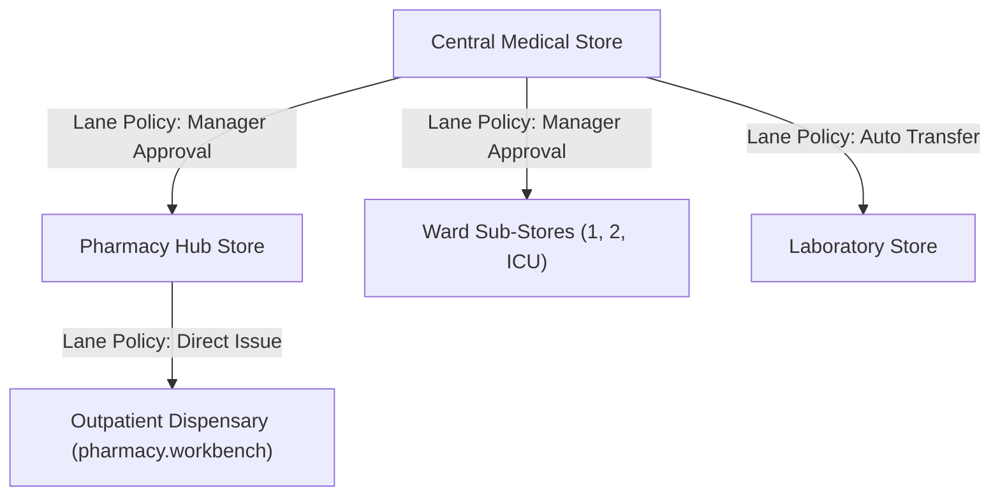

# Store & Inventory Governance Workbench

ROLE GUARD: SUPERADMIN | ADMIN | STORE

The **Store & Inventory Governance Workbench** oversees multi-store hospital supply chains: Central Medical Stores, Pharmacy Hubs, Ward Sub-Stores, and Diagnostic Labs.

---

## 1. Visual Tour: Store Inventory Cockpit

> [!TIP]
> The Store Workbench provides real-time stock batch visibility, transfer requisition approvals, and automated reorder alerts within a locked zero-scroll viewport.

---

## 2. Real Routes & Role Authorization

- **Primary Route**: `inventory.store-workbench.index` (`/inventory/store-workbench`)
- **Authoritative Role Guard**: Defined in `sidebar/_nav-store.blade.php` as `@hasanyrole('SUPERADMIN|ADMIN|STORE')`.

---

## 3. Store Hierarchy & Lane Policy Matrix

### Key Capabilities:
- **Lane Policy Enforcement**: Controls inter-store stock movements (No approval required, Manager approval, Admin approval).
- **Weighted Average Costing (WAC) & FIFO**: Tracks inventory valuations accurately.

---

## 4. Cross-Module Data & Patient Flows

- **Pharmacy & Nursing**: Sub-stores raise requisitions for medications and consumables that route to Store managers.
- **Accounting**: Approved receipts and damage write-offs generate automatic GL inventory entries (`StockBatchObserver`).

---

## Developer Reference
👉 **[Read the Store & Inventory Developer API Reference](/developer/workbenches/inventory)**
