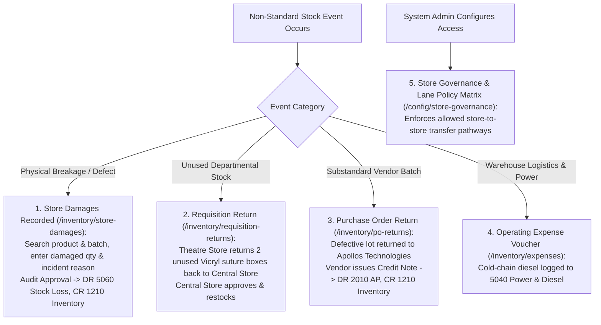

# Damages, Expirations, Returns, Operating Expenses & Governance

ROLE GUARD: SUPERADMIN | ADMIN | super-admin | STORE | ACCOUNTS | AUDIT

The **Damages, Returns, Expenses & Governance** subsystem governs non-standard stock flows—damaged item write-offs, expired lot disposals, intra-hospital requisition returns, supplier purchase order returns, cold-chain operating expenses, and multi-store lane governance rules.

---

## 1. Visual Tour: Store Damages & Loss Mitigation

> [!NOTE]
> The **Store Damages Console** (`/inventory/store-damages`) provides an audited mechanism for logging compromised, expired, or physically damaged medical inventory, ensuring stock losses are authorized and accounted for in the General Ledger.

---

## 2. Stepped Non-Standard Stock & Governance Workflow

---

## 3. Store Damages & Defective Batch Disposal

In a high-volume hospital, fragile glass ampoules, compromised sterile packs, or temperature-abused vaccines must be safely disposed of:

### 1. Clinical & Operational Objective
Remove compromised or unviable clinical supplies from active inventory, maintain shelf accuracy, prevent inadvertent administration to patients, and record financial write-offs in compliance with audit standards.

### 2. Exact UI Location / Where to Click
- Navigate to **Store / Inventory** &rarr; **Store Damages** (`/inventory/store-damages`).
- Click the dark blue **`+ Record Damage`** button (`#btn-create-damage`).

### 3. Required Fields & Damage Classification
- **Store (*Required)**: Select holding store (e.g. `Theatre Store`).
- **Product (*Required)**: Select item from catalog (e.g. `Vicryl 2-0 Sutures Box`).
- **Batch / Lot (*Required)**: Select affected lot (`LOT-VIC-442`).
- **Quantity Damaged (*Required)**: Enter damaged units (e.g. `1 box`).
- **Damage Category (*Required)**:
  - `Physical Breakage`: Crushed carton, broken glass vial.
  - `Sterile Seal Compromise`: Punctured blister pack or torn wrap.
  - `Cold-Chain Temperature Breach`: Refrigerator malfunction exceeding $8^\circ\text{C}$.
  - `Spillage / Contamination`: Liquid chemical exposure.
- **Incident Description (*Required)**: `Suture box dropped and crushed by theatre trolley during room turnover`.
- **Photo Evidence (*Optional)**: Upload image of damaged pack.

### 4. Downstream Approval & Accounting Impact
Click **`Submit Damage Report`**. The report enters the pending verification queue (`/inventory/store-damages/{id}`). The Internal Auditor and Chief Storekeeper inspect the physical item and click **`Approve Damage & Dispose`**:
- **Physical Stock Decrement**: The batch quantity drops from 4 to 3 in `Theatre Store`.
- **General Ledger Loss Invariant**:
  - **`DR 5060 Stock Loss & Damage Expense`**: `₦4,200.00`
  - **`CR 1210 Theatre Store Inventory`**: `₦4,200.00`

---

## 4. Requisition Returns (Department Back to Central Store)

When clinical units draw more stock than utilized during a clinical shift:

### 1. Clinical & Operational Objective
Safely return unopened, intact consumables from clinical departments (Theatre, Wards) back to parent warehouses without manual ledger tampering.

### 2. Exact UI Location / Where to Click
- Navigate to **Store / Inventory** &rarr; **Requisition Returns** (`/inventory/requisition-returns`).
- Click **`+ New Requisition Return`** (`/inventory/requisition-returns/create`).

### 3. Return Lifecycle for Unused Sutures
After *Oladipo Amina's* appendectomy was concluded, 2 unused boxes of Vicryl sutures remained in Theatre:
1. **Search Original Requisition**: Select `REQ2026090551`.
2. **Select Return Items**: Check `Vicryl 2-0 Sutures Box` &bull; Return Qty: `2 boxes` &bull; Batch: `LOT-VIC-442`.
3. **Return Reason**: Select `Excess Departmental Stock / Procedure Concluded`.
4. **Physical Inspection & Acceptance**:
   - Central Storekeeper inspects seals to verify they were never opened or contaminated.
   - Clicks **`Accept Requisition Return`** (`#btn-accept-req-return`).
   - `Theatre Store` balance drops from 3 to 1.
   - `Central Medical Store` balance restores by +2 boxes.
   - Status transitions to `RETURN_ACCEPTED`.

---

## 5. Purchase Order Returns (Vendor Returns & Credit Notes)

When delivered goods from external suppliers fail quality inspection or arrive near expiration:

### 1. Clinical & Operational Objective
Return non-compliant supplier stock to verified vendors, obtain formal credit notes, and reduce outstanding Accounts Payable liabilities.

### 2. Exact UI Location / Where to Click
- Navigate to **Store / Inventory** &rarr; **PO Returns** (`/inventory/po-returns`).
- Click **`+ New PO Return`** (`/inventory/po-returns/create`).

### 3. Step-by-Step Supplier Return Workflow
1. **Search Purchase Order**: Select order **`PO2026010001`** (Supplier: *Apollos Technologies*).
2. **Select Line Item & Batch**: Select `Disposable Surgical Gowns Pack` &bull; Batch: `LOT-GWN-108`.
3. **Return Quantity**: `5 packs`.
4. **Reason for Return**: Select `Packaging Defect / Missing Manufacturer Seal`.
5. **Approval & Credit Note Execution**:
   - Store Manager submits the return voucher.
   - Apollos Technologies acknowledges receipt and issues Credit Note `CN-APOLLOS-0082`.
   - Clicking **`Approve PO Return`** triggers `PurchaseOrderReturnObserver`:
     - **`DR 2010 Accounts Payable (Apollos Technologies)`**: `₦10,536.50` (Liability reduced)
     - **`CR 1210 Central Store Inventory`**: `₦10,536.50` (Stock removed)
   - The remaining balance due to Apollos Technologies automatically adjusts from `₦154,019.00` down to **`₦143,482.50`**.

---

## 6. Store Operating Expenses

Maintaining hospital warehouse logistics, pharmaceutical refrigeration, and clean storage involves non-stock overheads:

### 1. Clinical & Operational Objective
Record and authorize facility overhead expenses supporting store and inventory operations with direct cost center attribution.

### 2. Exact UI Location / Where to Click
- Navigate to **Store / Inventory** &rarr; **Expenses** (`/inventory/expenses`).
- Click **`+ Add Expense`** (`#btn-create-expense`).

### 3. Logging Cold-Chain Refrigerator Generator Fuel
- **Category (*Required)**: Select `5040 - Power, Diesel & Utilities`.
- **Cost Center (*Required)**: Select `Central Medical Store & Pharmacy Depot`.
- **Paying Bank (*Required)**: Select `1020 - Zenith Bank Operating`.
- **Amount (*Required)**: Enter `₦25,000.00` (Dedicated backup diesel for vaccine cold-chain freezer).
- **Payee (*Required)**: `TotalEnergies Retail Station`.
- **Attachment**: Scanned fuel receipt.
- **Approval Workflow**: Click **`Submit Expense`**. The Chief Accountant approves the voucher: `DR 5040 Power & Diesel (₦25,000)`, `CR 1020 Zenith Bank (₦25,000)`.

---

## 7. Store Governance & Lane Policy Configuration

Located at `/inventory/config/store-governance`, this administrative module establishes hospital supply chain rules:

### 1. Store Role Catalog & Ownership
- Maps each physical store to an operational tier (`Central Warehouse`, `Pharmacy Hub`, `Departmental Store`, `Ward Store`, `Diagnostic Lab`).
- Assigns designated Store Officers and Custodians with Spatie permission validation.

### 2. Lane Policy Matrix (`/inventory/config/store-governance/lane-matrix`)
- Establishes a mathematical rule grid governing whether Store $A$ is permitted to issue stock to Store $B$.
- Defines required approval tiers (`No Approval Required`, `Storekeeper Sign-off`, `Medical Director Approval`).

### 3. Context Resolution Rules
- Automatically detects the user's active department upon login and sets their default store context, preventing clinicians from accidentally requesting supplies into the wrong ward inventory.

---

## Downstream Supply Chain Impact
- **Elimination of Hidden Shrinkage**: Damaged goods cannot be discarded without formal dual approval and general ledger write-off.
- **Supplier Accountability**: Defective deliveries are documented and converted to immediate AP liability reductions.
- **Strict Movement Governance**: Lane matrices prevent chaotic, uncontrolled cross-borrowing between hospital units, ensuring every stock movement follows institutional policy.

---

## Developer Reference
👉 **[Read Store Architecture & Multi-Store Tenancy](/developer/workbenches/inventory)**  
👉 **[Read Store API Contracts & Route Specifications](/developer/workbenches/inventory/api-contracts)**  
👉 **[Read Store Database Schema & Observer Reference](/developer/workbenches/inventory/database-and-models)**

