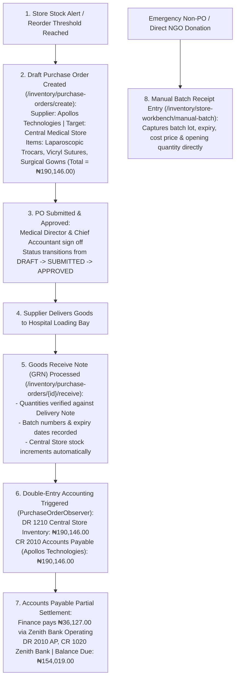

# Procurement, Purchase Orders, GRNs & Stock Reception

ROLE GUARD: SUPERADMIN | ADMIN | super-admin | STORE | ACCOUNTS

The **Procurement & Stock Reception** subsystem manages the formal intake of pharmaceutical drugs, surgical devices, and medical consumables into the hospital network. It enforces three-way matching (Purchase Order &rarr; Supplier Delivery Note &rarr; Physical Inspection Count), records lot/batch metadata, generates Goods Receive Notes (GRNs), synchronizes inventory ledgers, and triggers automated Accounts Payable liabilities.

---

## 1. Visual Tour: Purchase Orders & Procurement Register

> [!NOTE]
> The **Purchase Orders Hub** (`/inventory/purchase-orders`) tracks hospital procurement pipelines across all stores. Notice the canonical order **`PO2026010001`** issued to **Apollos Technologies** for `Theatre Store` (3 items, Total: `₦190,146.00`, Status: `RECEIVED`, Payment: `PARTIAL`).

---

## 2. Stepped Procurement & Reception Workflow

---

## 3. Creating a Purchase Order (PO)

### 1. Clinical & Operational Objective
Formalize the procurement of clinical supplies with verified vendors, binding agreed unit prices, quantities, and delivery schedules before goods are dispatched.

### 2. Exact UI Location / Where to Click
- Navigate to **Store / Inventory** &rarr; **Purchase Orders** (`/inventory/purchase-orders`).
- Click the dark blue **`+ New Purchase Order`** button (`#btn-create-po` or `/inventory/purchase-orders/create`).

### 3. Required vs Optional Fields, Types & Variations
- **Supplier (*Required)**: Select `Apollos Technologies` (medical technology & consumable distributor).
- **Target Store (*Required)**: Select `Central Medical Store` (or `Theatre Store`).
- **Expected Delivery Date (*Required)**: Date goods must arrive (e.g. `12 Nov 2026`).
- **Payment Terms (*Required)**: Select `Net 30 Days` (or `Cash on Delivery`, `Net 15 Days`).
- **Multi-Line Item Table (*Required)**:
  - Line 1: `Laparoscopic Trocar 10mm` &bull; Quantity: `10 units` &bull; Unit Cost: `₦8,500.00` &bull; Line Total: `₦85,000.00`.
  - Line 2: `Vicryl 2-0 Sutures Box` &bull; Quantity: `15 boxes` &bull; Unit Cost: `₦4,200.00` &bull; Line Total: `₦63,000.00`.
  - Line 3: `Disposable Surgical Gowns Pack` &bull; Quantity: `20 packs` &bull; Unit Cost: `₦2,107.30` &bull; Line Total: `₦42,146.00`.
- **Grand Total Calculation**: Dynamically sums to strictly **`₦190,146.00`**.
- **Procurement Notes (*Optional)**: `Restock surgical consumables ahead of elective laparoscopic appendectomy roster`.

### 4. Downstream Handover & Approval
Click **`Submit PO`**. The order enters the **Pending Approval** queue (`/inventory/purchase-orders?status=pending`). The Medical Director and Financial Controller review the item costs against departmental budget ceilings and click **`Approve PO`**. The supplier is issued an official purchase order copy.

---

## 4. PO Receiving & Goods Receive Note (GRN) Processing

When the supplier's delivery truck arrives at the hospital delivery bay:

### 1. Clinical & Operational Objective
Perform physical quality inspection, verify intact packaging and cold-chain integrity, verify delivered quantities against the delivery waybill, and register manufacturing lot numbers with statutory expiry dates.

### 2. Exact UI Location / Where to Click
- In `/inventory/purchase-orders`, locate order **`PO2026010001`**.
- Click the blue action button **`Receive Items`** (`/inventory/purchase-orders/1/receive`).

### 3. Goods Receive Verification Fields
- **Delivery Note / Waybill Number (*Required)**: Enter vendor waybill code (e.g. `DN-APOLLOS-8821`).
- **Received Date (*Required)**: Date of physical delivery (`09 Nov 2026`).
- **Item Batch Registration Table**:
  - Item 1 (Laparoscopic Trocar 10mm):
    - Received Qty: `10`
    - Batch / Lot Number (*Required): `LOT-TRC-901`
    - Expiry Date (*Required): `31 May 2029`
  - Item 2 (Vicryl 2-0 Sutures Box):
    - Received Qty: `15`
    - Batch / Lot Number (*Required): `LOT-VIC-442`
    - Expiry Date (*Required): `31 Oct 2028`
  - Item 3 (Disposable Surgical Gowns Pack):
    - Received Qty: `20`
    - Batch / Lot Number (*Required): `LOT-GWN-108`
    - Expiry Date (*Required): `31 Dec 2031`

### 4. Downstream Handover & Automated Side Effects
Click **`Process GRN & Accept Stock`**:
1. **Physical Inventory Ledger**: Central Medical Store stock counts increment immediately by 10 trocars, 15 suture boxes, and 20 gown packs.
2. **Batch Records Created**: Three new active batches are inserted into `product_batches`, making them available for FEFO transfer.
3. **Automated Accounts Payable Voucher**: The system triggers `PurchaseOrderObserver` to create voucher `AP-202611-0042`:
   - **`DR 1210 Central Medical Store Inventory`**: `₦190,146.00`
   - **`CR 2010 Accounts Payable (Apollos Technologies)`**: `₦190,146.00`

---

## 5. Accounts Payable (AP) & Vendor Settlement

### "Follow the Money": Partial Payment to Apollos Technologies
Following delivery verification, the Finance Committee authorizes partial payment:

### 1. Clinical & Operational Objective
Manage vendor liabilities, honor supplier credit terms, record milestone payments, and track outstanding balances due.

### 2. Exact UI Location / Where to Click
- Navigate to **Inventory** &rarr; **Purchase Orders** &rarr; **Accounts Payable** (`/inventory/purchase-orders/accounts-payable`).
- Locate vendor **`Apollos Technologies`** (Total Billed: `₦190,146.00`, Outstanding: `₦190,146.00`).
- Click **`Record Payment`** (`/inventory/purchase-orders/1/payment`).

### 3. Payment Voucher Fields
- **Paying Bank Account (*Required)**: Select `1020 - Zenith Bank Operating`.
- **Payment Method (*Required)**: Select `Electronic Bank Transfer (NIP)`.
- **Amount Paid (*Required)**: Enter **`₦36,127.00`**.
- **Reference / Transaction ID (*Required)**: `ZEN-TX-99824102`.
- **Payment Date (*Required)**: `09 Nov 2026`.

### 4. Downstream Financial Impact
Click **`Process Payment`**. The transaction executes:
- **`DR 2010 Accounts Payable (Apollos Technologies)`**: `₦36,127.00`
- **`CR 1020 Zenith Bank Operating`**: `₦36,127.00`
- **Updated Status**: Order status updates to `PARTIAL`, showing exactly **`₦154,019.00`** remaining balance due.

---

## 6. Manual Batch Reception (Non-PO Stock Intake)

For items entering the hospital without an electronic purchase order (e.g. World Health Organization donated vaccine vials, free clinical trial samples, or legacy baseline stock):

### 1. Clinical & Operational Objective
Ingest un-ordered physical stock into specific stores while establishing verified batch lots, unit costs, and expiry dates.

### 2. Exact UI Location / Where to Click
- Navigate to **Store Workbench** (`/inventory/store-workbench`).
- In the Quick Actions grid, click **`Add Batch`** (`/inventory/store-workbench/manual-batch`).

### 3. Required Fields
- **Destination Store (*Required)**: Select target holding store (e.g. `Pharmacy Main Store`).
- **Product (*Required)**: Select product from catalog (e.g. `Aceclofenac 100mg Tablets`).
- **Batch / Lot Number (*Required)**: Manufacturer lot number (e.g. `LOT-ACE-2026-04`).
- **Quantity In (*Required)**: Number of physical units (e.g. `500 tablets`).
- **Cost Price Per Unit (*Required)**: `₦25.00` (or `₦0.00` with Donation ledger classification).
- **Selling / Tariff Price (*Required)**: Standard retail price `₦50.00`.
- **Manufacturing Date (*Optional)**: `01 Oct 2026`.
- **Expiry Date (*Required)**: `30 Sep 2029`.
- **Source / Acquisition Type (*Required)**: Select `Opening Stock`, `Direct Donation`, or `Emergency Local Purchase`.

### 4. Downstream Handover
Click **`Create Batch & Update Stock`**. The batch is assigned to the selected store and immediately enters the Electronic Tally Card and FEFO dispensing queue.

---

## Downstream Supply Chain Impact
- **No Stock Without Lot Integrity**: Every tablet, trocar, and suture in CoreHealth v2 possesses an immutable batch number and expiry date.
- **Synchronized Balance Sheet**: Physical warehouse stock and General Ledger inventory (`1210`) balance to the exact kobo.
- **Traceability Guarantee**: If a manufacturer issues a product recall, the hospital can instantly identify every patient who received items from that specific lot.

---

## Developer Reference
👉 **[Read Store Architecture & Multi-Store Tenancy](/developer/workbenches/inventory)**  
👉 **[Read Store API Contracts & Route Specifications](/developer/workbenches/inventory/api-contracts)**  
👉 **[Read Store Database Schema & Observer Reference](/developer/workbenches/inventory/database-and-models)**

