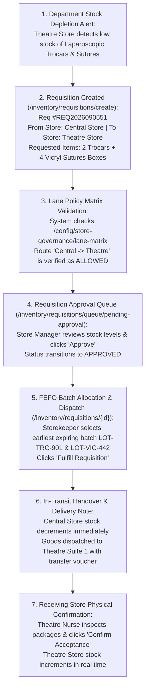

# Requisitions, Approvals, Lane Policies & Inter-Store Transfers

<span class="badge-role">ROLE GUARD: SUPERADMIN | ADMIN | super-admin | STORE | PHARMACY | NURSING</span>

The **Requisitions & Inter-Store Transfers** subsystem coordinates stock movements between the Central Medical Store and peripheral hospital delivery points (Theatre Store, Pharmacy Dispensaries, Inpatient Wards, Intensive Care Units, and Diagnostic Laboratories). It enforces Lane Policy matrices, approval hierarchies, First-Expired-First-Out (FEFO) batch allocation, and audited physical handovers.

---

## 1. Visual Tour: Store Requisitions Command Center


> [!NOTE]
> The **Store Requisitions Hub** (`/inventory/requisitions`) manages over 2,390 historical transfer requests. Note the live triage queue counters (79 Pending Approval, 764 Awaiting Fulfillment), the multi-store filter drop-downs, and real-time status badges (`FULFILLED`, `APPROVED`, `PARTIAL`, `CANCELLED`).

---

## 2. Stepped Inter-Store Requisition Lifecycle



---

## 3. Creating an Inter-Store Requisition


### 1. Clinical & Operational Objective
Empower departmental supervisors (Theatre charge nurses, ward managers, pharmacy dispensary leads) to formally request replenishment stock from central holding warehouses.

### 2. Exact UI Location / Where to Click
- Navigate to **Store / Inventory** &rarr; **Requisitions** (`/inventory/requisitions`).
- Click the dark blue **`+ New Requisition`** button (`#btn-create-requisition` or `/inventory/requisitions/create`).

### 3. Required vs Optional Fields, Types & Variations
- **Source Store (Issuing Store) (*Required)**: Select `Central Medical Store`.
- **Destination Store (Receiving Store) (*Required)**: Select `Theatre Store` (or `Pharmacy Main Store`, `Female Surgical Ward Store`).
- **Urgency / Priority (*Required)**: Select `Routine` (standard replenishment) or `Urgent / STAT` (theatre emergency ahead of scheduled surgeries).
- **Target Delivery Date (*Required)**: Expected handover date (e.g. `10 Nov 2026`).
- **Items Requisition Table (*Required)**:
  - Item 1: `Laparoscopic Trocar 10mm` &bull; Requested Qty: `2 units` &bull; Available in Central Store: `10 units`.
  - Item 2: `Vicryl 2-0 Sutures Box` &bull; Requested Qty: `4 boxes` &bull; Available in Central Store: `15 boxes`.
- **Clinical Narration (*Optional)**: `Theatre Suite 1 restock for scheduled laparoscopy appendectomy for patient Oladipo Amina`.

### 4. Downstream Handover
Click **`Submit Requisition`**. The requisition is logged as **`REQ2026090551`** with status `PENDING APPROVAL`.

---

## 4. Lane Policy Matrix & Store Governance Rules


CoreHealth v2 prevents unauthorized stock requisition routes using a formal **Lane Policy Matrix** (`/inventory/config/store-governance/lane-matrix`):

```json
{
  "source_role": "central",
  "destination_role": "theatre",
  "allowed": true,
  "requires_approval_level": "store_manager",
  "notes": "Central to Theatre Store standard replenishment"
}
```

### Governance Invariants:
1. **Central Warehouse Routing**: The Central Medical Store is authorized to supply all secondary clinical and departmental stores.
2. **Pharmacy Hub & Satellite Rules**: Satellite dispensaries (e.g. Emergency Pharmacy, Outpatient Pharmacy) can only requisition pharmaceuticals from the Central Store or Pharmacy Main Store; they cannot draw directly from ward floor stocks.
3. **Ward Cross-Pulling Block**: Wards cannot requisition stock from other wards (e.g. *Male Medical Ward* cannot pull drugs directly from *Labour Ward Store*). Stock must pass through the authorized parent store or be formally returned.

---

## 5. Approval Queues & Storekeeper Triage

In `/inventory/requisitions/queue/pending-approval`, store managers monitor incoming requests:

### 1. Clinical & Operational Objective
Screen stock requests against historical departmental consumption rates, prevent hoarding, verify central stock availability, and authorize allocation.

### 2. Exact UI Location / Where to Click
- Click the **Pending Approval** tab on the Requisitions console (`/inventory/requisitions?status=pending`).
- Select requisition **`REQ2026090551`**.

### 3. Review & Approval Actions
- **Stock Sufficiency Check**: The interface displays current central stock (`10 Trocars`, `15 Vicryl boxes`) alongside the requested quantities (`2 Trocars`, `4 Vicryl boxes`).
- **Adjust Quantities**: Store managers can partially approve line items (e.g. approving 2 trocars but reducing vicryl boxes to 3 if central stock is constrained).
- **Approve Requisition**: Click the green **`Approve Requisition`** button (`#btn-approve-req`). Status updates to `APPROVED` and moves to the fulfillment queue.

---

## 6. FEFO Batch Allocation, Fulfillment & Handover


### 1. Clinical & Operational Objective
Select the optimum physical stock batches based on **First-Expired-First-Out (FEFO)** logic, deduct central inventory, issue physical transfer vouchers, and dispatch goods.

### 2. Exact UI Location / Where to Click
- Navigate to **Pending Fulfillment** queue (`/inventory/requisitions/queue/pending-fulfillment`).
- Open **`REQ2026090551`** and click **`Fulfill Requisition`** (`#btn-fulfill-req`).

### 3. FEFO Batch Selection
The system automatically suggests batches with the earliest expiry dates:
- **Laparoscopic Trocar 10mm**:
  - Suggests Batch: `LOT-TRC-901` (Expiry: `31 May 2029`, Available: `10`).
  - Allocated Qty: `2 units`.
- **Vicryl 2-0 Sutures Box**:
  - Suggests Batch: `LOT-VIC-442` (Expiry: `31 Oct 2028`, Available: `15`).
  - Allocated Qty: `4 boxes`.

### 4. Downstream Handover & Physical Reception
1. **Central Store Deduction**: Clicking **`Confirm Dispatch`** immediately deducts 2 trocars and 4 suture boxes from `Central Medical Store`.
2. **Transfer Waybill**: A printed dispatch slip accompanies the items to the Operating Theatre suite.
3. **Receiving Store Confirmation**:
   - The Theatre charge nurse opens `/inventory/requisitions/2393` and inspects the physical cartons.
   - Clicks **`Confirm Acceptance`** (`#btn-accept-transfer`).
   - `Theatre Store` inventory increments immediately by 2 trocars and 4 suture boxes.
   - The status updates to **`FULFILLED`**.

---

## Downstream Clinical & Financial Impact
- **Zero Stockout During Surgery**: Surgical kits arrive in Theatre Suite 1 hours before *Oladipo Amina's* scheduled laparoscopic appendectomy.
- **FEFO Waste Prevention**: Automated batch allocation ensures older stock is consumed first, minimizing expiry write-offs.
- **Audit-Proof Transfer Ledger**: Every physical transfer leaves a dual sign-off footprint (Central storekeeper dispatch signature + Theatre nurse receiving signature).

---

## Developer Reference
👉 **[Read Store Architecture & Multi-Store Tenancy](/developer/workbenches/inventory)**  
👉 **[Read Store API Contracts & Route Specifications](/developer/workbenches/inventory/api-contracts)**  
👉 **[Read Store Database Schema & Observer Reference](/developer/workbenches/inventory/database-and-models)**

