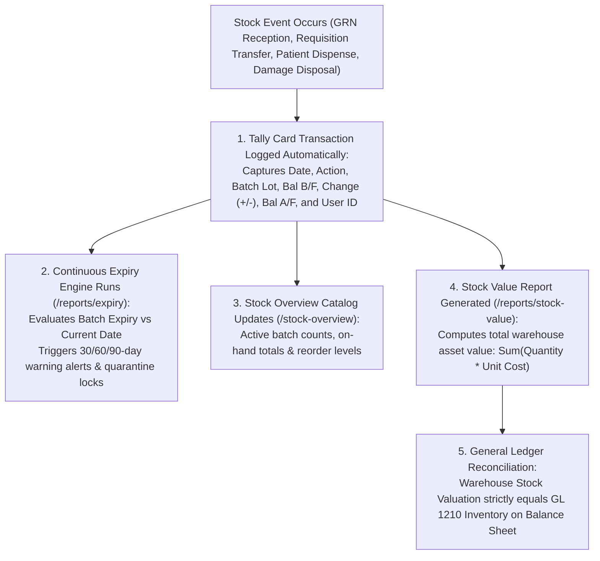

# Electronic Tally Cards, Expiry Monitoring & Inventory Valuation

ROLE GUARD: SUPERADMIN | ADMIN | super-admin | STORE | ACCOUNTS | AUDIT

The **Stock Ledger & Valuation** subsystem replaces physical paper bin cards with immutable **Electronic Tally Cards**, enforces proactive multi-tier expiration alerting, and provides real-time financial inventory valuations reconciled against the General Ledger (`GL 1210 Inventory`).

---

## 1. Visual Tour: Electronic Tally Card Ledger

> [!NOTE]
> The **Electronic Tally Card** (`/inventory/store-workbench/tally-card`) provides a live, forensic stock ledger. Note the dual View Axis (by Product or by Store), live aggregate KPI pills (Total IN, Total OUT, Net Movement, Balance), the pending actions queue cards, and the persistent floating action console.

---

## 2. Stepped Tally Card & Valuation Architecture

---

## 3. Electronic Tally Card (Perpetual Bin Card)

In hospital store operations, paper tally cards frequently suffer from lost entries, illegible handwriting, and backdated falsifications. CoreHealth v2 replaces them with an automated, tamper-proof electronic ledger:

### 1. Clinical & Operational Objective
Maintain an unbroken chronological record of every physical item entering or exiting a store, displaying running balances brought forward (Bal B/F) and carried forward (Bal A/F).

### 2. Exact UI Location / Where to Click
- Navigate to **Store Workbench** &rarr; **Tally Card** (`/inventory/store-workbench/tally-card`).
- Select **View Axis**: Click **`Product`** or **`Store`**.
- Filter by Store (e.g. `Theatre Store` or `Central Medical Store`) and select product (e.g. `Laparoscopic Trocar 10mm`).

### 3. Tally Card Ledger Columns
1. **DATE / TIME**: Exact microsecond timestamp of the transaction (e.g. `09 Nov 2026 14:15:22`).
2. **ACTION**: System operation tag (`PO_RECEIPT`, `TRANSFER_IN`, `TRANSFER_OUT`, `PATIENT_UTILIZATION`, `DISPENSE`, `DAMAGE_WRITE_OFF`, `INVENTORY_ADJUSTMENT`).
3. **BATCH DETAILS**: Manufacturer lot code, expiry date, and unit cost (e.g. `LOT-TRC-901 &bull; Exp: 31 May 2029`).
4. **BAL B/F (Balance Brought Forward)**: Quantity on shelf prior to the transaction (e.g. `2 units`).
5. **CHANGE (+ / -)**: Numerical increment or decrement (e.g. `-1 unit`).
6. **BAL A/F (Balance Carried Forward)**: Resulting verified stock balance (e.g. `1 unit`).
7. **BY**: Full user stamp including staff othername (e.g. `Nurse Nanle Sunday Dachollom`).
8. **NOTES**: Audit narration linking directly to source voucher (e.g. `Consumed during appendectomy for patient Oladipo Amina (14-32-97)`).
9. **ACTIONS**: Single-click buttons to inspect linked patient invoice, PO receipt, or dispatch note.

### 4. Floating Action Console
At the base of the Tally Card screen, storekeepers access an always-accessible floating menu:
- **`+ New Requisition`**: Rapid transfer initiation.
- **`+ Add Batch`**: Direct manual stock receipt.
- **`+ New PO`**: Instant purchase order creation.
- **`Adjust Stock`**: Open audited stock count variance modal.
- **`Record Damage`**: Log broken vials or contaminated sets.
- **`Return Req Items`**: Departmental returns back to central.
- **`Return PO Items`**: Vendor returns and credit notes.

---

## 4. Expiry Monitoring & Proactive Alerts

Preventing expired drugs from reaching clinical wards is a critical patient safety invariant:

### 1. Clinical & Operational Objective
Identify batches approaching statutory shelf-life limits, enforce proactive quarantine, and initiate vendor exchanges or clinical redistributions before expiration.

### 2. Exact UI Location / Where to Click
- Navigate to **Store Workbench** &rarr; **Expiry Report** (`/inventory/store-workbench/reports/expiry`).
- Filter by store or view across all hospital holdings.

### 3. Threshold Severity Categories
- **Critical Red Alert ($\le 30\text{ Days}$)**: Batches expiring within the current calendar month. The system triggers visual warning banners across both Store and Pharmacy Workbenches and restricts them from routine non-emergency requisitions.
- **Warning Yellow Alert ($31 – 90\text{ Days}$)**: Batches eligible for proactive clearance, accelerated FEFO prioritization, or return to vendor for credit.
- **Normal Green ($> 90\text{ Days}$)**: Active viable clinical inventory.

### 4. Downstream Clinical Actions
From the Expiry Report, supervisors can directly execute:
1. **`Quarantine Batch`**: Temporarily freezes the batch from appearing in clinical order sets.
2. **`Write Off Expired`**: If a batch passes its expiry date without consumption, clicking this button generates an automated disposal voucher (`DR 5065 Expiry Write-Off, CR 1210 Inventory`).

---

## 5. Multi-Store Stock Overview & Batch Drilldown

### 1. Clinical & Operational Objective
Provide warehouse controllers a consolidated catalog view of all 315+ pharmaceutical and consumable products, indicating real-time availability across all hospital sub-stores.

### 2. Exact UI Location / Where to Click
- Navigate to **Store Workbench** &rarr; **Stock Overview** (`/inventory/store-workbench/stock-overview`).
- Filter by Category (`Antiseptic-Fluids/Drips`, `Infusion`, `Surgical-Surgical`, `Tablets-Analgesic`).

### 3. Catalog Data Columns
- **Product Name & SKU Code**: e.g. `10% Dextrose Water 500mls (FLUID-100)`.
- **Category**: Therapeutic class or clinical supply category.
- **Total Qty On Hand**: Cumulative units available across all active batches in the selected store (e.g. `121 bottles`).
- **Batches Count**: Number of distinct active manufacturing lots (e.g. `4 batches`).
- **Stock Status Badge**: Dynamic badge (`In Stock`, `Low Stock`, `Out of Stock`).
- **Actions (`Batches` Button)**: Opens modal displaying each individual batch lot, expiry date, current quantity, and unit cost.

---

## 6. Stock Valuation Report & General Ledger Reconciliation

### 1. Clinical & Operational Objective
Calculate the total monetary value of inventory assets held across hospital warehouses, supporting periodic stock counts and statutory Balance Sheet audit verification.

### 2. Exact UI Location / Where to Click
- Navigate to **Store Workbench** &rarr; **Stock Value** (`/inventory/store-workbench/reports/stock-value`).
- Filter by Store (e.g. `Central Store`, `Theatre Store`, `Pharmacy Store`, or `All Stores`).

### 3. Inventory Valuation Methodology
CoreHealth v2 utilizes **Weighted Average Costing (WAC)** and **FIFO Lot Valuation**:
$$\text{Total Inventory Value} = \sum_{i=1}^{N} \left( \text{Batch Quantity}_i \times \text{Unit Cost}_i \right)$$

### 4. General Ledger Balance Sheet Reconciliation
At month-end, the Financial Controller verifies that the valuation report matches the General Ledger:
1. **Valuation Report Total**: e.g. **`₦28,450,190.50`** across all hospital stores.
2. **General Ledger Asset Code `1210 - Inventory on Hand`**: Exactly **`₦28,450,190.50`**.
3. **Discrepancy**: Strictly **`₦0.00`**.
4. The report can be directly exported to signed PDF or Excel for external auditors.

---

## Downstream Financial & Operational Impact
- **Forensic Audit Readiness**: Every single stock movement can be traced to a verified cashier payment, surgical consumption sheet, or GRN receipt.
- **Zero Ghost Stock**: Discrepancies between physical bin counts and electronic tally cards are immediately highlighted, preventing shrinkage.
- **Financial Balance Sheet Integrity**: Hospital management and board members possess 100% confidence that the inventory asset figure on financial statements is supported by physical lot valuations.

---

## Developer Reference
👉 **[Read Store Architecture & Multi-Store Tenancy](/developer/workbenches/inventory)**  
👉 **[Read Store API Contracts & Route Specifications](/developer/workbenches/inventory/api-contracts)**  
👉 **[Read Store Database Schema & Observer Reference](/developer/workbenches/inventory/database-and-models)**

