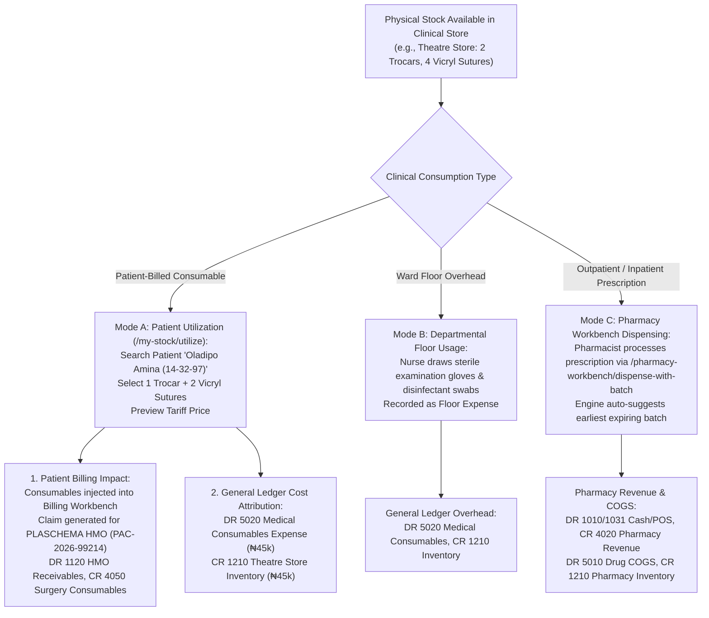

# Stock Consumption, Dispensing & Departmental Utilization

ROLE GUARD: SUPERADMIN | ADMIN | super-admin | STORE | PHARMACY | NURSING | DOCTOR

The **Stock Consumption & Dispensing** subsystem governs the final clinical delivery of pharmaceuticals, surgical implants, and medical consumables. It distinguishes between **Patient-Billed Items** (which generate clinical invoices and HMO claims) and **Departmental Floor Stock Overheads** (which post directly to hospital operational expense ledgers), while integrating with the Pharmacy Workbench for First-Expired-First-Out (FEFO) dispensing.

---

## 1. Visual Tour: My Stock & Departmental Utilization Console

> [!NOTE]
> The **My Stock & Utilization Console** (`/inventory/requisitions/my-stock`) provides clinical unit supervisors (e.g. `Medical Department Store - MED_DS`, `Theatre Store - THEATRE_ST`) an interactive dashboard for tracking local floor stock, viewing batch balances, and recording real-time clinical consumption.

---

## 2. Stepped Stock Consumption Architecture

---

## 3. Departmental Floor Stock & My Stock Dashboard

In `/inventory/requisitions/my-stock`:

### 1. Clinical & Operational Objective
Enable ward charge nurses and theatre scrub technicians to inspect physical stock on hand, detect depleted consumables, and initiate immediate patient utilization or departmental write-offs.

### 2. Exact UI Location / Where to Click
- Navigate to **Supplies & Stock** &rarr; **My Stock** (`/inventory/requisitions/my-stock`).
- Ensure active operating store indicates your clinical department (e.g. `Theatre Store` or `Medical Department Store - MED_DS`).

### 3. Console Tabs & Controls
- **Stock Cards Tab**: Displays product cards with real-time on-hand quantities, active batch counts, unit cost, and quick filter pills (`All`, `Low Stock`, `Out of Stock`, `Expiring Soon`, `Expired`).
- **Utilization & Transaction History Tab**: Chronological audit feed of all clinical consumption logs.
- **Aggregate Summaries Tab**: High-level category rollups (Surgical Consumables, Infusions, Anaesthetic Gases).
- **Export Controls**: Direct **`CSV Export`** and **`Print Stock`** buttons for physical ward inventory audits.

---

## 4. Mode A: Recording Patient-Billed Consumables

### "Follow the Stock & Money": Oladipo Amina's Appendectomy Kit
During *Oladipo Amina's* laparoscopic surgery, the surgical team consumed 1 Laparoscopic Trocar (`LOT-TRC-901`) and 2 Vicryl Sutures (`LOT-VIC-442`):

### 1. Clinical & Operational Objective
Assign consumed high-value surgical materials to the patient's electronic hospital file, triggering automatic billing checkout inclusion, insurance pre-authorization claims, and stock decrement.

### 2. Exact UI Location / Where to Click
- On the My Stock console, locate product **`Laparoscopic Trocar 10mm`** and click **`Utilize Stock`** (`/inventory/requisitions/my-stock/utilize`).

### 3. Required Utilization Fields
- **Utilization Type (*Required)**: Select `Patient Billed`.
- **Search Patient (*Required)**: Type `Oladipo Amina` or File No `14-32-97`. System auto-populates patient profile, active admission encounter, and insurance coverage (*PLASCHEMA Private Retainership*).
- **Batch Selection (*Required)**: Select `LOT-TRC-901` (Expiry: `31 May 2029`).
- **Quantity Utilized (*Required)**: Enter `1 unit`.
- **Performer / Surgeon (*Required)**: Select `Dr. Danladi Timothy (Consultant Surgeon)`.
- **Tariff Preview**: The system dynamically fetches HMO tariff pricing (`₦12,500.00` billing value vs `₦8,500.00` inventory cost price).

### 4. Downstream Clinical & Billing Impact
Click **`Confirm Utilization & Bill Patient`**:
1. **Inventory Decrement**: `Theatre Store` on-hand quantity for Trocar decrements from 2 to 1.
2. **Billing Workbench Injection**: The item automatically reflects in the cashier checkout modal under *Oladipo Amina's* pending bill items.
3. **HMO Claim Bundling**: The item attaches to Pre-Authorization Code `PAC-2026-99214` for electronic submission to PLASCHEMA.
4. **General Ledger Balancing**:
   - Inventory Asset reduction: `DR 5020 Consumables Expense (₦8,500)`, `CR 1210 Theatre Inventory (₦8,500)`.
   - Revenue Earned: `DR 1120 HMO Receivables (₦12,500)`, `CR 4050 Surgery Consumables Revenue (₦12,500)`.

---

## 5. Mode B: Recording Departmental Floor Stock Overheads

For consumable items used in general patient care where individual patient billing is non-applicable (e.g. floor disinfectant, disposable gloves, hypodermic needles, paper drapes):

### 1. Clinical & Operational Objective
Account for ward floor operational consumption, maintaining physical stock accuracy without generating patient invoices.

### 2. Utilization Fields
- **Utilization Type (*Required)**: Select `Department Overhead / General Floor Use`.
- **Department / Ward (*Required)**: Select `Main Operating Theatre - Suite 1`.
- **Product & Batch**: Select `Disposable Examination Gloves (Unit)` &bull; Batch: `LOT-GWN-108`.
- **Quantity Utilized**: `5 pairs`.
- **Reason**: `Routine preoperative theatre sanitization and preparation`.

### 3. Downstream Financial Impact
Click **`Log Floor Usage`**. The system decrements stock and posts:
- **`DR 5020 Medical Consumables & Departmental Overhead`**: `₦2,500.00`
- **`CR 1210 Theatre Store Inventory`**: `₦2,500.00`

---

## 6. Mode C: Pharmacy Workbench FEFO Batch Dispensing

When doctor orders or discharge prescriptions arrive at the Pharmacy:

### 1. Clinical & Operational Objective
Dispense verified pharmaceutical medications to patients, enforcing **First-Expired-First-Out (FEFO)** batch discipline, preventing dispensing of expired lots, and printing thermal instruction labels.

### 2. Exact UI Location / Where to Click
- Open **Pharmacy Workbench** &rarr; **Prescription Queue** (`/pharmacy-workbench`).
- Click **`Dispense with Batch`** (`/pharmacy-workbench/dispense-with-batch`).

### 3. FEFO Batch Recommendation Engine
When dispensing *Oladipo Amina's* post-operative analgesics (*Aceclofenac 100mg Tablets*):
1. **Algorithmic Batch Suggestion**:
   - The engine queries all active batches for `Aceclofenac 100mg` in `Pharmacy Main Store`.
   - It identifies Lot `LOT-ACE-2026-04` expiring in `120 days` ahead of Lot `LOT-ACE-2026-08` expiring in `450 days`.
   - It automatically pre-selects the earliest expiring lot: `LOT-ACE-2026-04`.
2. **Batch Adaptation & Adjustments**:
   - If the patient requests a generic equivalent or different strength, the pharmacist utilizes `/pharmacy-workbench/prescription/{id}/adapt`.
3. **Dispense Execution**:
   - Pharmacist clicks **`Dispense & Print Thermal Label`**.
   - Pharmacy stock drops by prescribed count.
   - The system triggers:
     - **`DR 5010 Cost of Goods Sold - Pharmaceutical Drugs`**
     - **`CR 1210 Pharmacy Store Inventory`**
   - Thermal printer outputs patient dosage instructions (`Take 1 tablet every 12 hours after meals`).

---

## Downstream Financial Margin Impact
- **Cost Center Gross Margin Accuracy**: Combining *Oladipo Amina's* surgical revenue (₦120,000) against direct consumed inventory (₦45,000 for trocars, vicryl sutures, gowns, and anaesthetic gases) verifies the General Surgery Department's **62.5% gross contribution margin**.
- **No Unbilled Leakage**: High-value surgical devices cannot disappear from Theatre shelves without an audited patient file link or supervisor-signed floor consumption log.

---

## Developer Reference
👉 **[Read Store Architecture & Multi-Store Tenancy](/developer/workbenches/inventory)**  
👉 **[Read Store API Contracts & Route Specifications](/developer/workbenches/inventory/api-contracts)**  
👉 **[Read Store Database Schema & Observer Reference](/developer/workbenches/inventory/database-and-models)**

