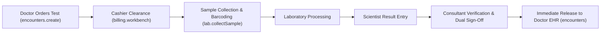

# Medical Laboratory (LIS) Workbench

ROLE GUARD: SUPERADMIN | ADMIN | LAB SCIENTIST

The **Medical Laboratory Workbench** (LIS) manages the complete diagnostic testing lifecycle: order receipt, specimen barcode accessioning, analytical processing, structured result entry, and dual consultant sign-off.

---

## 1. Visual Tour: Laboratory Cockpit

> [!TIP]
> The Laboratory Workbench displays sample accessioning queues and result validation forms side-by-side with previous patient test histories.

---

## 2. Real Routes & Role Authorization

- **Primary Route**: `lab.workbench` (`/lab-workbench`)
- **Authoritative Role Guard**: Defined in `sidebar/_nav-lab.blade.php` as `@hasanyrole('SUPERADMIN|ADMIN|LAB SCIENTIST')`.

---

## 3. Diagnostic Lifecycle & Dual Attestation

### Key Capabilities:
1. **Balanced Dual Attestation Layout**:
   - Laboratory reports feature side-by-side attestation blocks: "Entered By" (Scientist) on the left and "Approved By" (Consultant/HOD) on the right.
2. **Structured & Free-Form Templates**:
   - Numeric parameters with reference ranges, abnormal flags (High/Low/Critical), and rich-text WYSIWYG editors for histology/microbiology.

---

## 4. Cross-Module Data & Patient Flows

- **Doctor**: Clinicians inspect real-time laboratory values directly within the encounter timeline without switching screens.
- **Billing**: Cleared payments flag laboratory work orders as ready for accessioning.

---

## Developer Reference
👉 **[Read the Laboratory Developer API Reference](/developer/workbenches/laboratory)**
