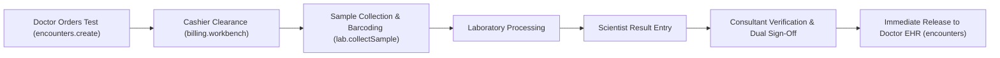

# Medical Laboratory (LIS) Workbench

ROLE GUARD: SUPERADMIN | ADMIN | LAB SCIENTIST

The **Medical Laboratory Workbench** (LIS) manages the complete diagnostic testing lifecycle: order receipt, specimen barcode accessioning, analytical processing, structured result entry, and dual consultant sign-off.

---

## 1. Visual Tour: Laboratory Cockpit

> [!TIP]
> The Laboratory Workbench displays sample accessioning queues and result validation forms side-by-side with previous patient test histories.

---

## 2. Real Routes & Role Authorization

- **Primary Route**: `lab.workbench` (`/lab-workbench`)
- **Authoritative Role Guard**: Defined in `sidebar/_nav-lab.blade.php` as `@hasanyrole('SUPERADMIN|ADMIN|LAB SCIENTIST')`.

---

## 3. Diagnostic Lifecycle & Dual Attestation

### Key Capabilities:
1. **Balanced Dual Attestation Layout**:
   - Laboratory reports feature side-by-side attestation blocks: "Entered By" (Scientist) on the left and "Approved By" (Consultant/HOD) on the right.
2. **Structured & Free-Form Templates**:
   - Numeric parameters with reference ranges, abnormal flags (High/Low/Critical), and rich-text WYSIWYG editors for histology/microbiology.

---

## 4. Cross-Module Data & Patient Flows

- **Doctor**: Clinicians inspect real-time laboratory values directly within the encounter timeline without switching screens.
- **Billing**: Cleared payments flag laboratory work orders as ready for accessioning.

---

## 5. NHMIS Monthly Return: Outcome Capture & Service Linking

**Clinical objective.** Some tests (malaria, HIV, hepatitis, syphilis, TB, urinalysis and others) feed the national NHMIS monthly return. When a scientist saves a result for one of these tests, the result window shows an **NHMIS Monthly Return: Required Outcome** bar, and an outcome (e.g. *Negative*, *Positive (+)*, *Reactive*) must be picked before the result can be saved.

### 5.1 Turning outcome capture on or off

**Where to click:** *Hospital Configuration* → *Result Approval Workflow* → **NHMIS Results Outcome Tracking**, then **Save Configuration**.

| Setting | What lab and imaging staff see |
|---|---|
| **On** (default) | The NHMIS outcome bar appears for linked tests and an outcome is required to save. |
| **Off** | The bar is hidden and results save without an outcome. Those results are not classified for the NHMIS return. |

> [!WARNING]
> While tracking is off, new results are not counted in the NHMIS monthly return. After turning it back on, use **Backfill History** (below) to classify past results.

### 5.2 Linking hospital services to NHMIS indicators

**Where to click:** *NHMIS Monthly Report* → **Service Links** (top-right button group).

- **Left list — indicators.** Grouped by NHMIS section. The green number is how many services are linked; amber **0** means nothing is linked yet, so the indicator is not counted. Use the search box, the **Lab / Imaging / Procedure** filters, or **Show unlinked only** to find gaps.
- **Right panel — the selected indicator.** Shows its code, section, and the outcomes it accepts (positive outcomes in red).
  - **Linked services**: press **Unlink** on a row, or **Unlink all**.
  - **Add services**: search by name or code and press **Link**. Only the indicator's own category is listed; tick **All categories** to see everything. When a search has 25 or fewer matches, **Link all** adds them in one go. An **also in N** tag means the service already counts towards another indicator.

Nothing is stored until you press **Save Changes**. Newly linked services appear at the top in blue, and changed indicators carry a blue dot. **Revert** undoes one indicator, and **Discard changes** undoes everything. Closing the window with unsaved changes asks for confirmation first.

The outcome bar appears only for services linked here. If a test shows the bar unexpectedly, find it in this window: it is linked to the indicator named on the bar.

**Auto-Detect** matches services to indicators by whole words in their names, and its suggestions are worth reviewing. **Backfill History** re-classifies earlier results using the saved links.

### 5.3 Downstream handover

Linked, classified results flow into the **NHMIS Monthly Report** cells. The records officer reviews them there, then uses **1-Click Auto Compile** and **Verify & Lock** for submission.

---

## Developer Reference
👉 **[Read the Laboratory Developer API Reference](/developer/workbenches/laboratory)**
