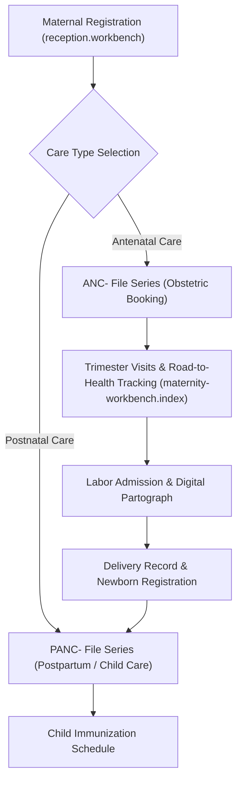

# Maternity & Child Health Workbench (ANC & Postnatal)

ROLE GUARD: SUPERADMIN | ADMIN | MATERNITY

The **Maternity Workbench** covers the full continuum of maternal and child healthcare: antenatal booking, trimester visit monitoring, labor management with digital partographs, delivery summaries, and postnatal wellness schedules.

---

## 1. Visual Tour: Maternity Cockpit

> [!TIP]
> The Maternity Workbench provides tabs for Antenatal Care, Labor & Delivery, Postnatal Progress, and Child Immunization charts.

---

## 2. Real Routes & Role Authorization

- **Primary Route**: `maternity-workbench.index` (`/maternity-workbench`)
- **Authoritative Role Guard**: Defined in `sidebar/_nav-maternity.blade.php` and `routes/maternity_workbench.php` as `@hasanyrole('SUPERADMIN|ADMIN|MATERNITY')`.

---

## 3. Maternal Continuum & Dual Prefix Care

### Dual Prefix Governance:
- **`ANC-`**: Antenatal files track pregnancy progress, fundal height, foetal heart rate, and routine antenatal investigations.
- **`PANC-`**: Postnatal files track postpartum maternal recovery, neonatal birth weight, APGAR scores, and vaccination tracking synced with Nursing.

---

## 4. Cross-Module Data & Patient Flows

- **Reception**: New mothers are enrolled using the `#patientFormModal` prefix pills (`ANC-` or `PANC-`).
- **Nursing (`nursing-workbench.index`)**: Child vaccination schedules are shared between Maternity and Child Welfare clinics.
- **Billing (`billing.workbench`)**: Delivery packages and antenatal care cards post directly to cashier records.

---

## Developer Reference
👉 **[Read the Maternity Developer API Reference](/developer/workbenches/maternity)**
