# Maternity, Obstetrics & Child Wellness Workbench

ROLE GUARD: SUPERADMIN | ADMIN | super-admin | MATERNITY | NURSE | DOCTOR

The **Maternity Workbench** governs the complete continuum of maternal, fetal, and neonatal healthcare. It manages antenatal care (ANC) booking, trimester visit monitoring, clinical order sets, Stage 1 labor tracking via the real-time **Digital Partograph**, delivery summaries (Spontaneous Vaginal Delivery vs Caesarean Section), newborn APGAR assessments, postpartum maternal lochia monitoring, and neonatal EPI vaccinations.

---

## 1. Visual Tour: Maternity Command Cockpit

> [!NOTE]
> The **Maternity Workbench Cockpit** (`/maternity-workbench`) integrates maternal care across clinical and inpatient phases. Note the top KPI overview metrics (Total Admissions, Average Length of Stay ALOS, Admissions by Class entry point), the multi-queue filter rail (Active ANC, Due Visits, Upcoming EDD, Postnatal, High-Risk Register, Bed Requests), and the 15 workspace clinical tabs.

---

## 2. "Patient In to Patient Out": The Maternal & Neonatal Journey

```mermaid
flowchart TD
    A["1. Antenatal Enrollment (ANC Booking):<br/>Mother registered with dual prefix file ANC-2026-0042 (Fatima Bello)<br/>LMP entered -> System auto-calculates EDD & Gestational Age<br/>Obstetric Parity (GPAL) & baseline labs recorded"] --> B["2. Trimester ANC Visits & Clinical Prophylaxis:<br/>Visits at 16, 24, 30, 36 & 39 weeks<br/>BP, Fundal Height, Fetal Heart Rate, Urinalysis, Iron/Folate & Tetanus Toxoid"]
    
    B --> C["3. Labor Ward Admission (Stage 1 Labor):<br/>True labor contractions onset at 40 weeks<br/>Midwife admits mother & initiates Digital Partograph"]
    
    C --> D["4. Real-Time Digital Partograph Monitoring:<br/>Plots Cervical Dilation Curve (Alert vs Action Line)<br/>Monitors Fetal Heart Rate (140 bpm), Liquor status & Contractions"]
    
    D --> E["5. Stage 2 & 3 Delivery Record:<br/>Spontaneous Vaginal Delivery (SVD) of live male infant at 18:24<br/>AMTSL protocol: 10 IU Oxytocin, complete placenta expulsion, blood loss 250ml"]
    
    E --> F["6. Newborn Clinical Registration & APGAR Scoring:<br/>Baby Boy Bello (3.4kg, 50cm, HC 35cm)<br/>APGAR Score: 8 at 1 min, 10 at 5 mins<br/>Vitamin K & Chlorhexidine cord care administered"]
    
    F --> G["7. Postnatal Ward Stay & Recovery (PANC File Series):<br/>Maternal lochia, fundal height involution & neonatal jaundice check"]
    
    G --> H["8. Child Wellness & EPI Immunization:<br/>Birth vaccines administered (BCG, OPV0, Hepatitis B birth dose)<br/>Road to Health card generated"]
    
    H --> I["9. Patient Out & Discharge Handover:<br/>Delivery package billed, newborn certificate stamped<br/>Mother & baby discharged with 6-week postnatal follow-up"]
```

---

## 3. The Dual Prefix Patient Identification System

CoreHealth v2 enforces strict longitudinal separation between pregnancy care and postpartum infant health:

| Prefix Code | Series Domain | Clinical Scope & Focus |
| :--- | :--- | :--- |
| **`ANC-`** | **Antenatal Care Series** | Obstetric booking, maternal medical history, gestational age progression, fetal growth milestones, and labor/delivery records. |
| **`PANC-`** | **Postnatal & Child Care Series** | Postpartum maternal recovery, neonatal growth charts, APGAR milestones, and routine National Programme on Immunization (EPI) vaccinations. |

---

## 4. Comprehensive Maternity Subpages

The full maternal continuum is documented across 5 specialized subpages:

### 1. ANC Enrollment, Booking & Obstetric History
👉 **[Read Guide: ANC Enrollment & History](/user-guides/workbenches/maternity/enrollment-and-history)**
- **Antenatal Booking**: Dual prefix assignment (`ANC-2026-0042`), booking package selection, and biometric registration.
- **Automated Gestational Calculator**: Last Menstrual Period (LMP) entry with automated Expected Date of Delivery (EDD) via Naegele's rule.
- **Obstetric History Matrix**: Gravida, Parity, Living Children, and Abortions (G P A L), previous Caesarean sections, and blood group/Rhesus typing.
- **Maternity Queues**: Active ANC, Due Visits, Upcoming EDD, and High-Risk Register.

### 2. Antenatal Trimester Visits, Investigations & Prophylaxis
👉 **[Read Guide: ANC Trimester Visits & Orders](/user-guides/workbenches/maternity/anc-visits-and-orders)**
- **Trimester Visits**: Blood pressure tracking (ruling out pre-eclampsia/gestational hypertension), fundal height, fetal lie, and Fetal Heart Rate (FHR).
- **Point-of-Care Urinalysis**: Proteinuria and glucosuria dipstick monitoring.
- **Clinical Orders & Prophylaxis**: Routine antenatal iron/folate supplements, Tetanus Toxoid (TT1–TT5) injections, Intermittent Preventive Treatment in pregnancy for malaria (IPTp-SP), and obstetric ultrasound scans.

### 3. Labor Ward Admission & Real-Time Digital Partograph
👉 **[Read Guide: Labor & Digital Partograph](/user-guides/workbenches/maternity/partograph-and-labor)**
- **Labor Ward Admission**: Triage of true vs false labor, rupture of membranes assessment.
- **Digital Partograph Engine**: Real-time plotting of cervical dilation against the WHO Alert Line and Action Line.
- **Fetal & Maternal Monitoring**: Fetal heart rate baseline, amniotic liquor quality (intact, clear, meconium), uterine contraction frequency and strength, maternal blood pressure, and oxytocin drops.

### 4. Delivery Record, Newborn Care & APGAR Scoring
👉 **[Read Guide: Delivery Record & Newborn Care](/user-guides/workbenches/maternity/delivery-and-newborn)**
- **Stage 2 & 3 Delivery Record**: Delivery modes (Spontaneous Vaginal Delivery SVD vs Vacuum vs Emergency CS), delivery timestamp, perineal tear grading, episiotomy repair, and Active Management of Third Stage of Labor (AMTSL).
- **Newborn Clinical Assessment**: Birth weight, head circumference, length, and gender.
- **APGAR Scoring System**: Real-time scoring at 1 Minute and 5 Minutes (Appearance, Pulse, Grimace, Activity, Respiration).

### 5. Postnatal Care (PNC), Immunization & Discharge Clearance
👉 **[Read Guide: Postnatal Care & Immunization](/user-guides/workbenches/maternity/postnatal-and-immunization)**
- **Postnatal Ward Care**: Maternal lochia monitoring (rubra, serosa, alba), fundal involution, and neonatal jaundice screening.
- **Child Wellness & EPI Vaccines**: Administering birth dose vaccines (BCG, OPV0, Hepatitis B birth dose) and Vitamin K prophylaxis.
- **Discharge Clearance**: SVD delivery package billing, Road to Health booklet generation, and 6-week postnatal clinic booking.

---

## 5. Cross-Module Maternal Interconnections

- **Reception Workbench**: Enrolls new mothers with automated `ANC-` series numbering (`#patientFormModal`).
- **Nursing Workbench**: Labor ward bed management and shift handovers coordinate seamlessly with bedside nursing rosters.
- **Laboratory & Imaging Workbenches**: Antenatal blood workups (PCV, HIV, VDRL, Hepatitis B) and obstetric ultrasound scans synchronize into maternal order sets.
- **Billing Workbench**: Delivery packages and antenatal care cards post directly to cashier ledgers (`billing.workbench`).

---

## Developer Reference
👉 **[Read Maternity Developer Architecture](/developer/workbenches/maternity)**  
👉 **[Read Maternity API Contracts & Route Specifications](/developer/workbenches/maternity/api-contracts)**  
👉 **[Read Maternity Database Schema & Models Reference](/developer/workbenches/maternity/database-and-models)**
