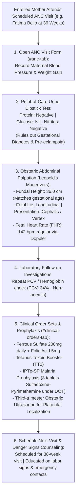

# Antenatal Trimester Visits, Investigations & Clinical Orders

ROLE GUARD: SUPERADMIN | ADMIN | super-admin | MATERNITY | NURSE | DOCTOR

The **Antenatal Trimester Visits & Orders** subsystem coordinates longitudinal maternal-fetal surveillance. It tracks maternal blood pressure, fundal height growth curves, fetal heart rates, urine dipstick findings, routine hematinic prophylaxis, Tetanus Toxoid vaccinations, malaria preventive therapy (IPTp-SP), and obstetric ultrasound scans.

---

## 1. Visual Tour: Antenatal Trimester Visit Assessment

> [!NOTE]
> The **ANC Visits Console** (`#anc-tab` or `/maternity-workbench/enrollment/{id}/anc-visits`) structures clinical evaluation across the 8-contact WHO antenatal model. Note the simultaneous capture of maternal vitals (BP, Weight), obstetric palpation (Fundal Height, Fetal Presentation), fetal Doppler heart rate, and point-of-care urinalysis.

---

## 2. Stepped Antenatal Surveillance Lifecycle

---

## 3. The 8-Contact ANC Trimester Model

CoreHealth v2 structures antenatal care according to World Health Organization (WHO) clinical recommendations:

| Contact Milestone | Gestational Age | Core Clinical Focus & Key Interventions |
| :--- | :--- | :--- |
| **Contact 1** | $\le 12\text{ Weeks}$ | Obstetric booking, baseline PCV/blood typing, early dating scan, daily folic acid. |
| **Contact 2** | $20\text{ Weeks}$ | Fetal anomaly ultrasound scan, maternal BP, initiate Ferrous Sulfate and Calcium. |
| **Contact 3** | $26\text{ Weeks}$ | Screening for gestational diabetes (oral glucose tolerance test), Fundal height, TT1. |
| **Contact 4** | $30\text{ Weeks}$ | Maternal anemia screen, IPTp-SP dose 1, fetal growth assessment. |
| **Contact 5** | $34\text{ Weeks}$ | Fundal height, fetal heart rate, IPTp-SP dose 2, pre-eclampsia screening. |
| **Contact 6** | $36\text{ Weeks}$ | Fetal lie and presentation check, repeat PCV, Birth Preparedness and Complication Readiness. |
| **Contact 7** | $38\text{ Weeks}$ | Pelvic assessment, confirm cephalic presentation, review emergency transport plan. |
| **Contact 8** | $40\text{ Weeks}$ | Full term evaluation; schedule post-term monitoring if undelivered by $41\text{ weeks}$. |

---

## 4. Bedside Examination Fields & Obstetric Palpation

In `#anc-tab`, click **`+ New ANC Visit`** (`#btn-new-anc-visit`):

### 1. Maternal Hemodynamics & Weight Tracking
- **Maternal Blood Pressure (*Required)**:
  - Systolic BP & Diastolic BP in $mmHg$ (e.g. `118/74 mmHg`).
  - **Pre-eclampsia Warning**: If BP reaches $\ge 140/90\text{ mmHg}$ on two readings 4 hours apart, the system triggers a **Gestational Hypertension Alert**.
- **Maternal Weight (*Required)**: Decimal in $kg$ (e.g. `68.5 kg`, showing steady $0.5\text{ kg/week}$ gain).

### 2. Obstetric Abdominal Palpation (Leopold's Maneuvers)
- **Fundal Height (*Required)**:
  - Measured in centimeters using McDonald's rule from the upper border of the pubic symphysis to the uterine fundus (e.g. `36.0 cm`).
  - **Growth Curve Invariant**: Should match gestational age $\pm 2\text{ cm}$. A discrepancy $>3\text{ cm}$ prompts an ultrasound referral to rule out Intrauterine Growth Restriction (IUGR) or Polyhydramnios.
- **Fetal Lie (*Required)**: Select `Longitudinal` (normal), `Transverse`, or `Oblique`.
- **Fetal Presentation (*Required)**: Select `Cephalic / Vertex` (head down), `Breech` (frank, complete, footling), or `Shoulder`.
- **Engagement of Presenting Part**: Measured in fifths palpable above the pelvic brim (e.g. `3/5th palpable`).

### 3. Fetal Auscultation
- **Fetal Heart Rate (FHR) (*Required)**:
  - Measured in beats per minute using fetal Doppler or Pinard stethoscope (e.g. `142 bpm`).
  - **Fetal Distress Flag**: Normal range is **$110 – 160\text{ bpm}$**. Rates $<110\text{ bpm}$ (severe bradycardia) or $>160\text{ bpm}$ (tachycardia) trigger urgent physician notification.

### 4. Point-of-Care Urinalysis
- **Protein (*Required)**: Select `Negative`, `Trace`, `+1 (30 mg/dL)`, `+2 (100 mg/dL)`, or `+3 (300 mg/dL)`.
  - Significant proteinuria ($\ge +1$) combined with elevated blood pressure confirms **Pre-eclampsia**, mandating immediate admission.
- **Glucose (*Required)**: Select `Nil`, `Trace`, `+1`, or `+2` (flags possible Gestational Diabetes Mellitus).
- **Leukocytes & Nitrites**: Screen for asymptomatic bacteriuria and urinary tract infection (UTI).

---

## 5. Clinical Orders, Prophylaxis & Order Bundles

In `#clinical-orders-tab`, midwives prescribe routine preventive care and laboratory workups:

### 1. Routine Nutritional Hematinics
- **Ferrous Sulfate (Iron)**: `200mg orally once daily` (or Ferrous Fumarate).
- **Folic Acid**: `5mg orally once daily` for neural tube defect prevention.
- **Calcium Supplementation**: `500mg daily` starting from 20 weeks for pre-eclampsia risk reduction.

### 2. Tetanus Toxoid (TT) Immunization Schedule
- **TT1**: Given at first antenatal contact.
- **TT2**: Administered 4 weeks after TT1 (confers protective immunity for current birth).
- **TT3**: Administered 6 months after TT2 (provides 5 years protection).
- **TT4**: Administered 1 year after TT3 (provides 10 years protection).
- **TT5**: Administered 1 year after TT4 (provides lifetime protection during reproductive years).

### 3. Intermittent Preventive Treatment of Malaria (IPTp-SP)
In malaria-endemic zones, midwives administer **Sulfadoxine-Pyrimethamine (SP)** under Directly Observed Therapy (DOT):
- Administered as 3 tablets of Sulfadoxine/Pyrimethamine ($500/25\text{ mg}$) starting at 16 weeks gestation.
- Repeated at every scheduled ANC visit at least 1 month apart until delivery.

### 4. Obstetric Ultrasound Scans
- **Second-Trimester Anomaly Scan (18–22 weeks)**: Screens fetal anatomy, spine, cardiac chambers, amniotic fluid volume, and placental localization.
- **Third-Trimester Presentation & Growth Scan (34–36 weeks)**: Confirms cephalic presentation and rules out Placenta Previa (low-lying placenta).

---

## Downstream Maternal Impact
- **Maternal Mortality Reduction**: Routine blood pressure and urinalysis surveillance catches asymptomatic pre-eclampsia weeks before eclamptic convulsions occur.
- **Preventing Obstructed Labor**: Detecting breech or transverse presentations at 36 weeks allows timely scheduling of External Cephalic Version (ECV) or elective Caesarean section.

---

## Developer Reference
👉 **[Read Maternity Developer Architecture](/developer/workbenches/maternity)**  
👉 **[Read Maternity API Contracts & Route Specifications](/developer/workbenches/maternity/api-contracts)**  
👉 **[Read Maternity Database Schema & Models Reference](/developer/workbenches/maternity/database-and-models)**

