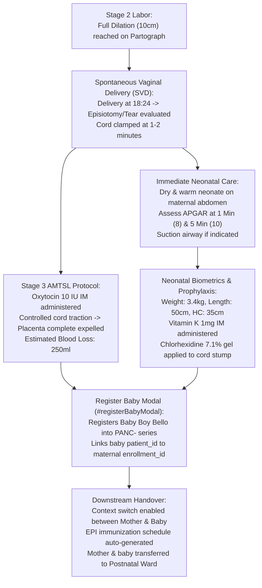

# Delivery Record, Newborn Care & APGAR Scoring

ROLE GUARD: SUPERADMIN | ADMIN | super-admin | MATERNITY | NURSE | DOCTOR

This guide covers Stage 2 (expulsion of the fetus) and Stage 3 (Active Management of Third Stage of Labor - AMTSL) delivery management, immediate neonatal resuscitation, APGAR scoring at 1, 5, and 10 minutes, biometric measurements, and formal baby registration into the patient registry.

---

## 1. Visual Tour: Stage 2 & 3 Delivery Record

### Clinical Objective & Overview
When cervical dilation reaches $10\text{ cm}$ (full dilation) on the Digital Partograph, the mother enters Stage 2 labor. The midwife or obstetrician guides maternal pushing efforts, assists fetal delivery, performs immediate cord clamping, and initiates Active Management of Third Stage of Labor (AMTSL) to expel the placenta and prevent Postpartum Hemorrhage (PPH).

### Exact UI Location / Where to Click
1. Open `/maternity-workbench` and select the mother from the active queue (e.g. **Fatima Bello** — `ANC-2026-0042`).
2. In the workspace navigation bar, click the **Delivery** tab (`#delivery-tab`).
3. Click the green button **Record Delivery** (`#delivery-form`).

### Required vs Optional Fields, Types & Variations
The delivery record captures four standardized clinical categories:

| Section | UI Field Label | Input Type | Required? | Clinical Options & Default Values |
| :--- | :--- | :--- | :--- | :--- |
| **Timing & Location** | Delivery Date | Date picker | **Yes** | Today's date by default. |
| | Delivery Time | Time picker | Optional | Exact timestamp of neonatal birth (e.g., `18:24`). |
| | Place of Delivery | Text input | Optional | Defaults to `This Facility` (or `Home`, `Transit`). |
| | Number of Babies | Number input | **Yes** | `1` (or $2+$ for multiple gestations: twins, triplets). |
| **Labour Details** | Type of Delivery | Dropdown select | **Yes** | `SVD (Spontaneous Vaginal)` *(default)*, `Assisted Vaginal`, `Elective CS`, `Emergency CS`, `Vacuum Extraction`, `Forceps Delivery`. |
| | Duration of Labour | Decimal input | Optional | Total active labor hours (e.g., `8.5` hrs). |
| | Estimated Blood Loss | Number (ml) | Optional | Normal SVD $\le 500\text{ ml}$; CS $\le 1000\text{ ml}$. $>500\text{ ml}$ flags PPH alert. Recorded: `250 ml`. |
| | Oxytocin Given | Dropdown select | Optional | `Yes` *(default AMTSL 10 IU IM within 1 min)* or `No`. |
| | Induction & Method | Dropdown + Text | Optional | `No` *(default)*; if `Yes`, specify e.g., `Oxytocin`, `ARM`. |
| | Anaesthesia Type | Dropdown select | Optional | `None` *(default)*, `Local`, `Epidural`, `Spinal`, `General`. |
| **Outcomes** | Placenta Status | Dropdown select | Optional | `Complete` *(default)* vs `Incomplete` (retained products). |
| | Perineal Tear Degree | Dropdown select | Optional | `None` *(default)*, `1st degree`, `2nd degree`, `3rd degree`, `4th degree`. |
| | Episiotomy | Dropdown select | Optional | `None` *(default)*, `Yes, mediolateral`, `Yes, midline`. |
| **Clinical Notes** | Complications | Rich text editor | Optional | Notes PPH, cord prolapse, shoulder dystocia. |
| | Delivery Notes | Rich text editor | Optional | Permanent narrative synced to global timeline. |

### Downstream Handover
Saving the delivery record updates `maternity_enrollments.has_delivery = 1`. This unlocks the **Baby Records** tab (`#baby-tab`), signals the pediatric nursing desk for neonatal reception, and generates the delivery charge item for cashier billing clearance.

---

## 2. Visual Tour: Newborn Registration & APGAR Engine

### Clinical Objective & Overview
Every neonate born within the facility must be registered immediately with their own demographic profile, linked bidirectionally to the maternal enrollment record. Immediate vital scoring via the APGAR framework determines whether neonatal intensive care (NICU) resuscitation is required.

### Exact UI Location / Where to Click
1. On the Maternity Workbench, click the **Baby Records** tab (`#baby-tab`).
2. Click the pink button **+ Register Baby** (`showRegisterBabyForm()`), which opens `#registerBabyModal`.

### The APGAR Scoring Standard
Calculated at 1 Minute and 5 Minutes (and 10 Minutes if 5-minute score $< 7$):

| Parameter | 0 Points | 1 Point | 2 Points | Fatima's Baby (1m / 5m) |
| :--- | :--- | :--- | :--- | :---: |
| **Appearance (Skin Color)** | Blue / Pale all over | Acrocyanosis (body pink, blue hands/feet) | Completely pink | **1 pt** / **2 pts** |
| **Pulse (Heart Rate)** | Absent | $< 100\text{ bpm}$ | $> 100\text{ bpm}$ | **2 pts** / **2 pts** |
| **Grimace (Reflex Response)** | No response | Grimace / feeble cry | Vigorous cry, sneeze, pull away | **1 pt** / **2 pts** |
| **Activity (Muscle Tone)** | Limp, flaccid | Some flexion of extremities | Active motion, well-flexed | **2 pts** / **2 pts** |
| **Respiration (Breathing)** | Absent | Slow, irregular, gasping | Strong, lusty cry | **2 pts** / **2 pts** |
| **Total APGAR Score** | **0 – 3: Severe Depression** | **4 – 6: Moderate Depression** | **7 – 10: Vigorous & Normal** | **8 / 10 (Vigorous)** |

### Required vs Optional Fields, Types & Variations
The `#registerBabyModal` captures comprehensive neonatal birth data:

| Field Label | Field Identifier | Type | Required? | Canonical Value |
| :--- | :--- | :--- | :--- | :--- |
| **Baby Surname** | `baby_surname` | Text | **Yes** | `Bello` |
| **Baby First Name** | `baby_firstname` | Text | **Yes** | `Baby Boy` |
| **Sex** | `sex` | Dropdown | **Yes** | `Male` (`male`, `female`, `ambiguous`) |
| **Still Birth Check** | `is_still_birth` | Checkbox | Optional | `0` (Unchecked = Live birth) |
| **Birth Weight (kg)** | `birth_weight_kg` | Number | **Yes** | `3.40` kg (Normal range: $2.5 – 4.0\text{ kg}$) |
| **Length (cm)** | `length_cm` | Number | Optional | `50.0` cm |
| **Head Circumference** | `head_circumference_cm` | Number | Optional | `35.0` cm |
| **APGAR 1 Min** | `apgar_1_min` | Integer ($0–10$) | **Yes** | `8` |
| **APGAR 5 Min** | `apgar_5_min` | Integer ($0–10$) | **Yes** | `10` |
| **APGAR 10 Min** | `apgar_10_min` | Integer ($0–10$) | Optional | `10` |
| **Feeding Method** | `feeding_method` | Dropdown | Optional | `Exclusive Breastfeeding` |
| **Birth Prophylaxis** | Checkboxes | Checkbox array | Optional | `BCG Given`, `OPV0 Given`, `HBV0 Given`, `Vitamin K Given`, `Eye Prophylaxis` (Tetracycline 1%) |

### Downstream Handover
Submitting `#btn-save-baby` triggers the following system actions:
1. Creates an authentic patient file with a dedicated `PANC-` series ID for the newborn.
2. Embeds the baby card into the maternal enrollment with quick actions: **Growth Chart**, **Add Growth**, and **Mark Deceased**.
3. Injects the baby into the **Context Switcher** in the top navigation ribbon, allowing staff to switch seamlessly between maternal records and infant charts.
4. Generates the default **EPI Immunization Schedule** for 0, 6, 10, 14 weeks, and 9, 12, 15 months.

---

## 3. Delivery & Newborn Workflow Diagram

---

## 4. Clinical Governance & Edge Cases

- **Immediate Resuscitation Protocol (APGAR $\le 6$)**: If the 1-minute APGAR score is $\le 6$, the system alerts the nurse to initiate the *Helping Babies Breathe (HBB)* golden-minute bundle: clearing airways, tactile stimulation, and positive pressure ventilation (bag-valve-mask) with room air.
- **Stillbirth Documentation**: If `is_still_birth` is checked, the system classifies the outcome as macerated stillbirth (MSB) or fresh stillbirth (FSB), disables the immunization schedule, and activates bereavement counseling and audit tracking.
- **Multiple Gestation (Twins/Triplets)**: When `number_of_babies > 1`, the delivery record remains shared, but the midwife clicks **+ Register Baby** multiple times, creating distinct sequential records (Twin A, Twin B) each with unique birth weights and APGAR scores.

---

## Developer Reference
👉 **[Read Maternity Developer Architecture](/developer/workbenches/maternity)**  
👉 **[Read Maternity API Contracts & Route Specifications](/developer/workbenches/maternity/api-contracts)**  
👉 **[Read Maternity Database Schema & Models Reference](/developer/workbenches/maternity/database-and-models)**

