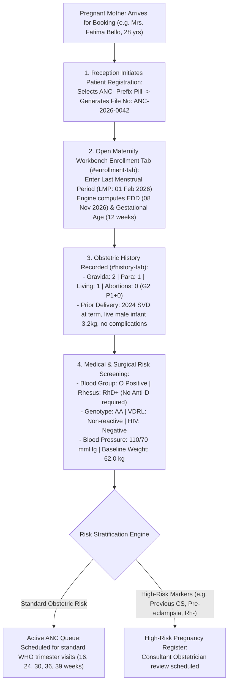

# Antenatal Enrollment, Booking & Obstetric History

ROLE GUARD: SUPERADMIN | ADMIN | super-admin | MATERNITY | NURSE | DOCTOR

The **Antenatal Enrollment & Obstetric History** subsystem establishes the foundation of maternal care. It manages initial obstetric booking, automated Expected Date of Delivery (EDD) calculations, parity categorization, previous pregnancy risk stratifications, baseline blood typing, and high-risk pregnancy triage.

---

## 1. Visual Tour: Antenatal Enrollment & Booking

> [!NOTE]
> The **Antenatal Enrollment Console** (`#enrollment-tab` or `/maternity-workbench/enroll`) captures initial booking parameters for pregnant mothers. It auto-computes gestational age and the Expected Date of Delivery (EDD) from the Last Menstrual Period (LMP), assigns the `ANC-` prefix, and prints official hospital ANC cards.

---

## 2. Stepped Antenatal Booking Lifecycle

---

## 3. Initial Booking & Automated Gestational Calculator

Accurate gestational estimation is crucial for identifying fetal growth restrictions, post-maturity, and scheduling interventions:

### 1. Clinical & Operational Objective
Formalize antenatal enrollment, calculate gestational milestones using Naegele's rule, and assign pregnant mothers to the monitored ANC roster.

### 2. Exact UI Location / Where to Click
- Load mother into Maternity Workbench workspace (`/maternity-workbench`).
- Click the **Enrollment** tab (`#enrollment-tab`).
- Click **`+ Enroll in Antenatal Care`** (`#btn-enroll-anc`).

### 3. Required Fields & Algorithmic Calculations
- **Antenatal Number (*Required)**: Auto-generated sequential code (e.g. `ANC-2026-0042`).
- **Booking Date (*Required)**: Today's date (`09 Nov 2026`).
- **Last Menstrual Period (LMP) (*Required)**: Enter verified date (e.g. `01 Feb 2026`).
  - **Automated EDD Calculation (Naegele's Rule)**:
    $$\text{EDD} = \text{LMP} + 7 \text{ Days} - 3 \text{ Months} + 1 \text{ Year} = \mathbf{08 \text{ Nov } 2026}$$
  - **Automated Gestational Age**: System calculates elapsed weeks from LMP to current date (e.g. `12 Weeks + 3 Days`).
  - **Ultrasound Adjusted EDD (*Optional)**: If an early dating scan (CRL measurement at 8–12 weeks) differs by $>7\text{ days}$, the sonographic EDD can be entered to override the menstrual date.
- **Booking Package / Scheme (*Required)**: Select `Standard Maternity Care Package` (or `HMO Obstetric Scheme`, `Private Consultant Amenity Package`).
- **Attending Midwife / Consultant (*Required)**: Select assigned clinical lead.

### 4. Downstream Handover
Click **`Complete Enrollment & Save`**. The mother's record is activated in `maternity_enrollments`. The system generates the official printed **Antenatal Care Card** (`/enrollment/{id}/print-anc-card`) and places the mother in the **Active ANC Queue**.

---

## 4. Mother's Obstetric & Medical History

In `#history-tab`, midwives record past obstetric performance and chronic medical conditions:

### 1. Clinical & Operational Objective
Identify historical risk factors (previous postpartum hemorrhage, recurrent miscarriages, previous uterine scars, pre-eclampsia) that dictate the current intrapartum plan.

### 2. The GPAL Obstetric Formula
CoreHealth v2 structures obstetric parity using standard notation:
- **`G` (Gravida)**: Total number of pregnancies including the current pregnancy (e.g. `G2`).
- **`P` (Para / Parity)**: Number of pregnancies delivered past the viable threshold of 28 weeks (e.g. `P1`).
- **`A` (Abortions / Miscarriages)**: Number of pregnancies lost prior to 28 weeks (e.g. `A0`).
- **`L` (Living Children)**: Number of currently surviving children (e.g. `L1`).
- **Formula Summary for Fatima Bello**: **`G2 P1+0, 1 Living Child`**.

### 3. Granular Previous Pregnancy Log
For each prior delivery, click **`+ Add Previous Pregnancy`**:
- **Delivery Year (*Required)**: e.g. `2024`.
- **Gestation at Delivery (*Required)**: e.g. `39 Weeks (Full Term)`.
- **Mode of Delivery (*Required)**: Select `Spontaneous Vaginal Delivery (SVD)`, `Assisted Vacuum`, `Elective CS`, or `Emergency CS`.
- **Baby Gender & Birth Weight (*Required)**: `Male &bull; 3.2 kg`.
- **Outcome (*Required)**: `Alive & Healthy`.
- **Complications**: `None reported; no perineal tear`.

### 4. Maternal Medical & Serological Baseline
- **Blood Group & Rhesus Typing**:
  - `O RhD Positive (O+)`: Normal care.
  - `RhD Negative (Rh-)`: Flagged immediately with high-priority yellow badge. Automated reminder scheduled for Anti-D Immunoglobulin at 28 weeks and within 72 hours post-delivery if baby is Rh positive.
- **Sickle Cell Genotype**: `AA` (Normal adult hemoglobin) / `AS` (Carrier) / `SS` (Sickle Cell Disease - flagged for high-risk obstetric-hematology joint clinic).
- **Infectious Screening**: HIV (Option B+ protocol if positive), Hepatitis B surface antigen (HBsAg), and VDRL/Syphilis serology.

---

## 5. Maternity Queues & Triage Tracking

On the left rail of `/maternity-workbench`, midwives navigate 5 operational queues:

### 1. Active ANC Queue (`142 Mothers Enrolled`)
- Master register of all pregnant women currently receiving antenatal care.
- Displays Gestational Age, EDD countdown, and assigned primary care team.

### 2. Due Visits Queue (`18 Visits Due This Week`)
- Identifies mothers due for scheduled trimester check-ups.
- Automated SMS appointment reminders are triggered directly from this view.

### 3. Upcoming EDD Queue (`6 Mothers Near Term`)
- Highlights mothers within 14 days of their expected delivery date ($\ge 38\text{ weeks}$).
- Prepares labor ward bed reservations and delivery packs.

### 4. High-Risk Pregnancy Register (`8 High-Risk Cases`)
- Filtered queue of mothers with identified risk factors (e.g. previous Caesarean scar, chronic hypertension, gestational diabetes, severe anemia $PCV < 28\%$, multiple gestations).
- Mandates Consultant Obstetrician review at every visit.

---

## Downstream Clinical Impact
- **Accurate Delivery Dating**: Eliminates gestational age confusion, ensuring post-term inductions of labor are triggered at exactly $41\text{ weeks} + 3\text{ days}$.
- **Zero Undetected Rhesus Incompatibilities**: Rhesus negative mothers receive automatic prompts for Anti-D prophylaxis, preventing hemolytic disease of the newborn.

---

## Developer Reference
👉 **[Read Maternity Developer Architecture](/developer/workbenches/maternity)**  
👉 **[Read Maternity API Contracts & Route Specifications](/developer/workbenches/maternity/api-contracts)**  
👉 **[Read Maternity Database Schema & Models Reference](/developer/workbenches/maternity/database-and-models)**

