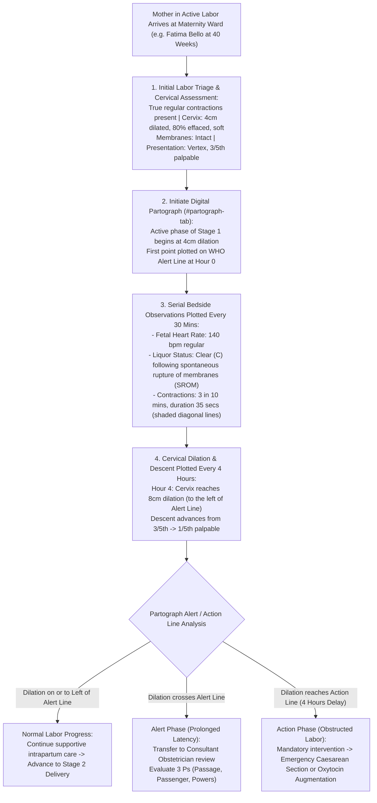

# Labor Ward Admission & The Real-Time Digital Partograph

ROLE GUARD: SUPERADMIN | ADMIN | super-admin | MATERNITY | NURSE | DOCTOR

The **Labor Ward Admission & Digital Partograph** subsystem provides computerized intrapartum monitoring during Stage 1 of labor. It tracks cervical dilation, fetal head descent, uterine contraction dynamics, fetal heart rate trajectories, and amniotic liquor quality against the international **World Health Organization (WHO) Alert and Action Lines**, preventing obstructed labor and intrapartum asphyxia.

---

## 1. Visual Tour: Real-Time Digital Partograph

> [!NOTE]
> The **Digital Partograph** (`#partograph-tab` or `/maternity-workbench/enrollment/{id}/maternity-partograph`) replaces manual paper partograph sheets. It dynamically plots cervical dilation ($4 – 10\text{ cm}$) against the **Alert Line** and **Action Line**, visualizes contraction frequency and duration with standardized shading, and records fetal heart rates and liquor status at 30-minute intervals.

---

## 2. Stepped Intrapartum Labor Monitoring Workflow

---

## 3. Labor Ward Admission & Stage 1 Triage

When a mother arrives presenting with labor symptoms:

### 1. Clinical & Operational Objective
Differentiate true labor from false labor (Braxton-Hicks contractions), assess cervical effacement and dilation, and formally admit the mother into the active Labor Ward suite.

### 2. Exact UI Location / Where to Click
- Load maternal file in Maternity Workbench.
- Click **`Admit to Labor Ward`** (`#btn-admit-to-ward`).

### 3. Admission Triage Parameters
- **Contraction Pattern**: Assess whether contractions are regular, increasing in frequency and painful intensity, and accompanied by show (cervical mucus plug).
- **Cervical Assessment (Digital Vaginal Examination - VE)**:
  - **Dilation**: Diameter of the external os in centimeters ($0 – 10\text{ cm}$).
  - **Effacement**: Percentage thinning of the cervix ($0\% – 100\%$).
  - **Consistency**: `Firm`, `Medium`, or `Soft`.
  - **Position**: `Posterior`, `Mid-position`, or `Anterior`.
- **Membranes & Liquor**:
  - `Intact (I)`: Membranes bulging during contractions.
  - `Ruptured (R)`: Document date and time of rupture.
- **Active Phase Threshold**: Active Stage 1 labor begins when regular painful contractions produce progressive cervical dilation to strictly **$\ge 4\text{ cm}$**.

---

## 4. The Digital Partograph Plotting Protocol

In `#partograph-tab`, click **`+ Add Partograph Entry`** (`#btn-add-partograph`):

### 1. Cervical Dilation & The Alert / Action Lines
- **Cervical Dilation ($4 – 10\text{ cm}$)**:
  - Plotted with a clean **`X`** marker.
  - **The WHO Alert Line**: Extends from $4\text{ cm}$ to $10\text{ cm}$ at a standard rate of $1\text{ cm/hour}$ over 6 hours.
  - **The WHO Action Line**: Drawn parallel to the Alert Line, placed exactly **4 hours to the right**.
  - **Clinical Rule**:
    - As long as cervical dilation plots on or to the **left of the Alert Line**, labor progress is physiological.
    - If cervical dilation plots to the **right of the Alert Line**, labor is prolonged.
    - If dilation touches or crosses the **Action Line**, labor is obstructed; the system locks conservative management and alerts the surgical team for emergency intervention.

### 2. Descent of the Fetal Head
- Plotted with a circle **`O`** marker on the same vertical grid.
- Measured in **fifths palpable above the pelvic brim**:
  - `5/5`: Completely above brim (floating).
  - `4/5` / `3/5`: Beginning engagement.
  - `2/5`: Presenting part engaged (biparietal diameter has passed the pelvic inlet).
  - `1/5` / `0/5`: Deeply engaged in the pelvic cavity, visible at the introitus.

### 3. Fetal Wellbeing Parameters (Every 30 Minutes)
- **Fetal Heart Rate (FHR)**:
  - Plotted as a connected continuous line graph.
  - Normal range: **$110 – 160\text{ bpm}$**.
  - Decelerations (early, late, or variable) trigger high-priority alerts.
- **Amniotic Fluid / Liquor Character**:
  - **`I`**: Membranes Intact.
  - **`C`**: Clear / Straw-colored liquor (normal).
  - **`M`**: Meconium-stained liquor (indicates fetal distress; alert pediatric resuscitation team).
  - **`B`**: Blood-stained liquor (rule out placental abruption).
  - **`A`**: Absent liquor.
- **Molding of Fetal Skull Bones**:
  - **`0`**: Bones separated, sutures easily felt.
  - **`+1`**: Bones touching each other.
  - **`+2`**: Bones overlapping but easily reducible by finger pressure.
  - **`+3`**: Severe overlapping, irreducible (indicates Cephalopelvic Disproportion CPD).

### 4. Uterine Contractions (Every 30 Minutes)
Plotted as the number of contractions occurring within a 10-minute window, shaded according to duration:
- **Mild Contraction ($< 20\text{ seconds}$)**: Visualized with dotted fill.
- **Moderate Contraction ($20 – 40\text{ seconds}$)**: Visualized with diagonal line hatching.
- **Strong Contraction ($> 40\text{ seconds}$)**: Visualized with solid dark shading.
- **Target Frequency**: $3 – 4\text{ strong contractions in 10 minutes}$ during the active phase.

### 5. Maternal Hemodynamics & Medications
- **Maternal Pulse**: Plotted every 30 minutes with a dot `•`.
- **Maternal Blood Pressure**: Plotted every 4 hours with arrows `↕`.
- **Temperature**: Plotted every 2 hours.
- **Oxytocin Infusion**: Documented as drops per minute ($mU/min$) when labor augmentation is prescribed.

---

## Downstream Clinical Impact
- **Elimination of Obstructed Labor**: Digital alerts immediately flag when progress lags behind the Alert Line, triggering surgical intervention hours before uterine rupture or obstetric fistula occurs.
- **Intrapartum Asphyxia Prevention**: Real-time fetal heart rate and meconium tracking ensure emergency Caesarean sections or vacuum deliveries are performed before irreversible hypoxic brain damage occurs.

---

## Developer Reference
👉 **[Read Maternity Developer Architecture](/developer/workbenches/maternity)**  
👉 **[Read Maternity API Contracts & Route Specifications](/developer/workbenches/maternity/api-contracts)**  
👉 **[Read Maternity Database Schema & Models Reference](/developer/workbenches/maternity/database-and-models)**

