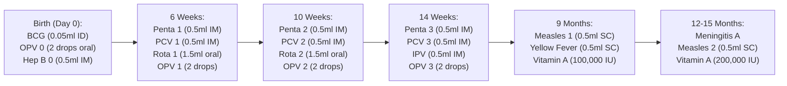

# Postnatal Care, Child Immunization & Discharge Clearance

ROLE GUARD: SUPERADMIN | ADMIN | super-admin | MATERNITY | NURSE | DOCTOR

This guide details postpartum maternal recovery monitoring, neonatal physical assessments, National Programme on Immunization (EPI) vaccine administration, and final discharge handover protocols including the "Road to Health" card generation and billing reconciliation.

---

## 1. Visual Tour: Postnatal Care (PNC) Monitoring

### Clinical Objective & Overview
Following delivery, mother and neonate transition to the Postnatal Ward. Maternal monitoring focuses on early identification of postpartum hemorrhage (lochia evaluation), puerperal sepsis (temperature and wound assessment), uterine subinvolution, and postpartum mood disorders. Neonatal evaluations verify thermal regulation, effective latching/breastfeeding, and absence of neonatal jaundice or umbilical cord sepsis.

### Exact UI Location / Where to Click
1. Open `/maternity-workbench` and select the enrolled mother (**Fatima Bello** — `ANC-2026-0042`).
2. Click the **Postnatal** tab (`#postnatal-tab`) in the workspace ribbon.
3. Click the pink button **+ New Visit** (`showPostnatalForm()`) to open `#postnatalModal`.

### Required vs Optional Fields, Types & Variations
The `#postnatalModal` enforces a dual maternal-neonatal checklist:

| Category | UI Field Label | Input Type | Required? | Clinical Options & Canonical Values |
| :--- | :--- | :--- | :--- | :--- |
| **Visit Metadata** | Visit Date | Date picker | **Yes** | Today's date (`2026-11-09`). |
| | Visit Type | Dropdown | **Yes** | `Inpatient (Day 1)` *(default)*, `Day 3-7 Follow-up`, `Week 6 Comprehensive PNC`. |
| **Maternal Vitals & Organ Assessment** | General Condition | Dropdown | Optional | `Good` *(canonical)*, `Fair`, `Poor`, `Critical`. |
| | Blood Pressure | Text input | Optional | Evaluates postpartum pre-eclampsia: `118/76 mmHg`. |
| | Temperature (°C) | Decimal input | Optional | Normal $36.5 – 37.2\text{ °C}$. $>38.0\text{ °C}$ alerts for puerperal sepsis. Recorded: `36.7 °C`. |
| | Lochia Character | Dropdown | Optional | `Rubra (red, normal Day 1-3)` *(canonical)*, `Serosa (pink/brown, Day 4-10)`, `Alba (white/yellow, Day 10-28)`, `Excessive/Foul-smelling` (PPH/sepsis alert). |
| | Uterine Involution | Text input | Optional | `Well-contracted at umbilicus` *(canonical)*, `Boggy` (atonic alert). |
| | Perineal Wound | Dropdown | Optional | `Intact / Healing well` *(canonical)*, `Swollen`, `Dehiscence`, `Infected`. |
| | Breast Assessment | Dropdown | Optional | `Soft / Colostrum flowing` *(canonical)*, `Engorged`, `Cracked nipples`, `Mastitis`. |
| | Emotional Wellbeing | Dropdown | Optional | `Normal` *(canonical)*, `Anxious`, `Depressed mood` (Edinburgh Postnatal Depression Scale trigger). |
| **Neonatal Evaluation** | Baby Weight (kg) | Decimal input | Optional | `3.38 kg` (physiological Day 1 weight loss $\le 7\%$). |
| | Feeding Pattern | Dropdown | Optional | `Exclusive Breastfeeding` *(canonical)*, `Formula`, `Mixed`. |
| | Cord Stump Status | Dropdown | Optional | `Clean & Dry (Chlorhexidine applied)` *(canonical)*, `Moist`, `Oozing`, `Infected`. |
| | Neonatal Jaundice | Toggle select | Optional | `No` *(canonical)* vs `Yes` (initiates bilirubin phototherapy workup). |
| **Handover & Counseling** | Family Planning | Toggle + Select | Optional | `Counselled: Yes`; Method chosen: `Lactational Amenorrhea Method (LAM)`. |
| | Next Appointment | Date picker | Optional | Scheduled for `6-Week Postnatal Checkup`. |

### Downstream Handover
Saving the visit logs the assessment permanently in the maternal timeline (`maternity_postnatal_visits`), updates ward nursing handover summaries, and confirms maternal fitness for discharge.

---

## 2. Visual Tour: Child Wellness & EPI Immunization

### Clinical Objective & Overview
Every infant born or managed in the maternity unit is enrolled in the National Programme on Immunization (EPI). The immunization module automates scheduling, tracks administered doses against inventory batch lots, and prints the patient's official immunization card.

### Exact UI Location / Where to Click
1. On the Maternity Workbench, click the **Immunization** tab (`#immunization-tab`).
2. Toggle between the **Mother** tab (Tetanus Toxoid TT1–TT5) and the **Baby** tab (**Baby Boy Bello** — `PANC-2026-0042`).
3. Click **+ Administer Vaccine** on any due row to open the administration modal (`#administerVaccineModal`).

### The National EPI Schedule Matrix

### Vaccine Administration Fields (`#administerVaccineModal`)
- **Vaccine Name & Dose**: Pre-selected based on schedule row (e.g. `BCG - Bacillus Calmette-Guérin`, `0.05 ml`).
- **Administration Route**: Pre-locked to clinical standard (`Intradermal`, `Oral`, `Intramuscular`, `Subcutaneous`).
- **Anatomical Site**: Dropdown (`Right Upper Arm`, `Left Thigh - Anterolateral`, `Right Thigh`, `Mouth`).
- **Batch / Lot Number**: Synced with Central Pharmacy/Store vaccine stock (`LOT-BCG-2026-05`).
- **Expiry Date**: Validated against real-time expiration tables.
- **Administered By**: Auto-stamped with authenticated staff session credentials.

---

## 3. Visual Tour: Maternity Billing & Discharge Protocol

### Clinical Objective & Overview
Before a mother and baby can safely exit the maternity unit, two parallel workflows must converge:
1. **Clinical Clearance**: Obstetric and pediatric sign-off ensuring maternal vitals are stable, lochia is normal, the infant is suckling vigorously, and birth vaccines are documented.
2. **Financial Reconciliation**: Consolidating delivery package fees, ward accommodation, pharmacy take-home medications (TTO), and procedural consumables.

### Exact UI Location / Where to Click
1. Click the **Billing** tab (`#billing-tab`) to verify that all charges have been settled or billed to the mother's HMO/NHIA provider.
2. In the patient top header ribbon, click the blue button **Road to Health** (`#btn-print-road-card`) to generate the official child health booklet.
3. In the patient top header ribbon, click the red button **Discharge** (`#btn-discharge-patient`), opening `#dischargeModal`.

### Discharge Modal Validation (`#dischargeModal`)

| Field Label | Control Identifier | Input Type | Required? | Validation Invariant |
| :--- | :--- | :--- | :--- | :--- |
| **Patient Identification** | `#discharge-patient-name` | Read-only | — | Displays `Fatima Bello (ANC-2026-0042)`. |
| **Discharge Warnings** | `#discharge-warnings-container` | Banner | — | Alerts if unsettled bills, pending lab results, or unadministered birth vaccines exist. |
| **Outcome Summary** | `#discharge-outcome-summary` | Textarea | **Yes** | Minimum 5 characters: `"Mother and baby discharged in satisfactory condition. Exclusive breastfeeding established. 6-week PNC visit scheduled."` |
| **Confirm Button** | `#btn-confirm-discharge` | Button | **Yes** | Disabled until required summary text is supplied. |

### Downstream Handover: The Patient Out Protocol
1. Submitting `#btn-confirm-discharge` transitions enrollment status to `discharged`.
2. The maternity bed status switches to `CLEANING`, releasing bed capacity for triage.
3. The cashier issues the final zero-balance clearance slip.
4. The midwife presents the mother with the stamped **Road to Health Card** and schedules her next appointment in the **6-Week Postnatal Clinic Queue**.

---

## 4. End-to-End Maternal Pathway Summary

| Stage | Clinical Milestone | Primary Artifact | Responsible Role |
| :--- | :--- | :--- | :--- |
| **Stage 1 (Booking)** | ANC Enrollment & History | `ANC-2026-0042` Profile | Antenatal Nurse |
| **Stage 2 (Trimester)** | ANC Visits & Prophylaxis | Fundal Height & FHR Graph | Obstetrician / Midwife |
| **Stage 3 (Intrapartum)** | Digital Partograph Monitoring | Cervical Dilation Curve | Labor Ward Midwife |
| **Stage 4 (Delivery)** | SVD & AMTSL Protocol | Delivery Record & APGAR 8/10 | Delivery Room Team |
| **Stage 5 (Neonatal)** | Baby Registration | `PANC-2026-0042` Profile | Neonatal Nurse |
| **Stage 6 (PNC)** | Postnatal Care & Recovery | Lochia & Uterine Sheet | Postnatal Midwife |
| **Stage 7 (Wellness)** | EPI Birth Dose Immunization | BCG / OPV0 / Hep B Lots | Immunization Officer |
| **Stage 8 (Patient Out)** | Billing & Health Card Handover | Road to Health Booklet | Billing Cashier & Ward In-Charge |

---

## Developer Reference
👉 **[Read Maternity Developer Architecture](/developer/workbenches/maternity)**  
👉 **[Read Maternity API Contracts & Route Specifications](/developer/workbenches/maternity/api-contracts)**  
👉 **[Read Maternity Database Schema & Models Reference](/developer/workbenches/maternity/database-and-models)**

