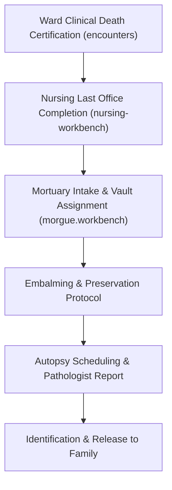

# Mortuary & Last Office Workbench

ROLE GUARD: SUPERADMIN | ADMIN | MORGUE

The **Mortuary Workbench** maintains solemn, audit-compliant governance of deceased patient records: clinical death certification verification, ward Last Office handoffs, vault compartment assignments, embalming logs, autopsy scheduling, and body releases to authorized relatives.

---

## 1. Visual Tour: Mortuary Vault Grid

> [!TIP]
> The Mortuary Workbench displays body preservation duration counters, cold-room compartment capacities, and release documentation checklists.

---

## 2. Real Routes & Role Authorization

- **Primary Route**: `morgue.workbench` (`/morgue-workbench`)
- **Authoritative Role Guard**: Defined in `sidebar/_nav-morgue.blade.php` as `@hasanyrole('SUPERADMIN|ADMIN|MORGUE')`.

---

## 3. Mortuary Governance Pathway

---

## 4. Cross-Module Data & Patient Flows

- **Nursing**: Wards perform Last Office protocol and hand over deceased records to Morgue attendants.
- **Reception**: Receptionists can trigger Brought-In-Dead (`showMorgueAdmissionModal()`) rapid admissions.
- **Billing**: Daily preservation charges and embalming fees post to mortuary accounts.

---

## Developer Reference
👉 **[Read the Mortuary Developer Reference](/developer/workbenches/mortuary)**
