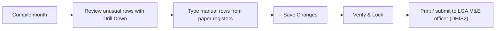

# NHMIS Monthly Summary Workbench

ROLE GUARD: SUPERADMIN | ADMIN | RECEPTIONIST (unit or department head only)

The **NHMIS Monthly Summary Workbench** fills the national *NHMIS Health Facility Monthly Summary Form (2019)* from what staff already record in CoreHealth: consultations, admissions, ANC and delivery records, immunizations, lab results and pharmacy dispensing. Every number can be opened to see the exact patients behind it.

> **Persona:** Mrs. Danjuma heads Health Records. On the first working day of each month she compiles last month's return, checks the figures that look unusual, types in the few items the EMR does not hold (RI sessions, birth registration), verifies and locks the form, then submits it to the LGA M&E officer.

---

## 1. Compile the month

**Where to click:** sidebar → **NHMIS Monthly Report**. Choose **Reporting Year** and **Reporting Period**, then press **1-Click Auto Compile**.

- Compiling counts every row from the records of that month. Re-compiling refreshes the counts but **keeps any number you typed in yourself**.
- A test is counted in the month the sample was taken, even if the result was typed in later.
- Medicines are counted only when **dispensed** by pharmacy. A prescription that was never dispensed does not count as "given".

### How each kind of row is counted

| Row type | Counted from |
|---|---|
| Attendance | One attendance per patient per day (consultations, ANC, postnatal and immunization visits). Outpatient attendance excludes days the patient was on admission. |
| Diagnoses (malaria, IMCI, NCDs, GBV, fistula, trachoma, snake bite) | The diagnosis list and the assessment ("Ass:", "Dx", "managed for…") in the consultation note. Custom diagnoses count the same as ICD-coded ones. Negated ("no fever") and queried ("? malaria", "r/o") mentions are not counted as diagnoses. |
| "New cases" (NCDs) | First time the condition appears for that patient in CoreHealth. Follow-up visits are not new cases. |
| Lab tests and positives | Tests on services linked in **Service Links** that have a result. |
| Deliveries, births, still births | Delivery and baby records in the maternity workbench. |
| Referrals out | External referrals and discharges recorded as transfers to another facility. Internal referrals between clinics are not referrals out. |

---

## 2. Read the numbers: computed, manual and unplaced

- **Computed cells** show the count from the EMR.
- **Manual cells** have a dashed amber border, the word *Enter*, and a **MANUAL** badge on the row label. The EMR has no record of these items, so CoreHealth leaves them blank rather than inventing a number. Hover over the badge to see why. Type the figure from the paper register.
- **Unplaced records:** a patient with no date of birth or sex recorded cannot go into an age/sex column. They are still counted in the row **Total**. Hover over the total to see how many, and correct those patient records in Reception to place them next month.

### Rows that always need manual entry

Care-seeking time and transport (34-35), newborn immediate care (51-54), newborn danger signs (57-58), KMC (61-62), AEFI investigations (89-90), RI operations and funds (91-97), birth registration (98-100), CMAM outcomes (109), FP referrals from other units (127), ADR referrals and NAFDAC reports (134, 185), TB symptom screening and TB referrals (161, 163), post-GBV care (173) and fistula follow-up (178-180).

Rows counted from pharmacy dispensing or lab tests are also manual while **nothing is linked** to them in **Service Links**. For example: LLIN, magnesium sulphate, rectal artesunate, anti-snake venom, implants or a malaria RDT. Link your own product or test (adding it to the catalogue first if needed) and the row starts counting at the next compile.

---

## 3. Check a number with Drill Down

**Where to click:** **Drill Down** beside any row, or double-click a cell.

- The list shows the exact records behind the number: patient, file number, HMO, sex, age, the **Source Record** (for example *Lab Request #4512* or *Delivery #388*) and the detail that made it count.
- **Total Records always equals the number on the form.**
- A yellow note explains manual cells and unplaced records.
- Use search, HMO and scheme filters to answer questions such as "how many of these were NHIS patients?".

---

## 4. Keep lab and pharmacy rows accurate with Service Links

**Where to click:** **Service Links** (top-right). Each facility names its tests and drugs differently, so you tell CoreHealth which of **your** items count for each national indicator. Only linked items are counted.

- **Lab / Imaging / Procedure:** link tests and theatre services (malaria microscopy, HBsAg, VDRL, caesarean section and so on). See [NHMIS Service Linking](/user-guides/workbenches/laboratory#_5-2-linking-hospital-services-to-nhmis-indicators) for step-by-step instructions.
- **Pharmacy:** link the products for each drug group: IPTp SP, LLIN, iron/folic acid, ACT, artesunate injection, ORS, zinc, amoxicillin, deworming, Vitamin A, contraceptives, MgSO4, anti-snake venom, hepatitis antivirals and others. The description under each group names the form rows it feeds. Only items actually **dispensed** count.

**Auto-Detect** suggests links by name for both tests and products; review the suggestions before compiling. Inactive products stay listed with their names, because their dispensing history still counts for past months.

---

## 5. Verify, lock and hand over

After **Verify & Lock**, the form cannot be recompiled or edited until it is unlocked. Use **Print** for the signed paper copy that goes to the LGA M&E officer for DHIS2 entry.

---

## Developer Reference
👉 **[Read the NHMIS Developer Reference](/developer/workbenches/nhmis)**
