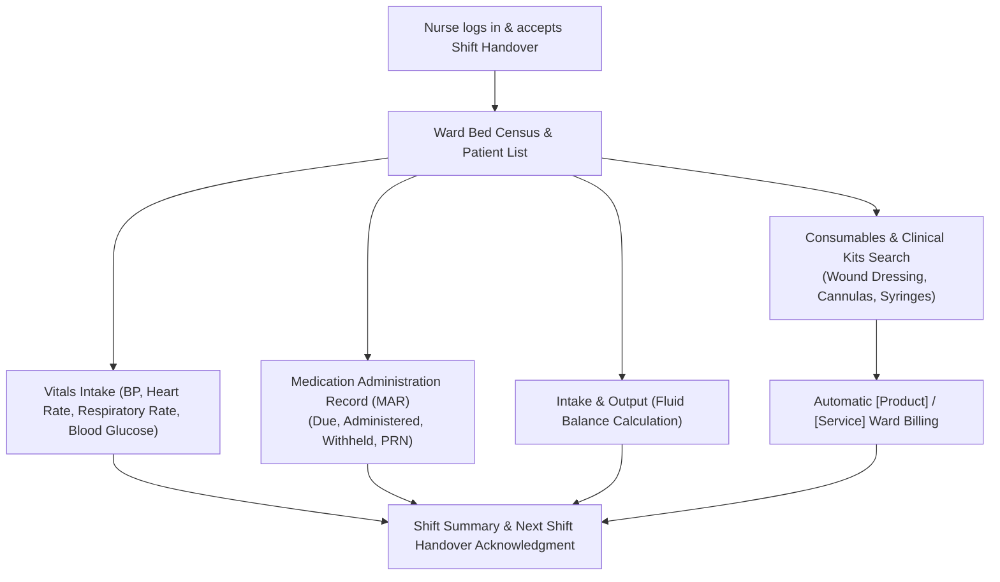

# Nursing & Inpatient Care Workbench (MAR)

ROLE GUARD: SUPERADMIN | ADMIN | NURSE

The **Nursing Workbench** orchestrates 24/7 bedside inpatient care, outpatient triage, Medication Administration Records (MAR), fluid balance tracking, nursing care plans, and clinical consumable billing.

---

## 1. Visual Tour: Nursing Cockpit & Ward Census

> [!TIP]
> The Nursing Workbench integrates ward bed management, triage scoring, and medication charts in a high-density viewport, eliminating scrolling between bed spaces.

---

## 2. Real Routes & Role Authorization

- **Primary Route**: `nursing-workbench.index` (`/nursing-workbench`)
- **Authoritative Role Guard**: Defined in `sidebar/_nav-nursing.blade.php` as `@hasanyrole('SUPERADMIN|ADMIN|NURSE')`.
- **Bed Census Route**: `beds.index` (`/beds`) for managing ward allocation.

---

## 3. Bedside Workflow & Care Delivery

### Key Capabilities:
1. **Intelligent Consumables & Kit Search (`ClinicalSearchHelper`)**:
   - Multi-token keyword search matching any word in item descriptions (e.g. typing `wound` finds `Private ward - wound dressing`).
   - Typo resilience (`canula` $\rightarrow$ `cannula`, `inj` $\rightarrow$ `injection`).
   - Dual badges (`[Product]` for inventory items and `[Service]` for nursing care procedures) with automated tab switching.
2. **Medication Administration Tracking**:
   - Timed administration slots with color-coded status badges (Scheduled, Due, Given, Omitted, Refused).
3. **Structured Shift Handover**:
   - Shift start/end reporting with multi-nurse digital sign-off.

---

## 4. Cross-Module Interconnections

- **Doctor**: Clinicians inspect real-time vital sign trends and fluid balance charts during morning rounds.
- **Store & Pharmacy**: Ward stock requisitions pull from Central or Pharmacy Hub stores via lane transfer policies (`inventory.store-workbench.index`).
- **Billing**: Nursing procedure charges and consumables automatically post to the patient's folio (`billing.workbench`).

---

## Developer Reference
👉 **[Read the Nursing & MAR Developer Reference](/developer/workbenches/nursing)**
