# Nursing & Inpatient Bedside Care Workbench (MAR)

ROLE GUARD: SUPERADMIN | ADMIN | super-admin | NURSE

The **Nursing Workbench** orchestrates 24/7 bedside clinical care across all inpatient wards (Male Medical, Female Surgical, Paediatrics, Maternity, and Intensive Care Units) as well as outpatient triage desks. It governs shift start/end handovers, queue triages, vital signs with automated Early Warning Scores (MEWS), the electronic Medication Administration Record (MAR), fluid intake & output (I/O) balance, nursing care plans, ward bed occupancy, consumable billing, and discharge handovers.

---

## 1. Visual Tour: Nursing Command Center & Shift Activation

> [!NOTE]
> The **Nursing Workbench Cockpit** (`/nursing-workbench`) requires an active, audited shift session. The Start Your Shift dialog enforces ward assignments (e.g. *All Wards (Floating)*, *Female Surgical Ward*), shift type (*Morning*, *Afternoon*, *Night*), and handover review before granting bedside access. Notice the live triage queue counters (209 Admitted Patients, 74 Bed Requests, 8 Medications Due, 2 Vitals, 67 Deceased records) and 7 quick-action shortcuts.

---

## 2. "Patient In to Patient Out": The Bedside Nursing Journey

```mermaid
flowchart TD
    A["1. Patient Arrival & Bed Allocation:<br/>Doctor issues Inpatient Admission or Reception books Walk-in<br/>Nurse checks Bed Requests Queue & assigns Ward Bed space"] --> B["2. Nursing Shift Handover & Activation:<br/>Incoming nurse starts shift, reviews pending tasks & accepts handover"]
    
    B --> C["3. Clinical Triage & Vital Signs Capture (/nursing-workbench/queue/vitals):<br/>BP, Pulse, Respiration, Temp, SpO2, BMI, Pain Score<br/>Engine calculates MEWS score with color-coded escalation alerts"]
    
    C --> D["4. Medication Administration Record MAR (medication-tab):<br/>Nurse reviews Doctor order sheet slots (Due, Scheduled, PRN)<br/>Administers drug from ward batch lot with 5-Rights verification"]
    
    D --> E["5. Fluid Balance & Intake / Output (intake-output-tab):<br/>Logs IV fluids, oral fluids & blood intake vs urine & surgical drains<br/>Computes 24-hr cumulative fluid balance"]
    
    E --> F["6. Nursing Care Plans & Daily SOAPIE Notes (notes-tab):<br/>Documents nursing diagnosis, interventions & patient response"]
    
    F --> G["7. Consumables & Procedure Billing (procedures-tab & billing-tab):<br/>Wound dressing kits, IV cannulas logged via multi-token search<br/>Billed to Patient Folio or Ward Overhead"]
    
    G --> H["8. Discharge Handover / Patient Out (discharge-requests-queue):<br/>Doctor issues discharge memo -> Nurse confirms TTO take-home drugs<br/>Reconciles nursing folio, releases bed & decontamination log"]
```

---

## 3. Dedicated Nursing Subpages

Every clinical dimension of the nursing journey is documented across 5 specialized subpages:

### 1. Shift Governance, Triage Queues & Handover Protocols
👉 **[Read Guide: Shift Governance & Triage](/user-guides/workbenches/nursing/shifts-and-triage)**
- **Shift Lifecycle**: Starting shifts, floating vs ward-specific duty assignments, overdue shift locks, handover notes, and digital sign-offs.
- **6-Queue Clinical Triage**: Admitted Patients, Vitals Triage, Bed Requests, Medication Due, Discharge Requests, and Deceased (Last Office).
- **Quick Action Tools**: Register Walk-in, Ward Dashboard, Quick Vitals, Medication Round, and Admissions Today.

### 2. Vital Signs, MEWS Scoring & Clinical Escalation
👉 **[Read Guide: Vital Signs & MEWS Scoring](/user-guides/workbenches/nursing/vitals-and-triage)**
- **Unified Vital Signs Entry**: Systolic/Diastolic BP, Heart Rate, Respiration Rate, Temperature, SpO2, Blood Glucose, BMI, and Pain Scales (0–10).
- **Modified Early Warning Score (MEWS)**: Real-time mathematical scoring algorithm and clinical risk tiering (Normal, Alert, Code Red).
- **Longitudinal Vitals Trends**: Graphical charting over time for doctor morning rounds and nursing handover review.

### 3. Medication Administration Record (MAR) & Injections
👉 **[Read Guide: Medication Administration Record (MAR)](/user-guides/workbenches/nursing/medication-and-injections)**
- **Electronic MAR Console**: 24-hour scheduled slots, stat orders, and PRN medications.
- **5-Rights Administration Workflow**: Right Patient, Right Drug, Right Dose, Right Route, Right Time with ward stock batch allocation.
- **Dose Status Transitions**: Given, Withheld (clinical contraindications / NPO), Refused, and Discontinued.
- **Injection Service**: Recording intramuscular and intravenous injections with adverse reaction reporting.

### 4. Fluid Balance (I/O), Notes & Nursing Care Plans
👉 **[Read Guide: Fluid Balance & Care Plans](/user-guides/workbenches/nursing/fluid-balance-and-care-plans)**
- **Fluid Balance (I/O) Chart**: Oral intake, IV infusions (Normal Saline, Dextrose), and blood products vs urine output, surgical drain fluid, and vomitus.
- **Cumulative 24-Hour Balance**: Detecting fluid overload in renal/cardiac patients or severe dehydration.
- **Nursing Care Plans**: Standardized NANDA nursing diagnoses, measurable goals, interventions, and evaluations.
- **SOAPIE & DART Nursing Notes**: Structured clinical documentation capturing shift progress.

### 5. Ward Occupancy, Consumables Billing & Discharge Clearance
👉 **[Read Guide: Occupancy, Consumables & Discharge](/user-guides/workbenches/nursing/occupancy-and-discharge)**
- **Ward Occupancy & Bed Census**: Live bed grid (occupied, vacant, reserved, isolation), bed assignments, and ward transfers.
- **Consumables Utilization**: Intelligent multi-token search for wound dressings, cannulas, and catheters with dual `[Product]` / `[Service]` billing.
- **Patient Out & Discharge Clearance**: Verifying take-home medications (TTOs), nursing folio clearance, and terminal bed decontamination.

---

## 4. Cross-Module Bedside Interconnections

- **Doctor Workbench**: Morning ward rounds inspect live MEWS trends, fluid balances, and nursing notes recorded through the workbench.
- **Store & Pharmacy Workbench**: Ward floor stocks are replenished via inter-store requisitions (`/inventory/requisitions`), while pharmacy prescriptions synchronize directly into the MAR.
- **Billing Workbench**: Nursing procedures and patient-utilized consumables automatically post to the cashier folio, unblocking final checkout.

---

## Developer Reference
👉 **[Read Nursing Architecture & Controller Reference](/developer/workbenches/nursing)**  
👉 **[Read Nursing API Contracts & Route Specifications](/developer/workbenches/nursing/api-contracts)**  
👉 **[Read Nursing Database Schema & Models Reference](/developer/workbenches/nursing/database-and-models)**
