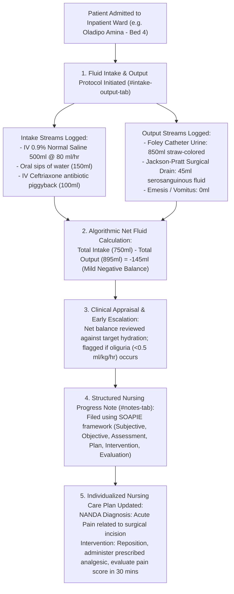

# Fluid Balance (I/O), Nursing Notes & Care Plans

ROLE GUARD: SUPERADMIN | ADMIN | super-admin | NURSE | DOCTOR

The **Fluid Balance & Nursing Care Planning** subsystem coordinates critical inpatient hydration tracking and structured clinical documentation. It maintains hourly and 24-hour **Intake & Output (I/O)** fluid balance charts, establishes evidence-based **Nursing Care Plans**, and enforces the **SOAPIE / DART** clinical progress framework.

---

## 1. Visual Tour: Fluid Balance & Nursing Notes

> [!NOTE]
> The **Intake & Output (I/O) Console** (`#intake-output-tab`) calculates real-time net fluid balance. Note the intake categories (Oral, IV Infusions, Blood Products) and output categories (Urine, Surgical Drain, Vomitus), alongside cumulative 24-hour shift totals.

---

## 2. Stepped Bedside Fluid & Documentation Architecture

---

## 3. Bedside Fluid Balance (Intake & Output) Charting

Maintaining fluid equilibrium is critical for post-surgical, cardiac, renal, and intensive care patients:

### 1. Clinical & Operational Objective
Quantify every milliliter of fluid entering and exiting the patient's body over a rolling 24-hour cycle, detecting third-space fluid sequestration, hypovolemic dehydration, or acute pulmonary fluid overload.

### 2. Exact UI Location / Where to Click
- Load patient workspace.
- Click the **I/O Chart** tab (`#intake-output-tab` or shortcut key `Alt + I`).
- Click **`+ Record Fluid Entry`** (`#btn-record-fluid`).

### 3. Intake vs Output Entry Fields
1. **Intake Streams**:
   - **Oral Fluids**: Water, oral rehydration solution (ORS), broth, tea (volume in $ml$, e.g. `200 ml`).
   - **Intravenous (IV) Infusions**: 0.9% Normal Saline, 5% Dextrose Saline, Ringers Lactate (volume infused in $ml$, e.g. `500 ml`).
   - **IV Medication Flushes & Diluents**: Antibiotic infusion piggybacks (e.g. `100 ml`).
   - **Blood Products**: Packed Red Blood Cells (PRBC), Fresh Frozen Plasma (FFP), Platelets (e.g. `250 ml`).
   - **Enteral Tube Feeds**: Nasogastric (NG) formula or PEG feeds (e.g. `300 ml`).
2. **Output Streams**:
   - **Urine Output (*Critical)**: Catheter drainage or urinal volume in $ml$ (e.g. `350 ml`).
     - Character: `Clear straw`, `Amber`, `Cloudy / Turbid`, `Hematuria (blood-stained)`.
     - Oliguria Warning: If urine output drops below $0.5\text{ ml/kg/hour}$ for two consecutive hours, the system triggers a **Renal Warning Badge**.
   - **Surgical Drains**: Jackson-Pratt, Redivac, Hemovac, or chest tube (e.g. `45 ml`).
     - Quality: `Serosanguinous`, `Purulent`, `Frank blood`, `Bile-stained`.
   - **Gastrointestinal**: Vomitus, nasogastric aspirate, or high-output stoma/stool (e.g. `100 ml`).
   - **Insensible Loss Estimation**: Automated standard estimation ($500\text{ ml/24 hrs}$ adjusted for fever spikes).

### 4. Algorithmic Net Balance Formula
$$\text{Net Fluid Balance} = \sum \text{Intake Volumes} - \sum \text{Output Volumes}$$
- **Positive Balance ($+$)**: Indicates fluid retention. Flagged if exceeding $+1,500\text{ ml}$ in non-resuscitated cardiac/renal patients.
- **Negative Balance ($-$)**: Indicates net fluid deficit. Expected during diuretic therapy, but flagged if accompanying hypotension.

---

## 4. Structured Nursing Notes (SOAPIE & DART Framework)

CoreHealth v2 rejects unstructured, vague nursing notes in favor of standardized clinical documentation:

### 1. The SOAPIE Clinical Documentation Model
In `#notes-tab`, nurses file shift progress entries using structured fields:
- **`S` (Subjective)**:
  - Direct patient quotations regarding symptoms, comfort, and pain:
  - *Example*: `Patient states: "My surgical wound feels slightly tight, but the sharp pain has settled after the afternoon injection."`
- **`O` (Objective)**:
  - Physical findings, vital signs, wound status, and drainage observations:
  - *Example*: `BP 122/78 mmHg, HR 74 bpm, Temp 36.7°C, SpO2 99%. Laparoscopic dressing clean and intact; no soakage. JP drain output 30ml serosanguinous fluid over 6 hours. Abdomen soft, non-distended; bowel sounds active.`
- **`A` (Assessment)**:
  - Nursing appraisal of patient status:
  - *Example*: `Post-operative Day 1 Laparoscopic Appendectomy. Hemodynamically stable; pain adequately managed (NRS 2/10); surgical wound healing without infection signs.`
- **`P` (Plan)**:
  - Immediate nursing goals:
  - *Example*: `Encourage gentle ambulation in room. Discontinue IV maintenance fluids if oral fluid tolerance continues. Administer 22:00 dose of IV Ceftriaxone.`
- **`I` (Intervention)**:
  - Concrete nursing care delivered:
  - *Example*: `Assisted patient to sit up and ambulate to bathroom. Offered 200ml oral water tolerated without nausea. Emptied and re-primed JP drain bulb.`
- **`E` (Evaluation)**:
  - Patient outcome following interventions:
  - *Example*: `Ambulated 15 paces without dizziness. Pain maintained at 2/10. Patient resting comfortably in bed.`

---

## 5. Standardized Nursing Care Plans

In addition to narrative progress notes, nurses initiate evidence-based Care Plans:

### 1. Clinical & Operational Objective
Establish individualized care trajectories with measurable nursing goals, scheduled bedside interventions, and evaluation intervals.

### 2. Formulating Care Plan for Oladipo Amina
1. **Nursing Diagnosis (NANDA)**: `Acute Pain related to surgical tissue trauma secondary to laparoscopic appendectomy as evidenced by verbal report (NRS 5/10) and guarding`.
2. **Measurable Goal**: `Patient will report pain reduction to score ≤ 3/10 within 45 minutes of analgesic administration and maintain comfortable mobility`.
3. **Nursing Interventions**:
   - Assess pain intensity using Numeric Rating Scale before and 30 minutes after analgesic administration.
   - Support surgical site with small pillow during coughing or position changes.
   - Administer prescribed analgesics (IV Paracetamol / Tramadol) on schedule.
   - Provide quiet, restful environment and dim lighting during rest periods.
4. **Outcome Evaluation**: Click **`Evaluate Goal`** (`#btn-evaluate-careplan`).
   - Outcome: `Goal Met. Patient pain reduced to 2/10. Patient ambulating comfortably`.

---

## Downstream Clinical Impact
- **Surgical Complication Prevention**: Monitoring JP drain output volume and color trends detects postoperative hemorrhage or intra-abdominal bile leaks immediately.
- **Consultant Rounding Efficiency**: Attending surgeons review the 24-hour I/O net balance and SOAPIE summary in under 30 seconds during morning rounds, accelerating clinical discharge decisions.

---

## Developer Reference
👉 **[Read Nursing Architecture & Controller Reference](/developer/workbenches/nursing)**  
👉 **[Read Nursing API Contracts & Route Specifications](/developer/workbenches/nursing/api-contracts)**  
👉 **[Read Nursing Database Schema & Models Reference](/developer/workbenches/nursing/database-and-models)**

