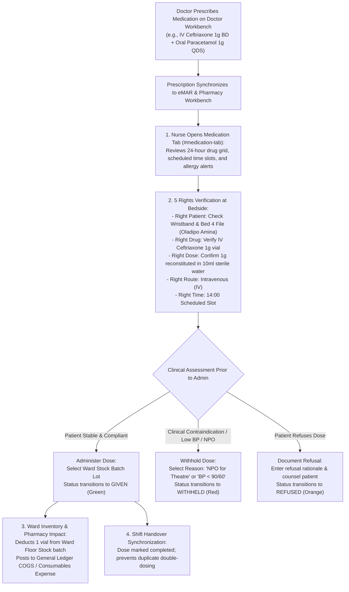

# Medication Administration Record (MAR) & Injections

ROLE GUARD: SUPERADMIN | ADMIN | super-admin | NURSE | PHARMACY | DOCTOR

The **Medication Administration Record (MAR) & Injections** subsystem governs the bedside delivery of physician-prescribed pharmaceuticals. It enforces the **"5 Rights of Medication Administration"**, provides interactive 24-hour administration time-slots, synchronizes with ward floor stock batches, tracks withheld/refused doses, and logs dedicated injection procedures.

---

## 1. Visual Tour: Enhanced Electronic MAR (eMAR)

> [!NOTE]
> The **Enhanced eMAR Console** (`#medication-tab`) organizes all active doctor prescriptions into structured 24-hour administration slots. Notice the color-coded dose badges (`Due Now` in yellow, `Administered` in green, `Withheld` in red, `Scheduled` in blue), prescriber attestation, and real-time ward stock batch availability.

---

## 2. Stepped Bedside Medication Administration Lifecycle

---

## 3. The 5 Rights of Medication Administration Workflow

Patient safety protocols mandate rigorous verification before breaking medication ampoules:

### 1. Clinical & Operational Objective
Eliminate medication administration errors, verify patient identity, confirm drug dosage against active renal/hepatic status, validate route, and record the exact second of administration.

### 2. Exact UI Location / Where to Click
- Load inpatient file (e.g. *Oladipo Amina - Bed 4*).
- Click the **Medication Chart** tab (`#medication-tab`).
- Click on the active due slot button (e.g. `14:00 Due`).

### 3. Bedside Verification Protocol
1. **Right Patient**: The eMAR modal displays the patient photo, hospital file number (`14-32-97`), and verified drug allergies (e.g. *Penicillin allergy flag*).
2. **Right Drug**: Verify that the physical ampoule label matches the electronic order (`Ceftriaxone Sodium Injection 1g`).
3. **Right Dose**: Confirm prescribed dose against reconstitution volume.
4. **Right Route**: Confirm route (`Intravenous Injection` vs `Intramuscular` vs `Oral`).
5. **Right Time**: Check that the dose is within the $\pm 30$-minute clinical administration window.

---

## 4. Dose Status Transitions & Non-Administration Capture

The administration modal (`#administer-medication-modal`) captures four distinct clinical outcomes:

### 1. Status: `GIVEN` (Administered)
- Nurse checks **`Administer`**.
- **Ward Stock Batch Selection (*Required)**: Select the physical batch lot pulled from the ward drug cabinet (e.g. `LOT-CEF-2026-09 &bull; Exp: 31 Dec 2028`).
- **Administration Notes**: e.g. `Administered via IV cannula right forearm slowly over 3 minutes. Flushed with 5ml 0.9% Normal Saline. No adverse reaction observed`.
- **Sign-off**: Digital signature stamped with authenticated nurse's name and active shift.

### 2. Status: `WITHHELD` (Omitted on Clinical Grounds)
- If clinical parameters contraindicate administration (e.g. patient is ordered *Nil-Per-Os (NPO)* for theatre, or systolic BP dips below 90 mmHg before anti-hypertensives):
  - Nurse clicks **`Withhold Dose`**.
  - **Reason (*Required)**: Select `Preoperative NPO Status`, `Hypotension (Systolic BP < 90)`, `Bradycardia (Pulse < 50)`, `Patient Vomiting`, or `Scheduled Lab Test Pending`.
  - **Notification**: The attending doctor receives an automated notification in the Doctor Workbench.

### 3. Status: `REFUSED` (Patient Autonomy)
- If a conscious patient declines a medication:
  - Nurse selects **`Refused by Patient`**.
  - **Reason (*Required)**: Document patient-reported reason (e.g. `Patient states oral paracetamol causes mild nausea; requested IV alternative`).
  - **Action**: Nurse counsels patient, offers anti-emetic, and reports to the duty resident doctor.

### 4. Status: `DISCONTINUED`
- Prescribing physicians can flag a medication as discontinued, immediately striking the row with a red banner and locking future administration slots.

---

## 5. Injection Administration Service

For outpatients or ward patients receiving dedicated intramuscular or subcutaneous injections (e.g. Tetanus Toxoid, Deep IM Diclofenac, Subcutaneous Enoxaparin/Clexane):

### 1. Clinical & Operational Objective
Record localized parenteral injections, document anatomical injection sites to prevent tissue necrosis, and monitor for immediate adverse reactions.

### 2. Exact UI Location / Where to Click
- In the workspace tabs, click **Injections** (`#injection-tab`).
- Click **`+ Administer Injection`** (`#btn-administer-injection`).

### 3. Anatomical Site Selection & Verification
- **Injectable Product (*Required)**: Multi-token catalog search (e.g. `Diclofenac Sodium 75mg/3ml Ampoule`).
- **Anatomical Injection Site (*Required)**:
  - `Left Deltoid` / `Right Deltoid`
  - `Left Ventrogluteal` / `Right Ventrogluteal`
  - `Left Dorsogluteal` / `Right Dorsogluteal`
  - `Left Vastus Lateralis` / `Right Vastus Lateralis` (Anterolateral thigh - preferred for infants)
  - `Abdominal Subcutaneous Tissue` (for low-molecular-weight heparin)
- **Needle Gauge & Syringe Size**: e.g. `21G Needle &bull; 5ml Syringe`.
- **Post-Injection Observation**: Mandatory 15-minute observation period tracking injection site erythema, induration, or signs of anaphylaxis.

---

## Downstream Clinical & Inventory Impact
- **Elimination of Double-Dosing**: Once a 14:00 slot is marked `GIVEN`, the slot turns solid green with the administering nurse's name, preventing incoming nurses from re-administering the same dose.
- **Automated Ward Stock Decrement**: Administering a drug batch decrements the ward floor stock on the Store Workbench in real time (`/inventory/requisitions/my-stock`).
- **Medicolegal Protection**: Every dose is time-stamped, providing an unalterable forensic record for hospital accreditation and clinical audits.

---

## Developer Reference
👉 **[Read Nursing Architecture & Controller Reference](/developer/workbenches/nursing)**  
👉 **[Read Nursing API Contracts & Route Specifications](/developer/workbenches/nursing/api-contracts)**  
👉 **[Read Nursing Database Schema & Models Reference](/developer/workbenches/nursing/database-and-models)**

