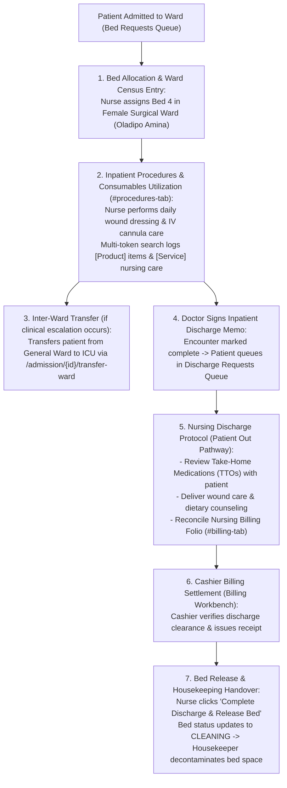

# Ward Occupancy, Consumables Billing & Discharge Clearance

ROLE GUARD: SUPERADMIN | ADMIN | super-admin | NURSE | BILLER | DOCTOR

The **Ward Occupancy, Bed Census & Discharge Clearance** subsystem governs physical bed turnover, ward transfers, consumable billing, and the formal **"Patient Out"** discharge pathway that releases inpatients, settles nursing folios, and decontaminates bed spaces.

---

## 1. Visual Tour: Ward Dashboard & Bed Census

> [!NOTE]
> The **Ward Occupancy Dashboard** provides a high-density, real-time matrix of all hospital wards (*Female Surgical*, *Male Medical*, *ICU*, *Paediatrics*). Note the live bed tiles showing occupancy status (`OCCUPIED` in blue with patient name and length of stay, `VACANT` in green, `RESERVED` in yellow, `CLEANING` in orange), ward occupancy rates, and single-click bed transfer actions.

---

## 2. Stepped Inpatient Stay & Discharge Flow

---

## 3. Ward Occupancy, Bed Census & Ward Transfers

Efficient hospital bed management prevents emergency department holding bottlenecks:

### 1. Clinical & Operational Objective
Track physical bed space utilization in real time, assign admitted patients to verified vacant beds, and coordinate audited inter-ward transfers.

### 2. Exact UI Location / Where to Click
- Click the **Ward Dashboard** button on the quick action rail (`#btn-ward-dashboard` or route `/nursing-workbench/wards`).
- Filter by ward (e.g. `Female Surgical Ward` or `All Wards`).

### 3. Ward Bed States
- **`OCCUPIED` (Blue Tile)**: Displays occupant name, hospital file number (`14-32-97`), admission date, and current Length of Stay (ALOS e.g. `Day 2`).
- **`VACANT / AVAILABLE` (Green Tile)**: Clean, disinfected bed ready for immediate patient intake.
- **`RESERVED` (Yellow Tile)**: Held for a patient undergoing surgery in Operating Theatre.
- **`CLEANING / DIRTY` (Orange Tile)**: Released by discharged patient; awaiting housekeeping terminal cleaning.
- **`ISOLATION / MAINTENANCE` (Red Tile)**: Out of service or reserved for infectious contact precautions.

### 4. Executing an Inter-Ward Transfer
When a patient requires clinical step-up (e.g. transfer to ICU) or step-down to general ward:
1. Load patient workspace and click **`Transfer Ward`** (`#btn-transfer-ward`).
2. **Current Ward**: `Female Surgical Ward &bull; Bed 4`.
3. **Destination Ward (*Required)**: Select `Intensive Care Unit (ICU)` or `Private Amenity Ward`.
4. **Target Bed (*Required)**: Select verified vacant bed space (e.g. `ICU Bed 2`).
5. **Clinical Transfer Reason (*Required)**: Document medical rationale (e.g. `Postoperative respiratory monitoring requiring arterial line management`).
6. Click **`Confirm Ward Transfer`**. The transfer executes immediately:
   - *Female Surgical Ward Bed 4* releases to `CLEANING`.
   - *ICU Bed 2* activates as `OCCUPIED`.
   - The clinical chart, MAR, and fluid balance records transfer seamlessly.

---

## 4. Nursing Procedures & Consumables Utilization

During daily bedside care, nurses administer clinical procedures and consume ward floor supplies:

### 1. Clinical & Operational Objective
Document performed nursing procedures, record consumed materials using intelligent search, and separate inventory stock reductions (`[Product]`) from billable clinical care (`[Service]`).

### 2. Exact UI Location / Where to Click
- Click the **Procedures** tab (`#procedures-tab`) or **Clinical Requests** tab (`#clinical-requests-tab`).
- In the item search bar, enter keywords using `ClinicalSearchHelper`.

### 3. Intelligent Multi-Token Search & Dual Badge Invariant
- **Typo-Resilient Multi-Token Resolution**: Typing `wound dress` instantly matches `Private ward - wound dressing kit`.
- **Dual Badge Visual Separation**:
  - **`[Product]` Badge (Green)**: Represents physical inventory items drawn from Ward Floor Stock (e.g. `Vicryl Suture Pack`, `IV Cannula 18G`, `Adhesive Dressing 10x10cm`). Consuming increments the patient's materials bill and decrements ward inventory.
  - **`[Service]` Badge (Blue)**: Represents clinical nursing care labor (e.g. `Surgical Wound Dressing Procedure`, `Urinary Catheterization Fee`, `IV Cannulation Service Fee`). Generates professional revenue without inventory decrement.

---

## 5. Patient Out: The Inpatient Discharge Clearance Protocol

When the attending surgeon certifies that the patient is clinically fit to return home:

### 1. Clinical & Operational Objective
Coordinate patient departure, counsel on take-home medications, reconcile all bedside consumables and procedures, ensure financial clearance, and release the physical bed space for new admissions.

### 2. Step-by-Step Discharge Protocol
1. **Discharge Memo Verification**:
   - The attending surgeon files the electronic discharge summary on the Doctor Workbench.
   - The patient automatically queues in the nurse's **Discharge Requests Queue** (`/nursing-workbench/queue/discharge-requests`).
2. **Take-Home Medications (TTOs) & Patient Education**:
   - Nurse inspects prescribed discharge medications (*Oral Antibiotics*, *Analgesics*).
   - Educates patient and family regarding dose schedules, red-flag symptoms (fever $>38^\circ\text{C}$, surgical wound redness, severe abdominal pain), and clinic follow-up date (7 days at Surgical Outpatient Clinic).
3. **Nursing Billing Reconciliation (`#billing-tab`)**:
   - Nurse reviews all billed items logged during the inpatient stay (bed stay charges, daily wound dressings, cannulation kits).
   - Verifies that all administered consumables are accounted for.
4. **Billing Workbench Financial Clearance**:
   - Cashier at Billing Workbench verifies that the HMO claim or cash co-payment has been completed and stamps the discharge slip electronically.
5. **Bed Decontamination & Release**:
   - Nurse clicks **`Complete Discharge & Release Bed`** (`#btn-complete-discharge`).
   - The patient file status updates to `DISCHARGED`.
   - The bed status transitions from `OCCUPIED` to `CLEANING`.
   - An automated task notification alerts Housekeeping to perform terminal disinfection.

---

## Downstream Operational Impact
- **Zero Bed Holding Bottlenecks**: Immediate bed release upon discharge minimizes waiting times in the Emergency Room and Recovery Room.
- **Accurate Billing Audit Trail**: Dual `[Product]` / `[Service]` classification guarantees that every used dressing kit and procedure fee is captured on the final hospital statement with zero revenue leakage.

---

## Developer Reference
👉 **[Read Nursing Architecture & Controller Reference](/developer/workbenches/nursing)**  
👉 **[Read Nursing API Contracts & Route Specifications](/developer/workbenches/nursing/api-contracts)**  
👉 **[Read Nursing Database Schema & Models Reference](/developer/workbenches/nursing/database-and-models)**

