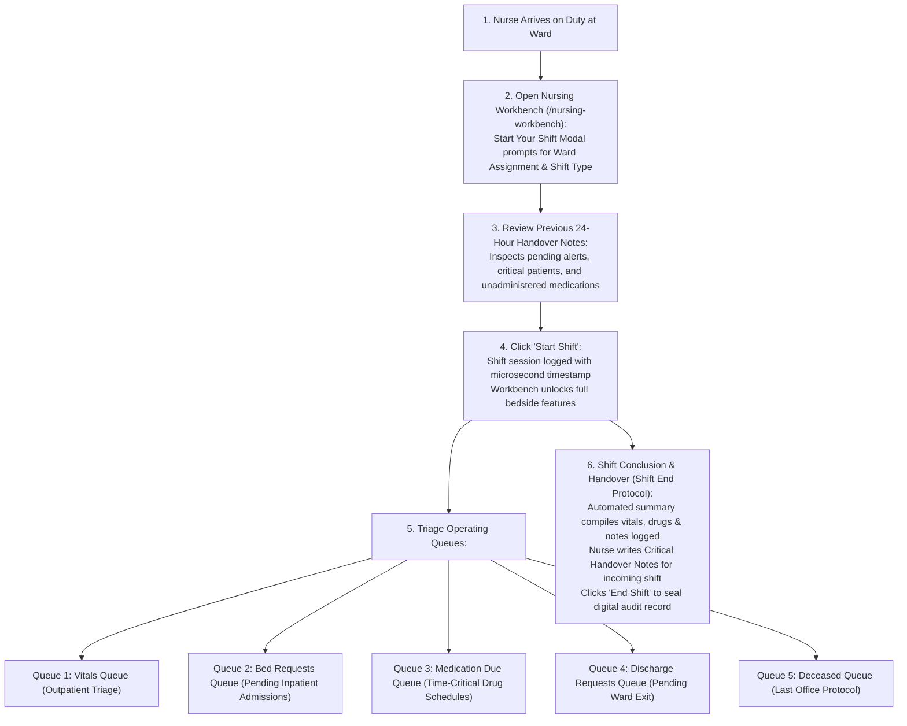

# Shift Governance, Triage Queues & Handover Protocols

<span class="badge-role">ROLE GUARD: SUPERADMIN | ADMIN | super-admin | NURSE</span>

The **Shift Governance & Triage** subsystem safeguards inpatient care continuity across rotational nursing shifts. It enforces authenticated shift start/end handovers, prevents undocumented duty rollovers, and triages patients across 6 specialized operational queues.

---

## 1. Visual Tour: Nursing Shift Activation & Cockpit


> [!NOTE]
> The **Nursing Workbench Cockpit** requires an active shift session before unlocking clinical actions. Note the **Start Your Shift** dialog featuring ward assignments (*All Wards (Floating)*, *Female Surgical Ward*), shift types (*Morning*, *Afternoon*, *Night*), and the handover review alert. The left rail houses 6 clinical queues (209 Admitted Patients, 74 Bed Requests, 8 Medication Due) and quick-action shortcuts.

---

## 2. Stepped Shift Handover & Triage Flow



---

## 3. Shift Initiation & Ward Duty Assignment

Clinical care requires audited accountability for every nurse on the floor:

### 1. Clinical & Operational Objective
Establish an active duty session, assign the nurse to a specific ward or floating role, and mandate review of handover notes left by the preceding shift.

### 2. Exact UI Location / Where to Click
- Navigate to **Nursing Workbench** (`/nursing-workbench`).
- If no active shift exists, the **Start Your Shift** modal automatically displays in the viewport.

### 3. Required Fields & Configuration
- **Ward Assignment (*Required)**:
  - `All Wards (Floating)`: For nursing supervisors or night float nurses covering multiple units.
  - `Female Surgical Ward (FSW)`: Dedicated bedside nurse for post-op patients (e.g. *Oladipo Amina*).
  - `Male Medical Ward (MMW)`: Medical inpatients.
  - `Intensive Care Unit (ICU)`: High-dependency 1:1 nursing.
  - `Paediatric Ward (PAED)`: Infant and child inpatient care.
- **Shift Type (*Required)**:
  - `Morning Shift (7:00 AM – 3:00 PM)`
  - `Afternoon Shift (2:00 PM – 10:00 PM)`
  - `Night Shift (9:00 PM – 8:00 AM)`
- **Check for Handovers Button**: Clicking **`Check for Handovers`** (`#btn-check-handovers`) displays outstanding handover memos from the previous 24 hours.

### 4. Downstream Handover
Click the green **`Start Shift`** button (`#confirm-start-shift-btn`). The system records the shift start in `nursing_shifts`, enables all bedside action tabs, and activates the floating shift timer in the bottom right corner of the screen.

---

## 4. Shift Overdue Protection & Concluding Handover

CoreHealth v2 enforces strict patient safety rules preventing fatigued nurses from documenting on expired sessions:

### 1. Clinical & Operational Objective
Automatically lock the workbench when a shift exceeds standard duration (e.g. 12 hours) and compel the outgoing nurse to document critical patient handovers before departure.

### 2. Shift Overdue Dialog Workflow
1. **Automated Lock**: When a shift exceeds 12 hours, a high-priority red alert overlay (**End Overdue Shift - Required**) freezes non-handover operations.
2. **Auto-Generated Activity Summary**: The system aggregates all actions completed during the shift (Total Vitals Captured, Medications Administered, Nursing Notes Filed, Total Patients Attended).
3. **Critical Handover Notes (*Required)**:
   - Outgoing nurse enters vital handoff instructions:
     ```
     Bed 4 (Oladipo Amina - Post-op Appendectomy):
     - IV Ceftriaxone 1g due at 22:00.
     - Monitor Jackson-Pratt drain output every 4 hours.
     - Pain score 3/10; report if MEWS exceeds 3.
     ```
4. **Concluding Notes (*Optional)**: General ward observations (e.g. `Oxygen cylinder pressure verified; backup suction unit operational`).
5. **Sealing the Shift**: Clicking **`End Overdue Shift`** (`#confirm-end-shift-btn`) closes the session and routes the handover memo to incoming nurses.

---

## 5. Comprehensive Queue Triage


In `/nursing-workbench/queue-view`, nurses monitor 6 dedicated clinical queues:

### 1. Admitted Patients Queue (`209 Active Inpatients`)
- Displays all currently admitted patients across hospital wards.
- Columns: Bed Number, Patient Name, Age/Gender, Admission Date, Primary Diagnosis, Attending Consultant, and Active Flags (NPO, Fall Risk, Allergy).
- Clicking any row instantly loads the patient into the bedside workspace.

### 2. Vitals Triage Queue (`2 Patients Waiting`)
- Outpatient intake queue for walk-in and scheduled clinic patients.
- Patients awaiting triage vital signs before entering consultation rooms.

### 3. Bed Requests Queue (`74 Pending Requests`)
- Inpatients ordered for admission by Doctor or Emergency Room but awaiting physical ward bed assignment.
- Nurses review bed availability, contact ward housekeepers, and allocate beds.

### 4. Medication Due Queue (`8 Doses Due`)
- Real-time time-critical queue alerting nurses to scheduled doses due within the current hour or overdue.
- Color-coded: Orange for Due Now, Red for Overdue ($>30\text{ mins}$).

### 5. Discharge Requests Queue (`1 Awaiting Clearance`)
- Patients certified by doctor for discharge, awaiting nursing take-home drug (TTO) counseling and folio reconciliation.

### 6. Deceased Queue & Last Office (`67 Records`)
- Terminal clinical queue for certified deceased patients.
- Enforces the **Last Office Protocol**: Tagging body with dual clinical identifiers, inventorying personal effects, and transferring custody to the Mortuary Workbench (`morgue.workbench`).

---

## 6. Quick Action Shortcuts

Located on the left command rail, quick actions provide rapid single-click workflows:
- **`+ Register Walk-In`**: Fast-track intake for emergency outpatient triage.
- **`Ward Dashboard`**: High-density graphical view of ward bed occupancy and census.
- **`Quick Vitals`**: Open floating vital signs capture dialog without changing patient context.
- **`Medication Round`**: Launch batch medication administration mode across all ward beds.
- **`Shift Handover`**: Access previous shift memos and duty notes.
- **`Nursing Reports`**: Export shift activity audits, incident logs, and nurse productivity summaries.

---

## Downstream Clinical Impact
- **Zero Omission at Shift Change**: Electronic handover memos guarantee that pending IV antibiotic doses or critical drainage monitoring orders are never lost during nurse shift rotations.
- **Accurate Nurse Auditing**: Every clinical observation, injection, and vitals reading is stamped with the authenticated nurse's active shift session.

---

## Developer Reference
👉 **[Read Nursing Architecture & Controller Reference](/developer/workbenches/nursing)**  
👉 **[Read Nursing API Contracts & Route Specifications](/developer/workbenches/nursing/api-contracts)**  
👉 **[Read Nursing Database Schema & Models Reference](/developer/workbenches/nursing/database-and-models)**

