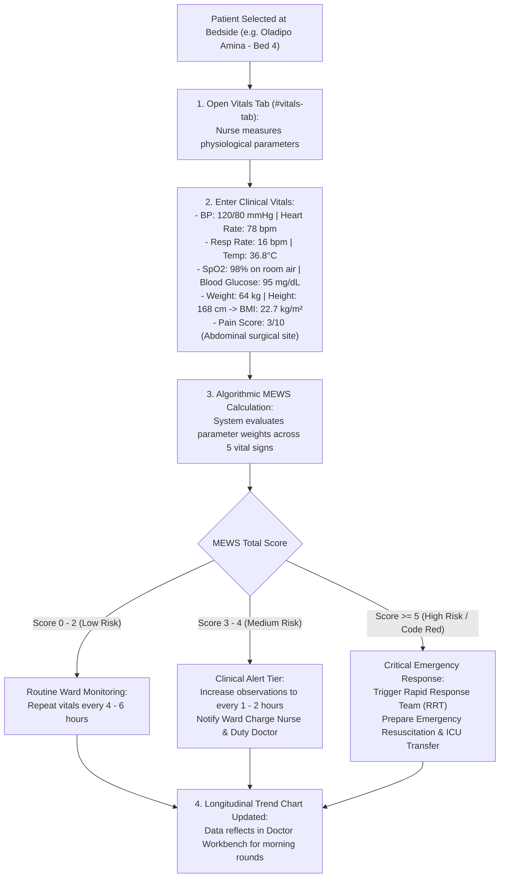

# Vital Signs, MEWS Scoring & Clinical Triage

ROLE GUARD: SUPERADMIN | ADMIN | super-admin | NURSE | DOCTOR

The **Vital Signs & Clinical Triage** subsystem provides bedside physiological monitoring, automated early warning calculations via the **Modified Early Warning Score (MEWS)**, and clinical deterioration alerts across outpatient triage and inpatient ward beds.

---

## 1. Visual Tour: Unified Vital Signs Capture

> [!NOTE]
> The **Unified Vitals Console** (`#vitals-tab` or `/nursing-workbench/patient/{id}/vitals`) provides standardized physiological entry fields. It auto-computes Body Mass Index (BMI) and the Modified Early Warning Score (MEWS) with visual risk color-coding, while rendering longitudinal vital sign trend charts.

---

## 2. Stepped Vital Signs & MEWS Escalation Workflow

---

## 3. Unified Vital Signs Parameter Matrix

Accurate clinical decision-making relies on structured physiological entry:

### 1. Clinical & Operational Objective
Capture baseline and continuous bedside physiological parameters, detect clinical instability early, and feed longitudinal trend graphs without manual paper charting.

### 2. Exact UI Location / Where to Click
- Load patient into Nursing Workbench workspace.
- Click the **Vitals** tab (`#vitals-tab` or shortcut key `Alt + V`).

### 3. Required vs Optional Fields, Types & Variations
- **Blood Pressure (*Required)**:
  - Systolic BP: Integer (mmHg, e.g. `120`).
  - Diastolic BP: Integer (mmHg, e.g. `80`).
- **Heart / Pulse Rate (*Required)**: Integer (beats per minute, e.g. `78 bpm`).
- **Respiratory Rate (*Required)**: Integer (breaths per minute, e.g. `16 bpm`).
- **Body Temperature (*Required)**: Decimal (°C, e.g. `36.8°C`).
- **Oxygen Saturation ($SpO_2$) (*Required)**: Percentage on room air or oxygen support (e.g. `98%`).
- **Oxygen Delivery Method**: Select `Room Air`, `Nasal Cannula (2L/min)`, `Simple Face Mask`, or `Non-Rebreather Mask`.
- **Random / Fasting Blood Sugar (*Optional)**: $mg/dL$ or $mmol/L$ (e.g. `95 mg/dL`).
- **Anthropometric Measurements (*Optional / On Admission)**:
  - Weight ($kg$): e.g. `64.0 kg`.
  - Height ($cm$): e.g. `168 cm`.
  - **Auto-Calculated BMI**: The engine computes:
    $$\text{BMI} = \frac{\text{Weight (kg)}}{\left(\frac{\text{Height (cm)}}{100}\right)^2} = \frac{64}{1.68^2} = \mathbf{22.68 \text{ kg/m}^2 \quad (\text{Normal Range})}$$
- **Pain Score (*Required for post-op patients)**:
  - Visual Analogue / Numeric Rating Scale (`0` = No Pain to `10` = Worst Imaginable Pain).
  - Location: e.g. `Right lower quadrant surgical incision`.
  - Character: `Dull ache`, `Sharp`, `Throbbing`, `Burning`.
- **Neurological AVPU Scale (*Required for MEWS)**:
  - `Alert`, `Voice Responsive`, `Pain Responsive`, `Unresponsive`.

### 4. Downstream Handover
Click **`Save Vitals`** (`#btn-save-vitals`). The readings are saved with the nurse's timestamp, update the patient header banner, and instantly calculate the MEWS score.

---

## 4. Modified Early Warning Score (MEWS) Engine

CoreHealth v2 incorporates the international **Modified Early Warning Score (MEWS)** protocol to detect physiological deterioration hours before cardiac arrest or septic shock:

### 1. The MEWS Scoring Matrix
Each vital sign is weighted with a score between 0 and 3 based on deviation from normal physiological ranges:

| Physiological Parameter | 3 Points | 2 Points | 1 Point | 0 Points (Normal) | 1 Point | 2 Points | 3 Points |
| :--- | :---: | :---: | :---: | :---: | :---: | :---: | :---: |
| **Systolic BP (mmHg)** | $\le 70$ | $71 – 80$ | $81 – 100$ | **$101 – 199$** | — | $\ge 200$ | — |
| **Heart Rate (bpm)** | — | $\le 40$ | $41 – 50$ | **$51 – 100$** | $101 – 110$ | $111 – 129$ | $\ge 130$ |
| **Respiratory Rate (/min)** | — | $\le 8$ | — | **$9 – 14$** | $15 – 20$ | $21 – 29$ | $\ge 30$ |
| **Temperature (°C)** | — | $\le 35.0$ | — | **$35.1 – 38.4$** | — | $\ge 38.5$ | — |
| **AVPU Score** | — | — | — | **Alert (A)** | Voice (V) | Pain (P) | Unresponsive (U) |

### 2. Clinical Risk Escalation Protocols
Upon saving vitals, the system sums the points and triggers appropriate clinical alerts:
- **Score 0 – 2 (Low Risk - Green Badge)**:
  - Patient is physiologically stable.
  - Action: Continue routine ward observation schedule (every 4–6 hours).
- **Score 3 – 4 (Medium Risk - Yellow Warning Badge)**:
  - Potential clinical deterioration.
  - Action: Increase monitoring frequency to every 1–2 hours. The system sends a notification to the Ward Charge Nurse and Duty Resident Doctor.
- **Score $\ge 5$ or Any Single Parameter Scoring 3 (High Risk - Red Code Red Alert)**:
  - Severe clinical danger (sepsis, severe shock, or respiratory failure).
  - Action: Immediate bedside review by Senior Registrar or Consultant. Emergency Medical Team (MET) alert triggered. Oxygen and IV fluid resuscitation prepared.

---

## 5. Longitudinal Vitals Trends & History

In `/nursing-workbench/patient/{id}/vitals-history-dt`:

### 1. Clinical & Operational Objective
Display historical vital signs in interactive trend charts and DataTables, allowing clinicians to evaluate response to treatment (e.g. fever lysis following IV antibiotics, or BP stabilization following anti-hypertensives).

### 2. Longitudinal Chart Features
- **Temperature Curve**: Visualizes fever spikes and lysis patterns.
- **Hemodynamic Trends**: Simultaneous plotting of Systolic/Diastolic BP against Heart Rate.
- **Oxygenation Curve**: Tracks SpO2 against oxygen delivery changes.
- **Doctor Consultation Rounds**: Attending doctors on morning ward rounds open the Vitals tab to review 24/48/72-hour physiological trajectories without searching through physical clipboards.

---

## Downstream Clinical Impact
- **Early Sepsis Detection**: Sepsis signs (hypotension, tachypnoea, tachycardia, fever) trigger MEWS alerts hours before irreversible organ failure.
- **Objective Discharge Readiness**: Stable MEWS scores over 24 consecutive hours provide objective clinical evidence supporting safe hospital discharge.

---

## Developer Reference
👉 **[Read Nursing Architecture & Controller Reference](/developer/workbenches/nursing)**  
👉 **[Read Nursing API Contracts & Route Specifications](/developer/workbenches/nursing/api-contracts)**  
👉 **[Read Nursing Database Schema & Models Reference](/developer/workbenches/nursing/database-and-models)**

