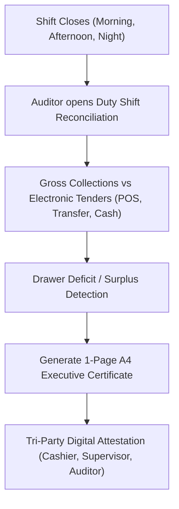

# Internal Audit & OpsAudit Workbench

ROLE GUARD: SUPERADMIN | ADMIN | AUDITOR | AUDIT

The **OpsAudit Workbench** provides internal control teams and financial controllers with real-time audit worksheets, shift handover reconciliation certificates, and tamper-resistant digital audit stamping.

---

## 1. Visual Tour: OpsAudit & Telemetry Console

> [!TIP]
> The OpsAudit stepped storyboard ribbon allows auditors to filter by time horizons, shift duty windows, and care streams without resetting page pagination.

---

## 2. Real Routes & Role Authorization

- **Audit Workbench**: `audit.workbench` (`/audit-workbench`)
- **Ops Audit Modules**: `ops-audit.reception` (`/ops-audit/reception`) and departmental audit views.
- **Authoritative Role Guard**: Defined in `sidebar/_nav-audit.blade.php` as `hasAnyRole(['SUPERADMIN', 'ADMIN', 'super-admin', 'AUDITOR', 'AUDIT'])`.

---

## 3. Duty Shift Reconciliation & 1-Page A4 Certificates

### Key Capabilities:
1. **Visible Page Stamping**: High-efficiency 1-click batch stamping of all visible records on current page (`stampCurrentPage`) without resetting table pagination.
2. **Care Stream Segmentation**: Segregates revenue across General Outpatient, Inpatient Admissions, and Scheme/HMO pools.

---

## 4. Cross-Module Data & Patient Flows

- **Cashier (`billing.workbench`)**: Cashier till settlements and daily receipts are reviewed and sealed by internal audit.
- **Store & Pharmacy**: Requisitions and fulfillment valuations are audited against master product costs.

---

## Developer Reference
👉 **[Read the OpsAudit Developer API Reference](/developer/workbenches/ops-audit)**
