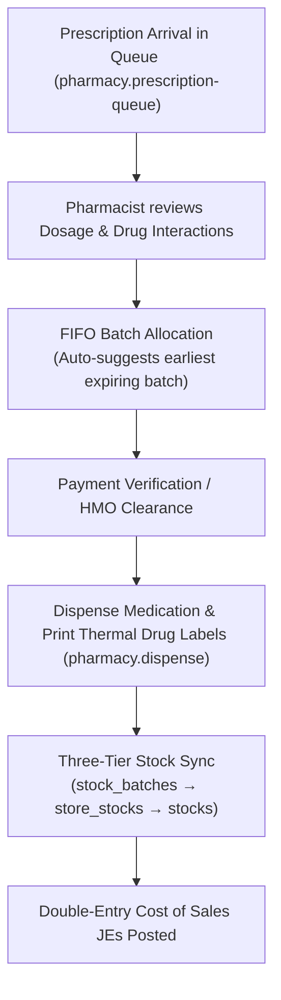

# Pharmacy & Dispensary Workbench

ROLE GUARD: SUPERADMIN | ADMIN | PHARMACIST

The **Pharmacy Workbench** coordinates outpatient and inpatient prescription fulfillment, FIFO batch selection, automated stock replenishment, inventory damage write-offs, and over-the-counter supermarket sales.

---

## 1. Visual Tour: High-Density Dispensary Cockpit

> [!TIP]
> The Pharmacy Workbench displays active prescriptions, FIFO batch recommendations, and live stock counts within a locked zero-scroll viewport.

---

## 2. Real Routes & Role Authorization

- **Primary Route**: `pharmacy.workbench` (`/pharmacy-workbench`)
- **Authoritative Role Guard**: Defined in `sidebar/_nav-pharmacy.blade.php` as `@hasanyrole('SUPERADMIN|ADMIN|PHARMACIST')`.

---

## 3. Dispensary Workflow & FIFO Control

### Key Capabilities:
1. **Three-Tier Stock Synchronization**:
   - Every dispense deducts from `stock_batches`, updates `store_stocks`, and recalculates master `stocks`.
2. **Pharmacy Returns & Damages**:
   - Restocking for uncollected items, damage write-offs with automatic GL expense entries (`DR Inventory Loss`, `CR Inventory Asset`).
3. **Over-The-Counter Supermarket Checkout**:
   - Rapid retail sales for walk-in buyers with barcode scanner support.

---

## 4. Cross-Module Data & Patient Flows

- **Doctor (`encounters.create`)**: Doctor prescription orders post directly to the pharmacy prescription queue.
- **Billing (`billing.workbench`)**: Payments cleared at the cashier update prescription readiness from unpaid to ready-for-dispense.
- **Store (`inventory.store-workbench.index`)**: Stock replenishment requisitions transfer batches from the Central Store to the Dispensary.

---

## Developer Reference
👉 **[Read the Pharmacy & Dispensary Developer API Reference](/developer/workbenches/pharmacy)**

## What stays in your hands (the bag and the dispense cart)
Items you tick are only ever for the patient on screen. They are cleared when you open another patient, when you leave the patient (queue, Returns, Damages, Stock or Summary reports), after a bill or dispense succeeds, and with **Esc** or **Clear**. The dispense cart is rebuilt from your ticked items every time it opens, so an earlier patient's items can never be dispensed by mistake. If someone else bills, pays, dispenses or dismisses an item while you hold it, it drops out of your selection at the next refresh and you are told.

## My Transactions (the Transactions Console)
**My Transactions** opens the shared Transactions Console. Everyone gets **What I did**: your stages here (**Billed by me**, **Dispensed by me**, **Returns I raised**) with your counts, a *where is it now* filter (needs my attention, waiting on others, done), department and category totals that filter the list, and one row per item. Staff with biller rights (for example an administrator) also see **My Transactions** (money collected) and **Manage Transactions**, exactly as on the Billing and Reception workbenches.

