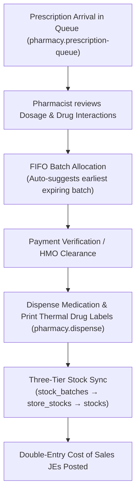

# Pharmacy & Dispensary Workbench

ROLE GUARD: SUPERADMIN | ADMIN | PHARMACIST

The **Pharmacy Workbench** coordinates outpatient and inpatient prescription fulfillment, FIFO batch selection, automated stock replenishment, inventory damage write-offs, and over-the-counter supermarket sales.

---

## 1. Visual Tour: High-Density Dispensary Cockpit

> [!TIP]
> The Pharmacy Workbench displays active prescriptions, FIFO batch recommendations, and live stock counts within a locked zero-scroll viewport.

---

## 2. Real Routes & Role Authorization

- **Primary Route**: `pharmacy.workbench` (`/pharmacy-workbench`)
- **Authoritative Role Guard**: Defined in `sidebar/_nav-pharmacy.blade.php` as `@hasanyrole('SUPERADMIN|ADMIN|PHARMACIST')`.

---

## 3. Dispensary Workflow & FIFO Control

### Key Capabilities:
1. **Three-Tier Stock Synchronization**:
   - Every dispense deducts from `stock_batches`, updates `store_stocks`, and recalculates master `stocks`.
2. **Pharmacy Returns & Damages**:
   - Restocking for uncollected items, damage write-offs with automatic GL expense entries (`DR Inventory Loss`, `CR Inventory Asset`).
3. **Over-The-Counter Supermarket Checkout**:
   - Rapid retail sales for walk-in buyers with barcode scanner support.

---

## 4. Cross-Module Data & Patient Flows

- **Doctor (`encounters.create`)**: Doctor prescription orders post directly to the pharmacy prescription queue.
- **Billing (`billing.workbench`)**: Payments cleared at the cashier update prescription readiness from unpaid to ready-for-dispense.
- **Store (`inventory.store-workbench.index`)**: Stock replenishment requisitions transfer batches from the Central Store to the Dispensary.

---

## Developer Reference
👉 **[Read the Pharmacy & Dispensary Developer API Reference](/developer/workbenches/pharmacy)**
