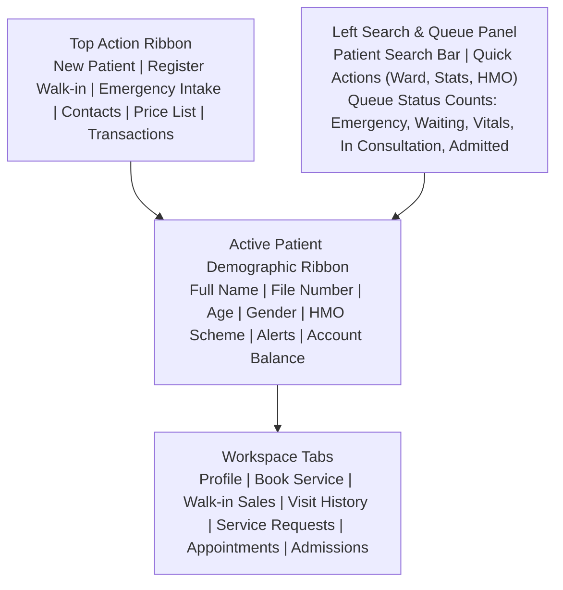
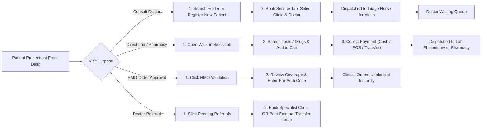

# Reception & Health Records Workbench Manual

*An operational manual for Receptionists, Health Records Officers, and Outpatient Front-Desk Staff.*

The **Reception & Health Records Workbench** is the central front-desk operations hub of the hospital. It coordinates patient folder identification, rapid new patient intake, clinic queue dispatching, direct walk-in retail sales, managed care (HMO) authorizations, and specialist referral transfers.

This guide explains **what you see on your screen, what every button does, how to execute daily front-desk workflows step-by-step, and who receives the patient next in the hospital chain**.

---

## 1. Visual Overview: The Reception Front-Desk Cockpit

### Front-Desk Operational Cockpit

### Central Operational Telemetry & Shift Activity

> [!TIP]
> **Everything at Your Fingertips**: The workbench is designed so you never have to leave this screen during your shift. Searching for an existing folder, registering a new emergency arrival, booking a clinic appointment, and collecting point-of-sale payments all happen within this single view.

---

## 2. Screen Tour: Where to Find Everything

Your screen is structured into 4 dedicated sections:

### 1. The Top Action Ribbon (Always Visible at Top)
- **`Toggle Search`**: Collapses or expands the left patient search panel to give you maximum workspace width on smaller monitors.
- **`+ New Patient` (Blue button)**: Opens the rapid registration form to create a brand new digital patient folder. *(Keyboard shortcut: `Alt + N`)*.
- **`+ Register Walk-In`**: Fast-track intake for visitors buying over-the-counter medications or receiving a diagnostic test without opening a full hospital record.
- **`Emergency Intake` (Red button)**: Immediately registers and beds a critically ill casualty patient who cannot wait in the normal queue.
- **`Contacts`**: Opens the internal hospital directory with phone extension numbers for all wards, labs, pharmacies, and on-call consultants.
- **`Price List`**: Opens the hospital tariff browser to look up current charges for medications, laboratory panels, imaging scans, and procedures.
- **`Transactions`**: Opens your personal cashier shift register to audit payments collected today, verify payment tenders, and reprint thermal receipts.

### 2. The Left Search & Queue Panel
- **Patient Search Bar**: Type a File Number (e.g. `21-36-49`), Full Name, or Phone Number to instantly locate an existing medical folder.
- **Colored Queue Filter Pills**: Displays live patient counts across the hospital:
  - **`Emergency` (Red)**: Critical triage alerts requiring immediate physician attention.
  - **`Waiting` (Orange)**: Checked-in outpatients awaiting clinical consultation.
  - **`Vitals Pending` (Cyan)**: Patients currently at the triage station having their blood pressure, weight, and temperature taken by nurses.
  - **`In Consultation` (Green)**: Patients currently inside doctor consulting offices.
  - **`Admitted` (Blue)**: Inpatients currently admitted to hospital ward beds.
  - **`Today's Appointments` (Purple)**: Patients with pre-scheduled clinic bookings today.
  - **`Pending Referrals`**: Patients referred to specialist clinics or external medical centers.
  - **`HMO Pending Validation`**: Insured prescriptions and tests awaiting front-desk insurance verification.

### 3. Active Patient Demographic Ribbon
Once a patient folder is selected, this blue bar locks to the top of your screen showing:
- **Full Patient Name** (Surname, Firstname, Othername) and **Hospital File Number**.
- **Demographics**: Exact Age, Gender, and Blood Group.
- **Account Balance**: Current internal wallet balance (positive deposit or outstanding bill).
- **Red Safety Badges**: Prominent clinical alert flags (e.g. `Severe Penicillin Allergy`, `High Fall Risk`).
- **`more biodata` Button**: Expands full next-of-kin contacts, residential address, and insurance policy numbers.

### 4. Interactive Workspace Tabs
- **`Profile`**: Review full medical history, past diagnoses, and demographic information.
- **`Book Service`**: Check in patients for outpatient doctor consultations.
- **`Walk-in Sales`**: Point-of-sale retail cart for lab tests, scans, and pharmacy items.
- **`Visit History`**: Chronological log of all previous visits, admissions, and discharges.
- **`Service Requests`**: Real-time status of all diagnostic tests and procedures ordered today.
- **`Appointments`**: Schedule future follow-up visits or specialist clinic appointments.
- **`Admissions`**: Review current and historical ward bed admissions.

---

## 3. The Complete Front-Desk Operational Flow

Every patient visit follows one of four primary front-desk journeys:

### Phase 1: Patient Folder Retrieval or Rapid Registration
1. **Existing Patients**: Type the patient's File Number, Name, or Phone into the left search bar. Click their name to load their folder into the Active Patient Ribbon.
2. **New Patients**: Click **`+ New Patient`** (or press `Alt + N`). Enter their name, gender, phone number, and date of birth. The system automatically issues the next sequential file number and alerts you if the phone number already exists to prevent duplicate files.
👉 *For complete details on registration fields, maternity ANC/PANC file numbering, and insurance linking, read the **[Patient Registration & Identity Guide](/user-guides/workbenches/reception/patient-registration)**.*

### Phase 2: Consultation Booking & Triage Dispatch
1. With the patient loaded in the top ribbon, click the **`Book Service`** tab.
2. Choose the destination specialty clinic (e.g. *General Outpatient*, *Paediatrics*, *Gynaecology*, *Cardiology*).
3. Assign a specific physician or select `-- Any Available Doctor --` for automatic queue load balancing.
4. The system automatically evaluates the hospital's consultation validity cycle (e.g. 14 days). If the patient is returning within this window, the fee is set to ₦0. Check **Force Re-bill** if a new charge must be applied.
5. Click **Book Consultation**. The patient is instantly queued on the **Nursing Workbench** under **Vitals Pending** and on the doctor's waiting list.
👉 *For clinic appointment calendars, re-billing rules, and routing slips, read the **[Queue Dispatching & Consultation Booking Guide](/user-guides/workbenches/reception/queue-and-booking)**.*

### Phase 3: Walk-in Retail Sales (Pharmacy, Lab, Radiology)
For ambulatory clients visiting the hospital only to buy medications, run blood tests, or take an X-ray without consulting a doctor:
1. Click the **`Walk-in Sales`** tab.
2. Search items across departmental catalogs: **Laboratory** (blood/urine tests), **Imaging** (X-rays/ultrasounds), **Pharmacy** (medicines/consumables), or **Procedures** (wound dressing).
3. Review total charges in the shopping cart, apply HMO co-payments if applicable, and collect payment via Cash, POS, Bank Transfer, or Split Tender.
4. Click **Checkout & Pay**. The thermal receipt prints, and orders route immediately to the laboratory phlebotomist or pharmacy dispensary.
👉 *For multi-department point-of-sale registers, custom billables, and shift audits, read the **[Walk-in Point-of-Sale & Direct Services Guide](/user-guides/workbenches/reception/walkin-and-billing)**.*

### Phase 4: HMO Approvals & Specialist Referral Tracking
1. **HMO Authorizations**: When doctors order secondary investigations or specialized medications for insured patients, they appear under **HMO Pending Validation**. Reception staff verify policy limits, attach pre-authorization codes, and approve orders to immediately unblock pharmacy dispensing.
2. **Specialist Referrals**: When doctors refer patients internally to another clinic, receptionists click **Book Referral** to schedule the consult. If referred externally to a teaching hospital, receptionists click **Refer Out** to generate and print the official referral letter.
👉 *For pre-authorization protocols, batch claims approvals, and referral letter generation, read the **[HMO Authorization & Specialist Referrals Guide](/user-guides/workbenches/reception/hmo-and-referrals)**.*

---

## 4. Downstream Hospital Handover Directory

| Patient Destination | What Front Desk Dispatches | What the Receiving Staff Does |
| :--- | :--- | :--- |
| **Nursing Triage Station** | Outpatient check-in record queued under `Vitals Pending`. | Triage nurse calls patient, records blood pressure, pulse, temperature, and weight, which stream instantly to the doctor. |
| **Doctor Consultation Room** | Patient file listed on doctor's waiting queue with vitals attached. | Attending doctor clicks **Start Encounter** to begin clinical consultation. |
| **Laboratory (LIS)** | Paid test requisitions with automated accession numbers. | Phlebotomist calls patient, scans barcode, collects blood/urine sample, and marks `SAMPLE TAKEN`. |
| **Radiology / Imaging** | Paid scan requisitions with clinical indication notes. | Radiographer performs X-ray or ultrasound scan and uploads digital images to PACS. |
| **Pharmacy Dispensary** | Paid or HMO-cleared prescription orders. | Pharmacist reviews dosages, verifies allergies, dispenses medications, and updates FIFO inventory. |
| **Cashier / Accounts** | Shift settlement transactions and bill invoices. | Accounts officers reconcile daily POS terminal receipts and bank transfer slips against the shift ledger. |

---

## 5. Detailed Operational Subpage Guides

For exhaustive, field-by-field instructions on specific front-desk modules:
- 👉 **[Patient Registration & Identity Governance](/user-guides/workbenches/reception/patient-registration)** — Auto-file numbering, maternity dual prefixes (`ANC-` vs `PANC-`), duplicate phone detection, and insurance linking.
- 👉 **[Queue Dispatching & Consultation Booking](/user-guides/workbenches/reception/queue-and-booking)** — Check-in, doctor assignment, consultation re-billing, and thermal queue slips.
- 👉 **[Walk-in Point-of-Sale & Direct Services](/user-guides/workbenches/reception/walkin-and-billing)** — Point-of-sale retail cart, split-tender payments, and thermal receipt printing.
- 👉 **[HMO Authorization & Specialist Referrals](/user-guides/workbenches/reception/hmo-and-referrals)** — Secondary care pre-auth vetting, batch claim approvals, and external referral letters.

---

## Technical Developer Reference
For developer route contracts, controller implementations, database schemas, and observer models:  
👉 **[Read the Reception Workbench Developer API Reference](/developer/workbenches/reception)**
