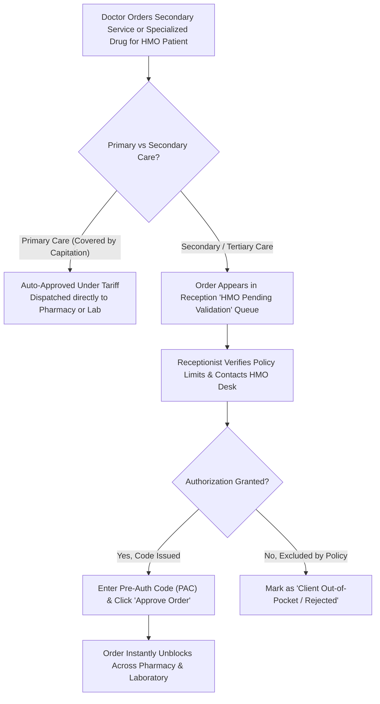
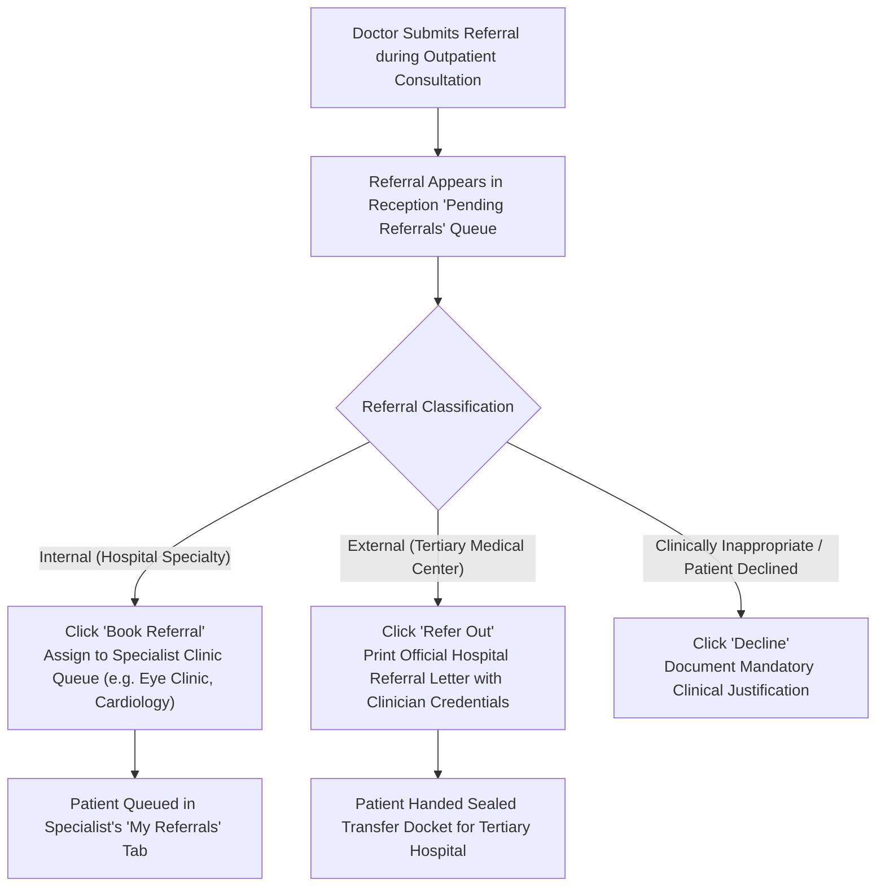

# HMO Authorization & Specialist Referrals

*A practical operational guide for Health Records Officers, HMO Liaison Desk Staff, and Referral Coordinators.*

The **HMO Validation & Specialist Referrals** module coordinates health insurance compliance and patient care transitions. It ensures insured prescriptions and tests receive timely pre-authorization and specialist doctor referrals are properly booked or transferred.

This guide explains **how to validate secondary HMO orders, attach pre-authorization codes, schedule internal specialty clinic consults, and print external referral letters**.

---

## 1. Visual Overview: HMO Validation & Specialist Referrals Worklists

### A. HMO Pending Validation Worklist
The HMO validation panel coordinates pre-authorization verification for secondary investigations and high-cost medications across active health insurance plans.

### B. Specialist Referrals Queue & Dispatch Desk
The Pending Referrals worklist tracks incoming internal consultation requests and external patient transfers categorized by triage urgency.

---

## 2. Part 1: Managing HMO Pre-Authorizations

When doctors order specialized laboratory panels, CT/MRI imaging scans, surgical procedures, or high-cost medications for an insured patient, hospital policy requires verification before items are dispensed.

### Step-by-Step HMO Authorization Verification

#### Step 1: Open the HMO Validation Queue
- In the left panel of the Reception Workbench, click **`HMO Validation`** under Quick Actions.
- Alternatively, click the amber **`HMO Pending Validation`** queue pill in the doctor queue list.
- The full HMO validation worklist displays all pending investigations and prescriptions awaiting verification.

#### Step 2: Search and Inspect Patient Orders
1. In the search box at the top of the table, type the patient's name or file number.
2. Review the requested items:
   - **Service / Drug Name** (e.g. *Computed Tomography CT Brain with Contrast* or *Enoxaparin Sodium 40mg Injection*).
   - **Requesting Doctor & Department** (e.g. *Dr. Adamu - Surgical Outpatient*).
   - **Insurance Provider & Enrollee ID** (e.g. *Hygeia HMO - Policy #HYG-84920*).
   - **Total Tariff Amount** and estimated client co-payment (if any).

#### Step 3: Attach Pre-Authorization Code & Approve
1. Contact the HMO desk or check their online portal to confirm secondary approval.
2. Click the green **`Validate`** button on the request row.
3. In the verification popup:
   - Enter the **Pre-Authorization Code (PAC)** provided by the insurer.
   - Enter any **Approval Notes** (e.g. *"Approved by Dr. Kalu via HMO portal"*).
4. Click **Confirm Approval**.

#### Batch Approvals (For Multiple Orders)
- If a patient has multiple lab tests and medications ordered during the same encounter, check the checkboxes next to each item row.
- Click **Approve Selected** at the top of the table to validate all items at once with a single pre-authorization code.

---

## 3. Part 2: Managing Specialist Referrals

When an attending physician issues a **Specialist Referral** during a consultation, the patient's referral docket routes directly to the Health Records desk.

### Step-by-Step Referral Execution

#### Step 1: Locate Pending Referrals
1. In the left panel queue list, click **`Pending Referrals`**.
2. The table displays all active referrals generated by doctors today:
   - Patient Name and File Number
   - Referring Doctor
   - Target Specialty Clinic or External Center
   - Urgency Level: **`Routine`**, **`Urgent`**, or **`Emergency`**

#### Step 2: Processing an Internal Hospital Referral
When a patient is referred to another specialty clinic inside your hospital (e.g. General Outpatient referring to the Cardiology Clinic):
1. Click the blue **`Book Referral`** button on the patient's row.
2. Select the **Target Clinic Date**:
   - Choose today's date if the specialist is on duty now.
   - Or pick their next scheduled clinic day (e.g. *Tuesday Cardiology Clinic*).
3. Confirm the attending consultant or leave as `-- Any Available Doctor --`.
4. Click **Confirm Booking**. The patient is placed into the receiving specialist's consultation waiting list and appears in their workbench under **`My Referrals`**.

#### Step 3: Processing an External Tertiary Transfer
When the doctor refers a patient to an external medical institution (e.g. a University Teaching Hospital, specialized cardiac Cath Lab, or radiation oncology center):
1. Click the purple **`Refer Out`** button.
2. Confirm the destination healthcare facility name (e.g. *Jos University Teaching Hospital - JUTH*).
3. Click **Generate & Print Referral Letter**.
4. The system compiles an official hospital transfer document:
   - Hospital header and official emblem.
   - Patient demographics, blood group, and vital signs.
   - Doctor's provisional ICD-10 diagnosis and clinical summary.
   - Attached recent laboratory reports and imaging findings.
   - Attending doctor's signature and registration credentials.
5. Hand the printed, stamped document to the patient or escorting nurse.

#### Step 4: Declining or Returning a Referral
If a patient declines the referral or it was created in error:
1. Click the red **`Decline`** button.
2. Enter the **Mandatory Justification Reason** (e.g. *"Patient declined tertiary transfer due to relocation; opted for outpatient oral regimen"*).
3. Click **Confirm Rejection**. The referring physician receives an audit notification.

---

## 4. Who Gets It Next?

- **HMO Approvals**: As soon as you click **Confirm Approval**, the orders instantly unlock on the **Pharmacy Workbench** and **Laboratory (LIS) Workbench**. Pharmacists and lab scientists can dispense and process samples immediately.
- **Internal Referrals**: The patient moves into the specialist clinic waiting room. The consultant sees them listed under **Encounter Hist / Admissions &rarr; My Referrals**.
- **External Referrals**: The patient departs with an official sealed referral package, ready for admission at the receiving tertiary hospital.

---

## Related Operational Guides
- 👉 **[Patient Registration & Identity Governance](/user-guides/workbenches/reception/patient-registration)**
- 👉 **[Queue Dispatching & Consultation Booking](/user-guides/workbenches/reception/queue-and-booking)**
- 👉 **[Walk-in Point-of-Sale & Direct Services](/user-guides/workbenches/reception/walkin-and-billing)**
