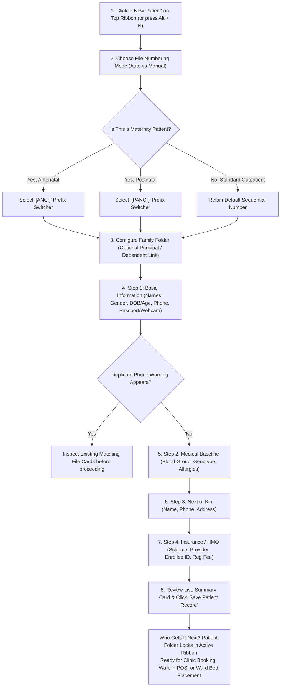

# Patient Registration & Identity Governance

*A practical operational guide for Health Records Officers and Front-Desk Receptionists.*

The **Patient Registration** workflow establishes a patient's official digital medical folder. It guarantees accurate legal identity, prevents duplicate records, assigns standardized hospital file numbers, and attaches health insurance policies.

This guide explains **what each registration tool does, where to find it on your screen, required fields, and who receives the record next**.

---

## 1. Visual Tour: Patient Header & Registration Interfaces

### A. The Active Patient Demographic Profile
The active demographic banner displays essential patient identifiers, HMO coverage tier, age, and critical alert tags across the top of all reception workspaces.

### B. The 5-Step Rapid Registration Modal
The multi-step registration modal coordinates file numbering, identity details, medical baseline history, next-of-kin contacts, and insurance attachments.

### C. Emergency Intake Rapid Intake Modal
For acute casualties requiring immediate admission or triage without multi-step administrative delays, the Emergency Intake modal provisions immediate emergency identifiers.

---

## 2. Step-by-Step Registration Procedure

### Step 1: Open the Registration Window
- In the top action ribbon of the Reception Workbench, click the blue **`+ New Patient`** button.
- Alternatively, press keyboard shortcut **`Alt + N`** anywhere on the workbench.

---

### Step 2: Select File Numbering Mode & Maternity Prefixes
At the top of Step 1:
- **`Auto` Mode (Default)**: The system automatically retrieves the next available sequential hospital file number (e.g. `PAT-01429`).
- **`Manual` Mode**: Select this option when migrating historical paper records into the digital system so you can type the patient's existing physical cardboard folder number.
- **`Regenerate` Button**: If multiple receptionists are registering patients simultaneously, click the refresh button (or press `Ctrl + G`) to grab the latest unassigned number.

#### Maternity Dual-Prefix Switcher (`ANC-` vs `PANC-`)
For maternal healthcare admissions, click the corresponding prefix button before saving:
- **`[ANC-]`**: Assigns an Antenatal Care file number (e.g. `ANC-0042`). The patient's file will automatically sync with the **Maternity (ANC)** clinic.
- **`[PANC-]`**: Assigns a Postnatal Care file number (e.g. `PANC-0018`). This syncs the mother and newborn with the **Postnatal Care** clinic.

#### Family Folder Configuration (Household Linking)
- **`Is Family Principal?` Toggle**: Check this box if the patient is the head of a household.
- **`Assign to Principal (Optional)`**: If registering a spouse, child, or dependent, select their family head's name from the dropdown. This links all family members under a unified household medical record.

---

### Step 3: Step 1 — Basic Information & Photo Capture
- **Surname (*Required)**: The patient's legal last name.
- **First Name (*Required)**: The patient's legal first name.
- **Other Names (Optional)**: Middle name or baptismal name. *(Always entered to distinguish individuals with common family names)*.
- **Gender (*Required)**: Select `Male`, `Female`, or `Others`.
- **Date of Birth / Age (*Required)**: The system provides 3 flexible input modes:
  - **`DOB` (Calendar Picker)**: Select the exact birth date.
  - **`Age` (Numeric with Unit)**: Enter the number and pick the unit: `yrs` (years), `mos` (months), or `days` (for newborns).
  - **`Age Group`**: Select an age bracket (*Neonate 0–28 days*, *Infant 1–11 months*, *Toddler 1–4 yrs*, *Child 5–11 yrs*, *Adolescent 12–17 yrs*, *Young Adult 18–35 yrs*, *Adult 36–55 yrs*, *Older Adult 56–64 yrs*, *Elderly 65+ yrs*). The system derives an estimated birth year automatically.
- **Phone Number**: Primary mobile contact number.

> [!WARNING]
> **Real-Time Duplicate File Prevention**:
> As you type the phone number and surname, the system instantly scans the hospital database. If a matching record is found, an amber alert card appears showing the existing patient's name, file number, and registration date. Always inspect this card to ensure you do not create a duplicate folder for a returning patient!

- **Email Address & Residential Address**: Patient's contact information.
- **Referred From**: Select how the patient reached your facility using quick-select chips: *Self / Walk-in*, *Family / Friend*, *Doctor / Physician*, *Hospital / Clinic*, *Community Outreach*, or *Corporate Partner*.
- **Passport Photo**:
  - **Upload Tab**: Drag and drop or browse for an existing photo (JPG or PNG, max 5MB).
  - **Webcam Tab**: Click **Start Camera** to take an authentic live passport picture using the front-desk webcam, then click **Capture**.
- **Old Records File Upload**: Attach historical paper records, scans, or referral notes (PDF, DOC, DOCX, JPG, PNG). An eye icon allows immediate preview of uploaded documents.

#### Emergency / Trauma Intake Modes
- **`Unidentified Patient` Tab**: For unconscious trauma arrivals where identity is unknown, click this tab. The system registers the patient as *"Unknown Patient"* and provides a **Distinguishing Features** field to record scars, tattoos, and clothing descriptions.
- **`Brought In Dead (BID)` Toggle**: For mortal arrivals, activate this toggle to document Date of Death, Time of Death, and Suspected Cause of Death for direct mortuary transfer.

---

### Step 4: Step 2 — Medical Information & Clinical Baseline
- **Blood Group**: Select confirmed group (*A+, A-, B+, B-, AB+, AB-, O+, O-*).
- **Genotype**: Select genotype (*AA, AS, AC, SS, SC*).
- **Disability Status**: Select `No Disability` or `Has Disability`.
- **Nationality & Ethnicity**: Defaults to `Nigerian`.
- **Known Allergies (*Critical Safety Guard)**:
  - Type each known allergy into the box and press `Enter` (e.g. *Penicillin, Sulpha drugs, Aspirin, Latex, Seafood*).
  - Each allergy appears as an interactive red tag. Documented allergies generate prominent **Red Safety Badges** across all doctor, nursing, and pharmacy workstations to prevent adverse drug reactions.
- **Medical History & Additional Notes**: Free-text areas to record chronic illnesses, past surgeries, or special administrative remarks.

---

### Step 5: Step 3 — Next of Kin / Emergency Contact
- **Next of Kin Name**: Full name of primary emergency contact.
- **Next of Kin Phone**: Direct phone number.
- **Next of Kin Address**: Residential address of the emergency contact.

---

### Step 6: Step 4 — Insurance & HMO Entitlements
- **Coverage Scheme**: Select `Private / Out-of-Pocket` or `Health Maintenance Organization (HMO)`.
- **HMO Provider**: Select from the hospital's registered health insurers (e.g. *Reliance HMO, Hygeia, AXA Mansard, NHIA State Pool*).
- **HMO Enrollment Number**: The unique policy number stamped on the patient's card.
- **HMO Plan & Company / Organization**: Record plan tier (e.g. *Gold, Platinum, Retainer*) and corporate employer sponsor.
- **Registration Fee (Optional)**: Select a registration billing service (e.g. *Hospital Card Registration Fee — ₦1,000*) to automatically bill the patient upon creation.

---

### Step 7: Step 4 — Summary Card Verification & Submission
- At the foot of Step 4, a **Comprehensive Registration Summary** displays all entered data: File Number, Name, Gender, DOB/Age, Phone, Address, Medical Baseline, and HMO details.
- Verify all details with the patient, then click the green **Save Patient Record** button.

---

## 3. Who Gets the Record Next?

Once you click **Save Patient Record**:
1. **The Active Patient Demographic Ribbon**: Automatically mounts the new patient's details across the top of your reception workbench.
2. **Consultation Booking Desk**: Switch to the **Book Service** tab to assign an outpatient clinic and dispatch the patient to the nursing vitals station.
3. **Dispensary & Point of Sale**: If the patient only requires over-the-counter medicine or lab tests, open the **Walk-in Sales** tab to process their cart.
4. **Emergency Casualty & Inpatient Wards**: In emergency mode, the patient's record is immediately available for bedside care and admission without administrative delay.

---

## Related Operational Guides
- 👉 **[Queue Dispatching & Consultation Booking](/user-guides/workbenches/reception/queue-and-booking)**
- 👉 **[Walk-in Point-of-Sale & Direct Services](/user-guides/workbenches/reception/walkin-and-billing)**
- 👉 **[HMO Authorization & Specialist Referrals](/user-guides/workbenches/reception/hmo-and-referrals)**
