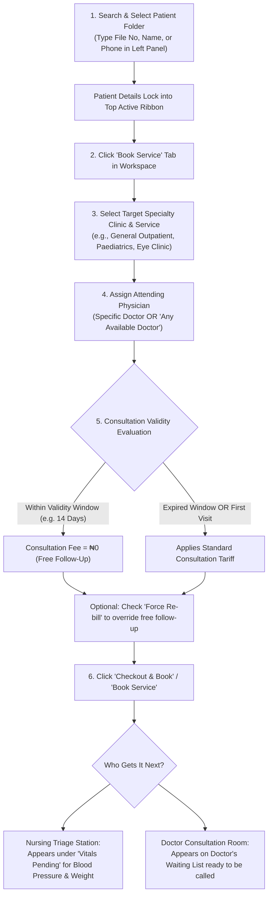
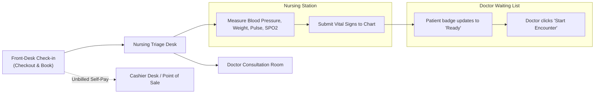

# Queue Dispatching & Consultation Booking

ROLE GUARD: SUPERADMIN | ADMIN | HEALTH RECORDS | RECEPTIONIST

Once an outpatient's digital medical folder is located or registered, front-desk health records staff check them in, assign their destination specialty clinic or attending physician, and dispatch them into the active clinic queue.

This guide explains **how to find patient folders, configure clinic appointments, manage consultation validity rules, and route patients to nursing triage and doctor waiting lists**.

---

## 1. Visual Tour: Outpatient Queue & Consultation Dispatching

### A. Live Doctor Queue & Status Telemetry
The Doctor Queue view provides real-time visibility into all active outpatients across clinics, categorized by triage urgency.

### B. Consultation Booking Workspace
Selecting a patient loads the **Book Service** workspace tab, enabling one-click specialty clinic dispatching and appointment scheduling.

---

## 2. Step-by-Step Consultation Booking

### Step 1: Locate and Select the Patient Folder
1. Click the **Search patient by file no, name** input in the left panel (or press `Ctrl + K`).
2. Search by:
   - **Hospital File Number** (e.g. `0009925` or `21-36-75`)
   - **Patient Full Name** (e.g. `Kabiru Tanimu` or `Muhammed Rukayya`)
   - **Phone Number**
3. Click the matching patient record from the search list.
4. The patient immediately locks into the workspace. Confirm that their name, file number, and billing scheme (Private / HMO) match the individual at the desk.

---

### Step 2: Open the "Book Service" Tab
- In the main workspace navigation tabs below the action ribbon, click the **`Book Service`** tab (`.workspace-tab[data-tab="booking"]`).

---

### Step 3: Configure Consultation Parameters

- **Service (*Required)**:
  - Select the consultation tariff line (e.g. *General Consultation*, *Specialist Consultation*, *ANC Consultation*, *Paediatric Consultation*).
- **Clinic (*Required)**:
  - Select the target clinical department (e.g. *General Outpatient Department - GOPD*, *Paediatrics*, *Internal Medicine*, *General Surgery*, *Obstetrics & Gynaecology*, *Ear, Nose & Throat*, *Ophthalmology*, *Dental*).
- **Doctor (Optional)**:
  - If the patient requests a designated doctor, select their name from the list.
  - If no physician preference is specified, leave as **`Any Available Doctor`**. The triage engine assigns the patient to the consulting room with the shortest waiting line to balance clinical loads.
- **Appointment Type (*Required)**:
  - Select **`Walk-In (Now)`** for patients physically present who require immediate same-day consultation.
  - Select **`Schedule Future`** if booking an elective return appointment or post-operative review date.
- **Consultation Tariff & Cycle Validity Rules**:
  - The system automatically evaluates the hospital's **Consultation Validity Period** (e.g. 14 days).
  - If the patient was seen within the validity window, the fee evaluates as **₦0 (Free Follow-Up)**.
  - If this is their first visit or the cycle has elapsed, the standard tariff applies.
- **Force Re-bill Checkbox (Administrative Override)**:
  - Check **`Force Re-bill Consultation (ignore cycle duration limits for all selected)`** if the patient presents with a fresh, unrelated medical complaint within the 14-day window that warrants an independent consultation fee.

---

### Step 4: Dispatch Consultation & Print Routing Slip
1. Click the green **`Checkout & Book`** button (or **`Book Service`** for non-billing records staff).
2. The booking card confirms queue assignment and assigns the next sequential waiting token.
3. The patient's queue entry immediately dispatches to the live doctor roster.

---

## 3. Managing Live Outpatient Queues

Click **`View Full Queue`** in the left panel (or click any specific queue pill) to open the interactive **Doctor Queue** view:

### Live Queue Status Counters

The left panel displays real-time telemetry tracking patient movement across all outpatient stations:

| Queue Counter | Status & Location | Action Required by Front-Desk Staff |
| :--- | :--- | :--- |
| **`Emergency` (Red)** | Casualty and acute resuscitation cases. | Direct patient immediately to the Emergency Room / Resuscitation bay. |
| **`Waiting` (Orange)** | Checked-in outpatients awaiting doctor consultation. | Monitor queue depth; advise patients of estimated wait times. |
| **`Vitals Pending` (Cyan)** | Patients dispatched to nursing triage. | Direct patient to the nursing vitals room for BP, pulse, and temperature checks. |
| **`In Consultation` (Green)** | Patients currently inside physician consulting rooms. | Patient is actively being attended to by the clinician. |
| **`Admitted` (Blue)** | Inpatients hospitalized in ward beds. | Health records tracking for ward inpatient beds. |
| **`Today's Appointments`** | Patients with pre-booked return visits scheduled for today. | Check in scheduled patients as they physically arrive at the clinic. |
| **`Pending Referrals`** | Patients awaiting specialist clinic booking or external transfer. | Process incoming consult referrals from doctors. |
| **`HMO Pending Validation`** | Insured patients requiring benefit validation. | Open HMO validation drawer to verify coverage limits and pre-auth codes. |

---

## 4. Appointment Scheduling & Calendar Management

Click **`Today's Appointments`** in the left queue panel to open the master **Appointment Schedule** view:

- **Calendar vs Table Toggle**: Switch seamlessly between the weekly FullCalendar agenda view and the structured tabular appointments register.
- **Multi-Clinic & Physician Filtering**: Filter by target specialty clinic, designated doctor, appointment status (*Scheduled*, *Waiting*, *Vitals Pending*, *Ready*, *In Consultation*, *Completed*, *Cancelled*, *No-Show*), or patient search term.
- **One-Click Check-in**: When a patient with a scheduled appointment arrives at the hospital, click their calendar card or table action button to check them in directly without re-typing their demographics.

---

## 5. Who Gets the Patient Next?

Once front-desk records staff click **Checkout & Book**:
1. **The Nursing Triage Station**: The patient's name instantly appears on the **Nursing Workbench** under **Vitals Pending**. Nurses call the patient into the triage room to record blood pressure, pulse, temperature, oxygen saturation, and body weight.
2. **The Doctor Consultation Room**: As soon as triage vitals are recorded, the patient card shifts to **`Ready`** on the doctor's consultation queue (`/encounters?status=waiting`). The doctor clicks **Start Encounter** to open the clinical cockpit.
3. **Cashier Desk (Self-Pay Invoices)**: For uninsured self-pay patients, if fee collection is deferred, a pending consultation invoice routes to the Cashier Workbench for settlement.

---

## Related Operational Guides
- 👉 **[Patient Registration & Identity Governance](/user-guides/workbenches/reception/patient-registration)** — Demographics, folder generation, and HMO profiles.
- 👉 **[Walk-in Point-of-Sale & Direct Services](/user-guides/workbenches/reception/walkin-and-billing)** — Pharmacy, laboratory, and direct point-of-sale checkout.
- 👉 **[HMO Authorization & Specialist Referrals](/user-guides/workbenches/reception/hmo-and-referrals)** — Pre-authorization validation and specialist intake.
