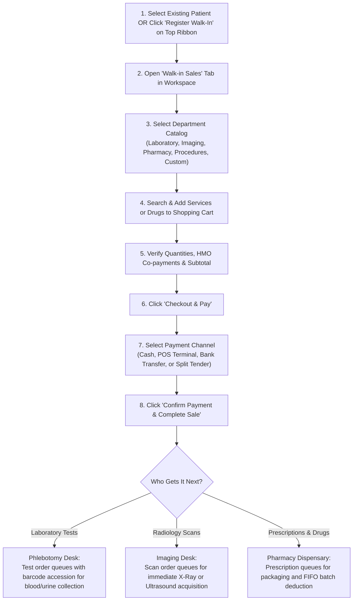

# Walk-in Point-of-Sale & Direct Services

*A practical operational guide for Health Records Officers, Outpatient Cashiers, and Dispensary Clerks.*

The **Walk-in Sales** module enables front-desk staff to bill, collect payments, and dispatch diagnostic tests, retail pharmaceuticals, and minor procedures directly to ambulatory patients who do not require a doctor's consultation.

This guide explains **how to search departmental catalogs, manage the shopping cart, execute multi-tender checkouts, and print receipts**.

---

## 1. Visual Overview: Direct Sales Workspace & Quick Registration

### A. Walk-in Point-of-Sale Workspace & Catalog Selector
The Walk-in Sales Point-of-Sale workspace provides immediate catalog search and multi-item cart dispatching across Laboratory, Imaging, Products, and Procedures.

### B. Register Walk-in Rapid Modal
For unregistered ambulatory visitors, the Register Walk-in modal collects immediate identity data for point-of-sale receipting.

---

## 2. Step-by-Step Walk-in Sales Procedure

### Step 1: Identify the Customer
- **Registered Patients**: Search by File Number, Name, or Phone in the left search panel. The patient's record mounts into the top blue ribbon.
- **Unregistered Walk-In Visitors**: Click the **`+ Register Walk-In`** button on the top action ribbon. Enter their name and phone number for quick receipt generation without opening a permanent medical folder.

---

### Step 2: Open the Walk-in Sales Tab
- In the workspace below the patient header, click the **`Walk-in Sales`** tab.

---

### Step 3: Browse Departmental Catalogs & Add Items to Cart
Click any department tab to browse and add billable items:

#### 1. Medical Laboratory Tests
- Type the test name or acronym in the search bar (e.g. *Full Blood Count / FBC*, *Malaria Parasite*, *Lipid Profile*, *Urinalysis*, *Widal Test*, *Liver Function Test*).
- Click any test card to add it to the shopping cart.
- *Clinical Handover*: Tests route automatically to the **Medical Laboratory** worklist.

#### 2. Imaging & Radiology Scans
- Search for required diagnostic imaging (e.g. *Chest X-Ray PA View*, *Pelvic Ultrasound*, *Obstetric Scan*, *ECG*, *CT Scan Brain*).
- Click to add to the cart.
- *Clinical Handover*: Scans route automatically to the **Radiology / Imaging** workstation.

#### 3. Pharmacy & Retail Medications
- Search for requested over-the-counter drugs, syrups, or prescription refills (e.g. *Paracetamol 500mg*, *Artemether-Lumefantrine*, *Amoxiclav 625mg*).
- The catalog displays current real-time stock on hand. You cannot add out-of-stock items.
- *Clinical Handover*: Medicines route automatically to the **Pharmacy Dispensary**.

#### 4. Minor Procedures & Dressings
- Select clinical interventions performed by front-desk or casualty nurses (e.g. *Wound Dressing Simple*, *Suture Removal*, *Ear Syringing*, *Catheterization*).

#### 5. Custom Free-Form Billables (Special Items)
- For ad-hoc hospital services not listed in the standard catalog:
  - Click **+ Add Custom Item**.
  - Type the description (e.g. *"Phototherapy goggles replacement"* or *"External Medical Report Validation"*).
  - Enter the unit price and quantity.

---

### Step 4: Manage the Shopping Cart & Verify Insurance
- Review the items in the cart table on the right side of the screen.
- Adjust **Quantities** as needed or click the red **Trash Can** icon to remove accidental items.
- **HMO Co-Payment Calculation**:
  - If the patient has active HMO coverage, the system automatically checks policy coverage rules.
  - If the item requires a co-payment (e.g. 10%), the co-pay fee calculates automatically, leaving the remainder billed to the HMO.

---

### Step 5: Process Payment & Select Tender Channel
1. Click the green **Checkout & Pay** button.
2. In the payment window, select how the customer is settling their bill:
   - **`Cash`**: Enter cash tendered; the computer calculates exact change due.
   - **`POS (Card)`**: Enter card reference and transaction authorization code.
   - **`Bank Transfer`**: Record the bank name and electronic transfer reference ID.
   - **`Split Tender`**: Split a single bill across multiple channels (e.g. paying ₦5,000 in Cash and ₦15,000 via POS).
3. Click **Confirm Payment**.

---

### Step 6: Thermal Receipt Printing
- As soon as payment confirms, the system generates an official receipt.
- **Thermal Slip**: Automatically sends the ticket to your connected thermal receipt printer (showing hospital header, date, items, amounts, cashier name, and barcode).
- **A4 PDF Invoice**: Click **Print A4** if the customer requires a formal invoice for corporate employer reimbursement.

---

## 3. End-of-Shift Cashier Reconciliation

To balance your register at the end of your shift:
1. Click **`Transactions`** on the top action ribbon.
2. The **My Transactions** shift ledger displays all payments collected by your user account today, grouped by tender (Total Cash, Total POS, Total Bank Transfers).
3. Print your **Shift Summary Report** and submit it along with physical cash and POS receipts to the Hospital Internal Auditor / Chief Accountant.

---

## Related Operational Guides
- 👉 **[Patient Registration & Identity Governance](/user-guides/workbenches/reception/patient-registration)**
- 👉 **[Queue Dispatching & Consultation Booking](/user-guides/workbenches/reception/queue-and-booking)**
- 👉 **[HMO Authorization & Specialist Referrals](/user-guides/workbenches/reception/hmo-and-referrals)**
