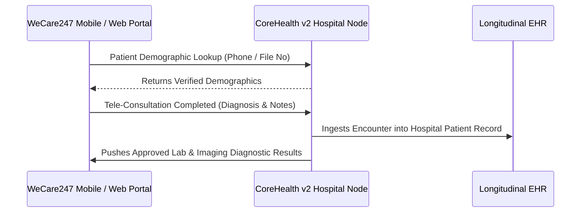

# WeCare247 Telehealth Integration

ROLE GUARD: SUPERADMIN | ADMIN

CoreHealth v2 maintains real-time bidirectional clinical synchronization with the **WeCare247** telemedicine platform (`wecare247/`), extending acute hospital care to remote patients and mobile consultations.

---

## 1. Visual Tour: Remote Patient Access

> [!NOTE]
> WeCare247 connects outpatients directly with hospital clinicians, auto-syncing remote clinical encounter summaries into CoreHealth longitudinal patient records.

---

## 2. Bidirectional Sync Architecture

### Key Capabilities:
- **Unified Endpoints**: Standardized under `/api/corehealth/*`.
- **Policy Controls in Hospital Settings**: Master switch `wecare_enabled` with granular toggles for auto-syncing encounters and lab results.
- **Deterministic Deduplication**: Composite sync keys (`wecare_sync_uuid`) prevent duplicate encounter records.

---

## Developer Reference
👉 **[Read the WeCare247 Integration Contracts & API Reference](/developer/workbenches/wecare)**

